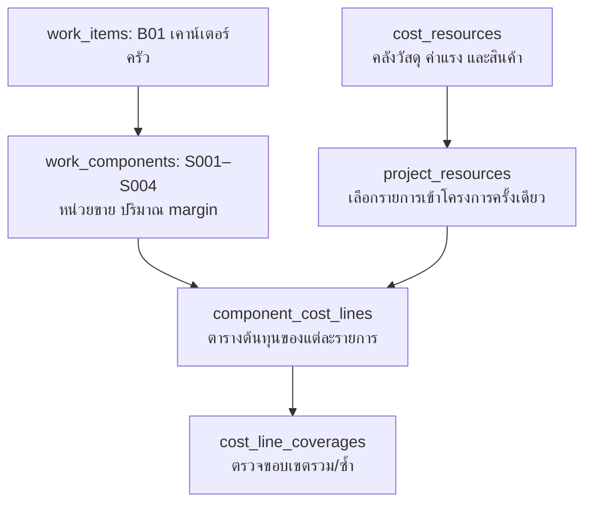

# B01 เคาน์เตอร์ครัว — แบบฉบับ 1.7 สำหรับตรวจเอกสาร

> **แบบ relation ล่าสุดสำหรับทบทวน: [รายการงาน/ชุด 18 ตาราง](RELATION-18-WORK-SETS.md)** เลือกซื้อสำเร็จรูปหรือผลิตเองแยกแต่ละชุด และไม่คิดวัสดุที่รวมมาในชุดซ้ำ แบบแผง 17 ตาราง/โค้ดทดลองที่อธิบายด้านล่างเป็นฉบับก่อนการทบทวนนี้ รอบปัจจุบันเปลี่ยนเฉพาะเอกสาร ฐานออนไลน์ยัง 16 ตาราง และยังไม่แก้โค้ดให้รองรับแบบชุดใหม่

> **แบบ relation ล่าสุดสำหรับตรวจทาน:** [17 ตาราง — กลุ่มแผงและวัสดุแยกกลุ่ม](RELATION-17-TABLES.md) เพิ่มระดับตัวตู้/หน้าบาน เก็บวัสดุแยกบรรทัดแล้วรวมสรุปซื้อ ฐานที่สร้างจริงยัง 16 ตารางธุรกิจ และเว็บในเครื่องยังไม่ใช้ relation ใหม่นี้ รอบนี้เปลี่ยนเฉพาะเอกสาร ข้อความแบบ 1.7 ด้านล่างเป็นประวัติก่อนเพิ่มกลุ่มแผง

> สถานะใหม่: เว็บคำนวณทดลองแยกสี่รายการแล้วตาม [B01-WEB-TRIAL.md](B01-WEB-TRIAL.md) ส่วนข้อความ “รอบนี้แก้เฉพาะเอกสาร” ด้านล่างเป็นบันทึกรอบก่อน ยังไม่ทำ migration หรือเปิดบันทึกข้อมูลจริง

วันที่ 23 ตุลาคม 2569 · ตามคำยืนยันเจ้าของ · ตัวเลขทั้งหมดเป็น SAMPLE

ข้อความส่วนฉบับ 1.7 นี้เป็นประวัติก่อนเพิ่มกลุ่มแผง; แบบล่าสุดดู RELATION-17-TABLES.md รอบนี้ยังไม่เปลี่ยนฐานข้อมูล โค้ด หรือเว็บทดลอง ผลทดสอบและลิงก์เดิมยังแสดงโครงสร้างก่อนแยกท็อปหิน ไม่ถือว่าผ่านการตรวจรับตามแบบนี้

## ระดับ 1: หัวข้อ Keyplan

| รหัส | ชื่องาน | จำนวนชุดที่อธิบายในตัวอย่าง |
|---|---|---|
| B01 | เคาน์เตอร์ครัว | 1 ชุด |

B01 รวมราคาของรายการข้างใน ไม่ใช่งานขายเป็นเมตรหรือตารางเมตรทั้งหมด “1 ชุด” ไม่ใช่ตัวคูณซ้ำของปริมาณลูก ยังไม่กำหนดระบบชุดงานหลายชุดหรือคัดลอกชุดอัตโนมัติ

## ระดับ 2: ตารางทำราคาภายใน B01

| รหัสรายการ | รายการ | ปริมาณขาย | หน่วยขาย | ตารางต้นทุนที่เปิดดู |
|---|---|---:|---|---|
| S001 | ตู้เตี้ย | 3.50 | เมตร | ต้นทุนตู้ เลือกผลิตเองหรือ VS Modular |
| S002 | ท็อปหิน | 2.10 | ตร.ม. | ต้นทุนต่อ 1 ตร.ม.หิน |
| S003 | ผนังกรุลามิเนต | 6.00 | ตร.ม. | ต้นทุนผนังต่อ 1 ตร.ม. |
| S004 | ซิงก์พร้อมอุปกรณ์ | 1 | ชุด | ต้นทุนซิงก์พร้อมอุปกรณ์ต่อ 1 ชุด |

หน่วยขายและปริมาณต้องกำหนดก่อนเปิดต้นทุน หน่วยขายของงานไม่บังคับให้ตรงกับหน่วยซื้อของวัสดุภายใน หน่วยเดียวกันก็ไม่ทำให้เป็นงานประเภทเดียวกัน และไม่ใช้รหัส S001 หรือชื่อรายการเป็นเงื่อนไขถาวรให้ระบบเดาชนิดงาน

ท็อปหินกรอกพื้นที่ขายรวม 2.10 ตร.ม. ตัวอย่าง 3.50 × 0.60 เป็นเพียงคำอธิบายที่มาจากแบบ ยังไม่เพิ่มช่องยาว/ลึกและสูตรคูณมิติอัตโนมัติ เปลี่ยนเมตรขายตู้ไม่ทำให้พื้นที่ขายหินหรือพื้นที่หน้าบานเปลี่ยนเอง

## ระดับ 3: รายละเอียดต้นทุนแยกแต่ละรายการ

### S001 ตู้เตี้ย — ทางเลือก CUSTOM

| รหัสต้นทุน | รายการ | ปริมาณในตัวอย่าง | ต้นทุนรวม บาท |
|---|---|---|---:|
| PN01 | ไม้โครงและแผ่นตู้ตามขอบเขตเดิม | 1.5 แผ่น/เมตร × 3.50 | 5,250.00 |
| LM01 | ผิวหน้าบาน | TOTAL พื้นที่กรอกเอง 5.04 ตร.ม. × (1,200 ÷ 2.88) | 2,100.00 |
| HW01 | บานพับและอุปกรณ์ | 1 ชุด/เมตร × 3.50 | 2,800.00 |
| ED01 | กาวและวัสดุปิดขอบตามขอบเขตเดิม | 1 ชุด/เมตร × 3.50 | 1,050.00 |
| LB01 | ค่าแรงผลิตตู้ | 1,400 บาท/เมตร × 3.50 | 4,900.00 |
| LB02 | ค่าแรงติดตั้งตู้ | 600 บาท/เมตร × 3.50 | 2,100.00 |
| | รวมตู้ ไม่รวมท็อป | | **18,200.00** |

ต้นทุนต่อเมตร 18,200 ÷ 3.50 = 5,200 บาท ไม่มี ST01 อยู่ใน S001 ขอบเขต PN01/ED01/ค่าแรงจริงยังรอ D03 ไม่ถือว่าตรวจครบหรือเพิ่มกาว/แรงซ้ำเอง

### S001 ตู้เตี้ย — ทางเลือก VS Modular

| รหัส/รายการ | ปริมาณในตัวอย่าง | ต้นทุนรวม บาท |
|---|---|---:|
| b-0800-0750-0600-0 | TOTAL 2 ใบ × 4,000 | 8,000.00 |
| b-0600-0750-0600-0 | TOTAL 2 ใบ × 3,200 | 6,400.00 |
| b-0700-0750-0600-0 | TOTAL 1 ใบ × 3,600 | 3,600.00 |
| FD01 แกนหน้าบานพร้อมบานพับ | TOTAL 1 ชุด × 4,200 | 4,200.00 |
| LM01 ผิวหน้าบาน | TOTAL พื้นที่กรอก 5.04 ตร.ม. | 2,100.00 |
| GL01 กาวหน้าบาน | TOTAL 5.04 × 15 ÷ 28.80 ลิตร × 200 | 525.00 |
| ค่าแรงประกอบหน้าบานและทำผิว | 400 บาท/เมตร × 3.50 | 1,400.00 |
| LB02 ค่าแรงติดตั้งตู้ | 600 บาท/เมตร × 3.50 | 2,100.00 |
| รวมตู้ ไม่รวมท็อป | | **28,325.00** |

ต้นทุนต่อเมตร 28,325 ÷ 3.50 = 8,092.857142… บาท เลือกเพียงหนึ่งวิธีต้นทุนตู้ ปริมาณใบแบบ TOTAL ไม่คูณเมตรซ้ำ ไม่ติด PN01/HW01/ED01/LB01 ของ CUSTOM มาซ้ำ ราคาและขอบเขตสินค้าเป็น SAMPLE รอ Index จริง

### S002 ท็อปหิน — ต่อ 1 ตร.ม.ขาย

| รหัสต้นทุน | ปริมาณใช้ต่อหน่วยขาย | ราคาต่อหน่วยใช้ | ต้นทุนต่อหน่วยขาย |
|---|---|---:|---:|
| ST01 | 1 ตร.ม.หิน ต่อ 1 ตร.ม.ขาย | 3,000.00 | 3,000.00 |

ขาย 2.10 ตร.ม. ใช้หิน 2.10 ตร.ม. ต้นทุนรวม 6,300 บาท ไม่ใช้ 0.60 ตร.ม.ต่อเมตรขายเหมือนแบบก่อน และไม่บวก ST01 กลับเข้า S001 ราคาหินตัวอย่างใช้ขอบเขตเดิม ไม่เพิ่มแรงหินหรือเผื่อเศษเอง ถ้าขอบเขตจริงไม่ครบต้องถามก่อน

### S003 ผนังกรุลามิเนต — ต่อ 1 ตร.ม.ขาย

| รหัสต้นทุน | ปริมาณใช้ต่อ 1 ตร.ม.ขาย | วิธีหาต้นทุนต่อหน่วยใช้ |
|---|---|---|
| WD01 ไม้โครง | 8 เมตร | 290 ÷ 25 บาท/เมตร |
| LM01 ลามิเนต | 1 ตร.ม. | 1,200 ÷ 2.88 บาท/ตร.ม. |
| PLY01 ไม้อัด | 1 ตร.ม. | 500 ÷ 2.88 บาท/ตร.ม. |
| GL01 กาว | 15 ÷ 28.80 ลิตร | 3,000 ÷ 15 บาท/ลิตร |
| LB03 แรงช่างไม้ | 1 ตร.ม. | 1,000 บาท/ตร.ม. |
| LB04 แรงช่างสี | 1 ตร.ม. | 800 บาท/ตร.ม. |

รวมต้นทุนต่อ 1 ตร.ม. = 2,587.244444… บาท แล้วใช้กับพื้นที่จริง 6 ตร.ม. ไม่ปัดเงินแต่ละบรรทัดก่อนรวม

### S004 ซิงก์พร้อมอุปกรณ์ — ต่อ 1 ชุดขาย

| รหัสต้นทุน | ปริมาณต่อชุด | ต้นทุน บาท |
|---|---|---:|
| SK01 ซิงก์ | 1 ใบ | 3,000.00 |
| FA01 ก๊อกน้ำ | 1 ชุด | 1,200.00 |
| DR01 สะดือและท่อน้ำทิ้ง | 1 ชุด | 600.00 |
| LB05 ค่าแรงติดตั้งและต่อท่อ | 1 ชุด | 800.00 |
| รวม | | **5,600.00** |

## ผลคำนวณใหม่สำหรับตรวจเอกสาร

กำไรตัวอย่างทุกแถว 40% ของราคาขาย ราคาขายต่อหน่วย = ต้นทุนต่อหน่วย ÷ 0.60 ปัด half-up สองตำแหน่งก่อนคูณปริมาณขาย ต้นทุนรวมแต่ละงานปัดสองตำแหน่ง แล้วรวมขึ้น B01

| รายการ | ปริมาณขาย | ต้นทุนรวม CUSTOM | ขาย/หน่วย CUSTOM | ขายรวม CUSTOM | ต้นทุนรวม VS | ขาย/หน่วย VS | ขายรวม VS |
|---|---|---:|---:|---:|---:|---:|---:|
| S001 ตู้เตี้ย | 3.50 เมตร | 18,200.00 | 8,666.67 | 30,333.35 | 28,325.00 | 13,488.10 | 47,208.35 |
| S002 ท็อปหิน | 2.10 ตร.ม. | 6,300.00 | 5,000.00 | 10,500.00 | 6,300.00 | 5,000.00 | 10,500.00 |
| S003 ผนังกรุ | 6.00 ตร.ม. | 15,523.47 | 4,312.07 | 25,872.42 | 15,523.47 | 4,312.07 | 25,872.42 |
| S004 ซิงก์พร้อมอุปกรณ์ | 1 ชุด | 5,600.00 | 9,333.33 | 9,333.33 | 5,600.00 | 9,333.33 | 9,333.33 |
| รวม B01 | 1 ชุดงาน | **45,623.47** | | **76,039.10** | **55,748.47** | | **92,914.10** |

ยอดตัวอย่างใหม่นี้บังเอิญเท่ายอดรวมก่อนแยก แต่ต้นทุน/หน่วยและราคาขาย/หน่วยของตู้เปลี่ยน และท็อปขายเป็น ตร.ม.แล้ว ไม่ใช้ความเท่ากันของยอดรวมเป็นหลักฐานว่าโครงสร้างถูกต้องเสมอไป เมื่อราคา margin หรือปริมาณเปลี่ยนต้องคำนวณใหม่ การแยกแถวอาจมีผลต่างจากการปัดเศษได้

ปริมาณวัสดุใช้รวมไม่เปลี่ยนในตัวอย่าง: ST01 2.10 ตร.ม., LM01 11.04 ตร.ม. งบซื้อวัสดุ CUSTOM 31,380 บาท + ค่าแรง 18,600 บาท = 49,980 บาท; VS 43,180 + 15,100 = 58,280 บาท รวมวัสดุตาม project_resource ทั้งโครงการก่อนปัดซื้อ ไม่รวมจากชื่อรายการและไม่ปัดแยก Keyplan

## แบบฐานข้อมูลและสิ่งที่ต้องเปลี่ยนภายหลัง

| ส่วน | แบบล่าสุด | สถานะฐาน/โปรแกรมที่มีอยู่ |
|---|---|---|
| หัวข้อ B01 | ใช้ work_items เดิม ไม่เพิ่มตารางเคาน์เตอร์เฉพาะ | ใช้โครงสร้างเดิมได้ ยังไม่แก้ข้อมูล |
| สี่รายการทำราคา | ใช้ work_components สี่แถว FK work_item_id | ตัวอย่าง/เว็บเดิมมีสามแถว ต้องเปลี่ยนในรอบพัฒนา |
| รหัสรายการ | เพิ่มแบบ component_code TEXT NOT NULL, UNIQUE(work_item_id, canonical code); PK/FK ยังคง UUID component_id | ฐานเดิมยังไม่มีช่องนี้ ยังไม่เพิ่มจริง ไม่ใช้รหัสเป็นชนิดงาน |
| หน่วยขาย | selling_unit_id และ quantity เดิม S002 ใช้ M2/2.10 | ยังไม่แก้ตัวอย่าง runtime |
| วิธีผลิต | construction_method เป็น CUSTOM/VS_MODULAR เฉพาะตู้ งานอื่น NULL; ไม่ใช้ DEFAULT CUSTOM กับทุกงาน | ฐานเดิม NOT NULL ต้องผ่อนข้อบังคับใน migration ภายหลัง ไม่เดาหรือแก้แถวเก่าเอง |
| พื้นที่หน้าบาน | facade_area_m2 อยู่ในรายละเอียดงานตู้ ใช้ต้นทุน TOTAL | มีช่องฐานแล้ว แต่หน้าจอเดิมวางปนกับปริมาณขาย ต้องแก้ภายหลัง |
| ตารางต้นทุน | ใช้ component_cost_lines เชื่อมแต่ละ component_id และ project_resource_id | ย้าย ST01 ไป S002 เมื่อพัฒนาจริง ไม่ทำสำเนาคิดซ้ำ |
| ข้อมูลร่วม | คง 16 ตาราง ไม่มีตารางใหม่ต่อ S001/S002 หรือคลังชุดราคากลางเพิ่มเติม | ไม่ย้ายคลังหรือ snapshot เดิมในรอบนี้ |

รายการนี้เป็นแบบเพื่อเตรียมพัฒนาภายหลัง ไม่ใช่สัญญา API ใหม่ที่นำขึ้นระบบแล้ว รายละเอียดวิธีระบุว่าเป็นงานตู้ในหน้าจอ/บริการต้องออกแบบให้ผู้ใช้เลือกชัด ไม่แอบจำแนกด้วยชื่อหรือหน่วย แต่ยังไม่สร้าง enum ชนิดงานเพิ่มเติมในรอบเอกสารนี้

## จุดตรวจและลำดับถัดไป

ตรวจว่ามีครบสี่รายการ ท็อปใช้ ตร.ม. ไม่อยู่ในต้นทุนตู้ และเลือกวิธีผลิตหลังปริมาณภายในงานตู้ จากนั้นตรวจยอดตารางข้างบน รอบนี้หยุดส่งเอกสารให้เจ้าของทบทวนก่อนเปลี่ยนฐานหรือเว็บ

หลังแบบตรงกันจึงทำ: คลัง/Excel ครบวงจรและสิทธิ์ → ตารางประกอบต้นทุน → หน้าประมาณราคา B01 → ทดลองงานครบตั้งแต่คลังถึงสรุป ไม่มีการขยาย scope ไปแก้ระบบเดิม
