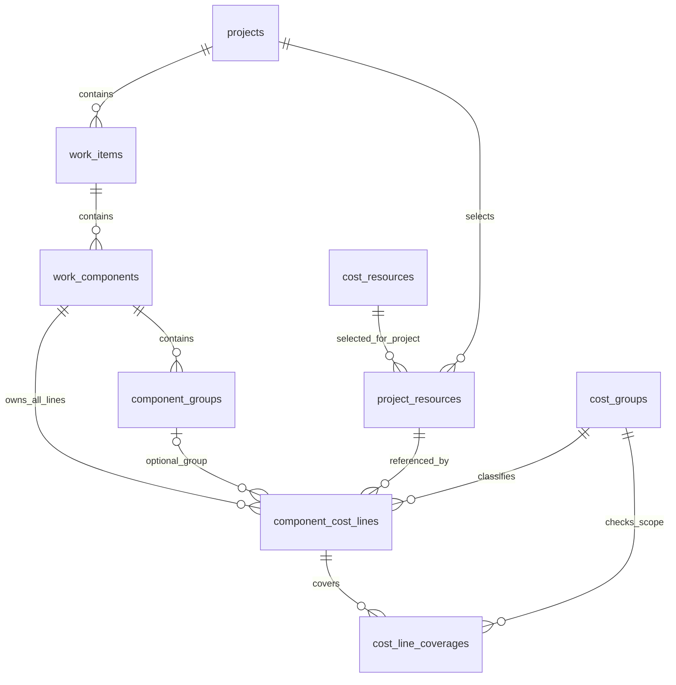

# แบบ Relation 17 ตาราง — กลุ่มแผงและวัสดุแยกตามกลุ่ม

> **แบบ relation ล่าสุดสำหรับทบทวน: [รายการงาน/ชุด 18 ตาราง](RELATION-18-WORK-SETS.md)** เลือกซื้อสำเร็จรูปหรือผลิตเองแยกแต่ละชุด และไม่คิดวัสดุที่รวมมาในชุดซ้ำ แบบแผง 17 ตาราง/โค้ดทดลองที่อธิบายด้านล่างเป็นฉบับก่อนการทบทวนนี้ รอบปัจจุบันเปลี่ยนเฉพาะเอกสาร ฐานออนไลน์ยัง 16 ตาราง และยังไม่แก้โค้ดให้รองรับแบบชุดใหม่


> **สถานะโค้ดทดลองก่อนแบบชุด 18 ตาราง:** ตารางกลุ่มแผงเปิดวัสดุด้านล่างและเก็บบรรทัดแยกกลุ่มในเบราว์เซอร์แล้ว รวมวัสดุเฉพาะตอนสรุปซื้อ ดู [วิธีทดลองและผลตรวจ](LOCAL-PANEL-RELATION-TRIAL.md) ฐานออนไลน์ยัง 16 ตารางธุรกิจ ไม่ได้ติดตั้ง relation 17 ตาราง ข้อความที่บอกว่ายังไม่ปรับโค้ดด้านล่างเป็นสถานะก่อนรอบนี้


วันที่ 23 ตุลาคม 2569 · แบบเอกสารสำหรับตรวจทาน · ยังไม่ใช่ schema ที่ติดตั้งแล้ว

เจ้าของอนุมัติให้ปรับแบบเป็น 17 ตารางธุรกิจ โดยเพิ่ม `component_groups` หนึ่งตาราง วัสดุตัวตู้และหน้าบานเก็บคนละบรรทัด แม้ใช้วัสดุรหัสเดียวกัน แล้วรวมเมื่อสรุปซื้อ ไม่เพิ่มทะเบียนวัตถุดิบหรือทะเบียนราคาอีกชุด

ฐานที่สร้างไว้ตามรายงานเฟส 2 ยังเป็น 16 ตารางธุรกิจ รอบนี้ไม่แก้ SQL, migration, RPC, RLS, โค้ดเว็บ หรือข้อมูลออนไลน์ ต้นแบบในเครื่องยังรวมวัสดุรหัสเดียวกันเป็นแถวต้นทุนก่อนคำนวณ จึงยังไม่ใช่การใช้งาน relation แบบใหม่นี้

## 1. อ่านโครงสร้างด้วยภาษางาน

```text
โครงการ → พื้นที่ → B01 เคาน์เตอร์ครัว
                   ├─ S001 ตู้เตี้ย (หน่วยขาย: เมตร)
                   │  ├─ กลุ่ม BODY: แผงตัวตู้ (พื้นที่ด้านเดียว: ตร.ม.)
                   │  │  └─ ไม้โครง / ไม้อัด / ลามิเนต / กาว แยกบรรทัด
                   │  ├─ กลุ่ม DOOR: แผงหน้าบาน (พื้นที่ด้านเดียว: ตร.ม.)
                   │  │  └─ ไม้โครง / ไม้อัด / ลามิเนต / กาว แยกบรรทัด
                   │  └─ บานพับ / ค่าแรงรวมตู้ (บรรทัดตรง ไม่ต้องมีกลุ่มแผง)
                   ├─ S002 ท็อปหิน
                   ├─ S003 ผนังกรุลามิเนต
                   └─ S004 ซิงก์พร้อมอุปกรณ์
```

กลุ่มแผงเป็นตัวรวบรวมส่วนประกอบ ไม่ใช่งานขายใหม่ ไม่มีราคาขายหรือกำไรของกลุ่ม ไม่บวกราคาเหมารวมแผงซ้ำกับวัสดุภายใน S001 ยังคงหน่วยขายและกำไรตามเดิม

## 2. รายชื่อตารางครบ 17 ตาราง

| ลำดับ | ตาราง | หน้าที่ / สิ่งที่เปลี่ยนในแบบนี้ |
|---|---|---|
| 1 | companies | บริษัท |
| 2 | members | ตัวตนผู้จัดทำ |
| 3 | company_memberships | ผูกบัญชีกับบริษัท 1:1 |
| 4 | projects | โครงการ สถานะและ version |
| 5 | areas | พื้นที่และห้อง |
| 6 | work_items | หัวข้อ Keyplan เช่น B01 |
| 7 | work_components | งานที่คิดราคาขาย เช่น S001–S004 |
| 8 | work_categories | หมวดงาน |
| 9 | units | หน่วยอ้างอิง |
| 10 | cost_types | ประเภทวัสดุ อุปกรณ์ ค่าแรง และอื่น ๆ |
| 11 | cost_resources | ทะเบียนต้นทุนกลาง หนึ่งรหัสต่อสเปก/บรรจุภัณฑ์ |
| 12 | component_cost_lines | **ปรับ:** เพิ่มตัวเชื่อมกลุ่มและที่มาของปริมาณ เก็บวัสดุแยกกลุ่ม |
| 13 | project_resources | วัสดุ/ต้นทุนที่เลือกเข้าโครงการหนึ่งครั้งต่อรหัส |
| 14 | modular_products | รายละเอียด VS Modular |
| 15 | cost_groups | หมวดขอบเขตต้นทุนสำหรับตรวจการคิดซ้ำ |
| 16 | cost_line_coverages | ขอบเขตที่แต่ละบรรทัดรับผิดชอบ |
| 17 | component_groups | **เพิ่ม:** กลุ่มส่วนประกอบภายในงาน เช่น แผงตัวตู้/หน้าบาน |

`component_groups` บอกว่า **เป็นส่วนไหนของงาน** ส่วน `cost_groups` บอกว่า **ราคา/ขอบเขตครอบคลุมต้นทุนชนิดใด** เป็นคนละหน้าที่ ไม่ใช้ตาราง 15 แทนตาราง 17

จำนวน 17 นี้นับเฉพาะตารางธุรกิจชุดเดิมบวกกลุ่มส่วนประกอบ ไม่รวมตารางระบบ auth หรือข้อเสนอทะเบียนแท็กบนคลาวด์ในอนาคต ซึ่งยังไม่ได้เพิ่มในรอบนี้

## 3. ความสัมพันธ์หลัก



- งานย่อยหนึ่งงานมีหลายกลุ่มได้ แต่กลุ่มหนึ่งอยู่ได้ในงานย่อยเดียว ไม่มีการซ้อนกลุ่มภายในกลุ่มในรุ่นนี้
- ทุกบรรทัดต้นทุนยังมี `component_id` บังคับ และอาจมี `component_group_id` เพิ่ม กลุ่มที่ระบุต้องอยู่ใน component เดียวกัน
- บรรทัดค่าแรง/อุปกรณ์รวมงานใช้ `component_group_id = NULL` ได้ ไม่สร้างกลุ่มแผงปลอมเพื่อใส่ต้นทุนตรง
- หลายบรรทัดจากหลายกลุ่มอ้าง `project_resource_id` เดียวกันได้ ไม่สร้างวัสดุใหม่เพียงเพราะใช้คนละกลุ่ม
- สายบริษัท → โครงการ → งาน → กลุ่ม → บรรทัด และ project_resource ของบรรทัดต้องตรงกันทั้งหมด

## 4. ตารางใหม่ component_groups

| ช่องข้อมูล | ชนิด / ข้อกำหนดในแบบ | ความหมาย |
|---|---|---|
| component_group_id | UUID, PK | รหัสภายในของกลุ่ม |
| component_id | UUID, FK → work_components, NOT NULL | งานย่อยเจ้าของกลุ่ม |
| group_code | TEXT, NOT NULL, normalize ก่อนตรวจ | เช่น BODY, DOOR ไม่ใช้เป็นตัวเดาวิธีคำนวณ |
| group_name | TEXT, NOT NULL, ไม่ว่าง | แผงตัวตู้ / แผงหน้าบาน |
| group_type | TEXT, NOT NULL, รุ่นนี้ PANEL | ระบุชนิดชัด ไม่อนุมานจากชื่อหรือรหัส |
| panel_area_m2 | NUMERIC(18,6), ไม่ติดลบ | พื้นที่แผงด้านเดียวรวมทั้งกลุ่ม หน่วย ตร.ม. ตามชื่อฟิลด์ |
| plywood_sides | SMALLINT, 1 หรือ 2 | จำนวนด้านที่บุไม้อัด |
| laminate_sides | SMALLINT, 0 ถึง plywood_sides | จำนวนด้านไม้อัดที่ปิดลามิเนต |
| is_active | BOOLEAN, NOT NULL | ปิดกลุ่มแล้วเก็บข้อมูลไว้แต่ไม่รวมคำนวณ |
| sort_order | INTEGER, NOT NULL, >= 0 | ลำดับกลุ่ม |
| note | TEXT, nullable | หมายเหตุ |
| created_at, updated_at | TIMESTAMPTZ, ระบบกำหนด | เวลาบันทึกตามกติกาเดิม |

ข้อบังคับที่ต้องติดตั้งเมื่อได้รับอนุมัติพัฒนาฐาน:

- UNIQUE(component_id, group_code) หลัง normalize; UNIQUE(component_group_id, component_id) สำหรับ FK คู่จากบรรทัดต้นทุน
- กลุ่มที่เปิดใช้และพร้อมตรวจรับต้องมีพื้นที่ > 0 และจำนวนด้านครบ ร่างที่ยังกรอกไม่ครบใช้ NULL ได้และแสดง PENDING ไม่แทนด้วย 0
- เมื่อรู้ทั้งสองจำนวนด้านต้องตรวจ laminate_sides <= plywood_sides แม้เป็นร่าง จำนวนด้านไม่คูณเมตรขาย
- ไม่เก็บรหัสไม้อัด/ลามิเนต ราคา อัตราไม้โครง หรืออัตรากาวซ้ำในกลุ่ม: เลือกสเปกผ่านบรรทัดต้นทุนของบทบาทนั้น ส่วนอัตราอยู่ในบรรทัดด้วย
- ไม่เก็บยอดต้นทุนกลุ่มหรือราคาต่อ ตร.ม. เป็นช่องที่ผู้ใช้แก้ได้ คำนวณจากบรรทัดเสมอ ไม่เพิ่มตาราง subtotal
- รุ่นแรกแต่ละกลุ่มใช้สเปกไม้อัดหนึ่งชนิดและลามิเนตหนึ่งชนิด ถ้าส่วนงานใช้ต่างสเปก/จำนวนด้านให้แยกกลุ่มเพิ่มในแบบข้อมูล ส่วน UI ทดลองปัจจุบันมีสองกลุ่มตามคำขอ

## 5. ปรับ component_cost_lines โดยใช้ตารางเดิม

| ช่องใหม่ | ข้อกำหนดในแบบ | ความหมาย |
|---|---|---|
| component_group_id | UUID, nullable | NULL = ต้นทุนตรงของงาน; มีค่า = ต้นทุนของกลุ่มนั้น |
| line_role | TEXT, NOT NULL | FRAME / PLYWOOD / LAMINATE / ADHESIVE / OTHER |
| quantity_source | TEXT, NOT NULL | MANUAL / PANEL_AREA / PLYWOOD_AREA / LAMINATE_AREA |

คง `component_id`, `project_resource_id`, ราคา/หน่วย/yield snapshot, `usage_numerator`, `usage_denominator`, `waste_percent`, `quantity_basis`, สถานะตรวจ และ coverage เดิม

| บทบาทวัสดุแผง | quantity_source | usage_numerator / usage_denominator หมายถึง | หน่วยใช้ |
|---|---|---|---|
| FRAME ไม้โครง | PANEL_AREA | เมตรไม้โครงต่อ 1 ตร.ม.แผง | เมตร |
| PLYWOOD ไม้อัด | PLYWOOD_AREA | 1 / 1 สำหรับพื้นที่บุไม้อัดที่คำนวณจากกลุ่มแล้ว | ตร.ม. |
| LAMINATE ลามิเนต | LAMINATE_AREA | 1 / 1 สำหรับพื้นที่ปิดผิวที่คำนวณจากกลุ่มแล้ว | ตร.ม. |
| ADHESIVE กาว | LAMINATE_AREA | 1 / จำนวน ตร.ม.ที่กาวหนึ่งลิตรปิดได้ | ลิตร |
| OTHER หรือบรรทัดตรง | MANUAL | ปริมาณ/อัตราใช้ตาม TOTAL หรือ PER_UNIT เดิม | ตามวัสดุ/งาน |

อัตราไม้โครงและกาวจริงยังต้องรับจากผู้ใช้ ตัวอย่างไม่กำหนดอัตราให้เอง บทบาทไม่แทนประเภทต้นทุนหรือ coverage

ข้อบังคับ:

1. FK คู่ `(component_group_id, component_id)` อ้างกลุ่มกับ component เดียวกัน ส่วน FK `component_id` เดิมยังบังคับทุกบรรทัด กรณี group เป็น NULL ยังคงตรวจเจ้าของงานตามเดิม
2. quantity_source ที่อิงพื้นที่ต้องมีกลุ่มชนิด PANEL และ `quantity_basis = TOTAL` เสมอ ตัวคูณพื้นที่มาจากกลุ่ม ไม่เก็บยอดพื้นที่ที่คำนวณแล้วซ้ำใน numerator
3. MANUAL ยังคงสูตรเดิม อนุญาตให้ผูกกลุ่มเพื่อจัดส่วนงานได้ แต่ไม่คูณพื้นที่กลุ่มให้อัตโนมัติ บรรทัดตรงไม่มี group ต้องเป็น MANUAL
4. แต่ละกลุ่มมีบทบาท FRAME/PLYWOOD/LAMINATE/ADHESIVE ได้อย่างละหนึ่งบรรทัดในแบบรุ่นแรก ใช้ partial UNIQUE(component_group_id, line_role) เฉพาะสี่บทบาทนี้และ group ไม่เป็น NULL; OTHER มีหลายบรรทัดได้
5. **ห้าม UNIQUE(component_id, project_resource_id)** เพราะจะทำให้ใช้วัสดุเดียวกันในตัวตู้และหน้าบานไม่ได้ ใช้ cost_line_id เป็นตัวตนของบรรทัด แม้ group และวัสดุเหมือนกันก็ตรวจบทบาท/ขอบเขตประกอบ ไม่ใช้ชื่อวัสดุตัดสินซ้ำ
6. แต่ละกลุ่มเลือกไม้อัดและลามิเนตผ่าน `project_resource_id` ของบรรทัด PLYWOOD/LAMINATE จึงเลือกต่างสเปกได้โดยไม่เพิ่ม FK วัสดุซ้ำบนกลุ่ม หน่วยใช้ต้องเป็นพื้นที่ และสเปก/หน่วยซื้อ/ขนาดบรรจุต้องตรง snapshot ของวัสดุที่เลือก
7. อัตราที่รอข้อมูลของบรรทัดอิงพื้นที่ให้เป็น NULL ได้เฉพาะร่าง PENDING; numerator ต้องไม่ติดลบ denominator ต้อง > 0 เมื่อมีค่า และต้องครบก่อนคำนวณ/ตรวจรับกลุ่มที่เปิดใช้ นี่เป็นข้อปรับแบบจากข้อบังคับเดิมที่อัตราห้ามว่างทุกสถานะ ไม่ใช่เปลี่ยนฐานแล้ว
8. กลุ่มที่เปิดใช้ต้องมีบทบาทวัสดุที่เกี่ยวข้องครบ ถ้าไม่ปิดลามิเนต (0 ด้าน) ไม่บังคับบรรทัดลามิเนต/กาวปิดผิว และบรรทัดสองบทบาทนี้ถ้ามีอยู่ไม่สร้างปริมาณจากการปิดผิว ค่าแรงและงานขอบยังต้องตรวจขอบเขต ไม่รับรองว่าชุดวัสดุนี้ทำให้งานจริงครบทุกต้นทุน

## 6. ตัวอย่างบันทึกแยก และรวมเมื่อสรุปซื้อ

ตัวเลข SAMPLE ใช้เพื่ออธิบาย relation พื้นที่ตัวตู้ 10 ตร.ม. และหน้าบาน 3 ตร.ม. บุสองด้าน/ปิดสองด้านทั้งคู่ ไม่กำหนดราคาหรืออัตราจริง

| cost_line ตัวอย่าง | component | group | project_resource | บทบาท | ปริมาณที่คำนวณได้ก่อนเผื่อเศษ |
|---|---|---|---|---|---:|
| CL-BODY-PLY | S001 | BODY | PR-PLY01 | PLYWOOD | 20 ตร.ม. |
| CL-DOOR-PLY | S001 | DOOR | PR-PLY01 | PLYWOOD | 6 ตร.ม. |
| CL-BODY-LM | S001 | BODY | PR-LM01 | LAMINATE | 20 ตร.ม. |
| CL-DOOR-LM | S001 | DOOR | PR-LM02 | LAMINATE | 6 ตร.ม. |
| CL-WALL-PLY | S003 | NULL | PR-PLY01 | OTHER / MANUAL | 6 ตร.ม. |
| CL-CAB-LABOR | S001 | NULL | PR-LB01 | OTHER / MANUAL | ตามอัตราค่าแรงที่กรอก |

รหัส CL/PR/BODY ในตารางเป็นชื่ออ่านง่าย PK/FK จริงยังเป็น UUID ตามแบบเดิม ตัวอย่างอัตราไม้อัด/ลามิเนต 1/1 ใช้หลังคูณจำนวนด้านแล้ว ไม่คูณด้านซ้ำในบรรทัด

สรุปซื้อของตัวอย่างข้างต้น:

| วัสดุ | ที่มา | รวมใช้ก่อนปัดซื้อ |
|---|---|---:|
| PLY01 | ตัวตู้ 20 + หน้าบาน 6 + ผนัง 6 | 32 ตร.ม. |
| LM01 | ตัวตู้ | 20 ตร.ม. |
| LM02 | หน้าบาน | 6 ตร.ม. |

ยังเก็บ CL-BODY-PLY และ CL-DOOR-PLY แยกกัน ย้อนเปิดแต่ละกลุ่มแล้วเห็นที่มาได้ สรุปซื้อไม่เขียนทับสองบรรทัดเป็นแถวเดียว และไม่สร้าง PLY01 ใหม่อีกตัวให้หน้าบาน ต่างสเปกต้องใช้ resource คนละรหัสตั้งแต่คลัง

## 7. สูตรและลำดับรวมยอด

สำหรับกลุ่มที่เปิดใช้:

```text
PANEL_AREA    = พื้นที่แผงด้านเดียวที่กรอก
PLYWOOD_AREA = PANEL_AREA × จำนวนด้านบุไม้อัด
LAMINATE_AREA = PANEL_AREA × จำนวนด้านปิดลามิเนต

บรรทัดอิงพื้นที่:
ปริมาณใช้บรรทัด = พื้นที่ตาม quantity_source
                 × usage_numerator ÷ usage_denominator
                 × (1 + waste_percent ÷ 100)
ไม่คูณ quantity หน่วยขายของ work_component ซ้ำ

บรรทัด MANUAL:
ใช้สูตร PER_UNIT/TOTAL เดิม ไม่เพิ่มตัวคูณพื้นที่กลุ่ม

ต้นทุนบรรทัด = ปริมาณใช้บรรทัด × purchase_price_snapshot
               ÷ yield_per_purchase_snapshot
ต้นทุนกลุ่ม = รวมต้นทุนบรรทัดของกลุ่มก่อนปัด (เพื่อแสดงรายละเอียด)
ต้นทุนงานย่อย = รวมบรรทัดทุกกลุ่มที่เปิดใช้ + บรรทัดตรง
```

ต้นทุนกลุ่มเป็นยอดแสดงผล ไม่ใช่บรรทัดมีราคาเพิ่ม ไม่รวมทั้ง subtotal กลุ่มและบรรทัดของกลุ่มซ้ำ ไม่ปัดต้นทุนแต่ละกลุ่มก่อนรวมงานย่อย รักษากฎกำไร/การปัดราคาขายเดิมของ Master

สรุปซื้ออ่านบรรทัดเดียวกันทุกกลุ่ม/ทุกงานในโครงการ แล้ว:

1. ตัดกลุ่มที่ปิดใช้และรายการนอกขอบเขต active ออก ใช้สถานะวิธีผลิตที่เลือกเท่านั้น
2. ตรวจข้อมูลครบสำหรับกลุ่มที่เปิดใช้ ถ้ารอพื้นที่/อัตรา/สเปก ให้รายงาน PENDING ไม่แสดงเป็นงบซื้อครบถ้วนด้วยศูนย์
3. รวม `ปริมาณใช้บรรทัด` หลังเผื่อเศษด้วย `project_resource_id` ภายในโครงการ ไม่ GROUP BY group_id และไม่รวมด้วยชื่อวัสดุ
4. คำนวณจำนวนซื้อ = CEILING(รวมใช้ ÷ yield ของ project_resource ÷ purchase_increment) × purchase_increment **เพียงครั้งเดียวต่อวัสดุในโครงการ**
5. งบซื้อใช้ราคาซื้ออ้างอิงของ project_resource ขณะที่ต้นทุนใช้จริงของแต่ละบรรทัดคงราคา snapshot ของตัวเอง หากราคาต่างกันให้แสดงที่มาต่างกัน ไม่ sync ย้อนหลังหรือแอบถัวราคาเพื่อให้ยอดตรง
6. วัสดุที่อ้าง project_resource เดียวกันต้องใช้หน่วยและขนาดบรรจุความหมายเดียวกัน หากสเปก/หน่วย/บรรจุเปลี่ยนให้เลือกรหัสใหม่ ราคาอย่างเดียวเปลี่ยนได้ใน DRAFT ตามกติกาเดิม แต่ต้องสื่อผลกระทบต่อราคาบรรทัดเดิม
7. ค่าแรงยังรวมเป็นค่าแรง ไม่ปัดเป็นจำนวนวัสดุซื้อ เผื่อเศษในแบบฐานนี้เก็บแยกแต่ละบรรทัด จึงต่างกลุ่มต่างอัตราได้ แต่ไม่เติมเปอร์เซ็นต์จริงให้เอง

ตัวอย่าง PLY01 รวม 32 ตร.ม. ได้ 2.88 ตร.ม./แผ่น ขั้นซื้อ 1 แผ่น → ซื้อ 12 แผ่น ไม่แยกปัด 20/6/6 ก่อนรวม

## 8. การป้องกันข้อมูลผิด การตรวจซ้ำ และการล็อก

- RLS ของ component_groups ต้องไล่เจ้าของจาก component → work_item → project → company เช่นเดียวกับ cost_lines ไม่เชื่อ company_id จาก client ไม่เพิ่มสิทธิ์ข้ามบริษัท
- ทุกคำสั่งแก้กลุ่ม/วัสดุ/อัตราร่วม transaction เดียวกับ project lock และ expected version เดิม เมื่อแก้พื้นที่หรือด้านต้องคำนวณใหม่จาก inputs ไม่แก้แค่ตัวเลขผลลัพธ์ บันทึกชนกันต้องปฏิเสธ ไม่ทับเงียบ
- การเปลี่ยนสเปกปรับเฉพาะบรรทัดของกลุ่มนั้นพร้อม snapshot ที่ผู้ใช้เลือกยืนยันใน DRAFT ไม่เปลี่ยนอีกกลุ่มที่ใช้วัสดุเดิม และไม่แก้ชื่อ/หน่วยของ resource เก่าให้กลายเป็นสินค้าใหม่
- ห้ามย้ายกลุ่มข้าม component หรือย้ายบรรทัดไปกลุ่มต่าง component โดยแก้ FK ตรง ๆ การคัดลอกงานต้องสร้าง ID กลุ่ม/บรรทัดใหม่และ remap FK พร้อมรักษา snapshot
- LOCKED ห้ามแก้กลุ่มหรือวัสดุของกลุ่ม รวมถึงเปิด/ปิดใช้ การลบกลุ่มที่มีต้นทุนต้องแจ้งผลกระทบและทำแบบควบคุมใน transaction ไม่กำหนดลบลูกเงียบด้วย cascade ในแบบนี้
- `cost_line_coverages` ยังอ้าง cost_line ของแต่ละกลุ่ม ใช้ scope_key ระบุส่วนงานให้ต่างกัน เช่น BODY/DOOR ภายในงานเดียวกัน เพื่อไม่ตีความว่าตัวตู้กับหน้าบานเป็นรายการซ้ำเพียงเพราะอยู่ cost_group เดียวกัน
- coverage ของราคาเหมารวมทั้งตู้ต้องตรวจการทับกับ scope ย่อย BODY/DOOR ด้วย การแยก scope ใหม่ไม่ใช่ช่องทางหลบการตรวจ BUNDLED ชน DETAIL ต้องกำหนดและทดสอบการครอบคลุมทั้งงาน/กลุ่มในบริการเดียวกันก่อนรับรองล็อกได้
- รวมเงิน/ปริมาณจาก cost_lines ครั้งเดียว ใช้ query แยกหรือ EXISTS ตรวจ coverage ไม่ JOIN หลาย coverage แล้ว SUM จนยอดบรรทัดทวีคูณ
- Index ที่เสนอเพิ่ม: component_groups(component_id, sort_order), cost_lines(component_group_id, sort_order) และ index/FK คู่ตามข้อ 5 ใช้ดัชนีจาก UNIQUE ที่มีอยู่แล้ว ไม่สร้างซ้ำ

## 9. ผลต่างจากต้นแบบในเครื่อง และงานที่ยังไม่ทำ

| ประเด็น | ต้นแบบในเครื่องปัจจุบัน | แบบ relation ที่เสนอในเอกสารนี้ |
|---|---|---|
| เก็บกลุ่ม | JSON ร่างเบราว์เซอร์สองกลุ่ม | component_groups ของงานย่อย |
| วัสดุรหัสเดียวในสองกลุ่ม | รวมเป็นแถวต้นทุนก่อนคำนวณ | เก็บสอง cost_lines แยก FK กลุ่ม |
| เผื่อเศษ | ต่อแถวรวมรหัสวัสดุ ใช้ร่วมสองกลุ่ม | ต่อบรรทัดของแต่ละกลุ่ม |
| ราคาและสเปก | snapshot ทรัพยากรในร่าง | snapshot บรรทัด/โครงการตาม Master |
| สรุปซื้อ | รวมผลในเครื่อง | รวมผลจาก cost_lines ทุกกลุ่ม โดยไม่แก้แถวต้นทาง |
| ฐานออนไลน์ | 16 ตารางธุรกิจที่สร้างไว้เดิม | เป้าหมาย 17 ตาราง ยังไม่ติดตั้ง |

ยังไม่เขียน migration/SQL ไม่เปลี่ยน API เครื่องคำนวณ ระบบสิทธิ์ เว็บทดลอง หรือข้อมูลใด ๆ การย้ายร่างทดลองเดิมหากพัฒนาจริงต้อง preview ค่าแยกกลุ่มจาก inputs ที่ยังเก็บอยู่ก่อน ไม่แบ่งยอดรวมเก่าด้วยการเดา และไม่คัดลอกราคาบรรทัดรวมให้ทุกกลุ่มโดยไม่ตรวจที่มา

## 10. เกณฑ์ตรวจรับก่อนพัฒนาฐานจริงในรอบถัดไป

- หนึ่ง S001 มี BODY/DOOR ได้ และต้นทุนตรง group NULL ได้; กลุ่มของ component อื่นหรือบริษัทอื่นถูกปฏิเสธ
- วัสดุ PR-PLY01 ใช้ใน BODY/DOOR ได้สองบรรทัด ไม่ชน unique และย้อนดูแยกได้
- เปลี่ยนพื้นที่ สเปก หรือเผื่อเศษของ BODY ไม่เปลี่ยน inputs/สเปก/อัตราของ DOOR
- เปลี่ยนเมตรขาย S001 ไม่คูณพื้นที่รวมของทั้งสองกลุ่มซ้ำ
- PLY01 ตัวอย่าง 20 + 6 + 6 ตร.ม. ซื้อ 12 แผ่นที่ yield 2.88 และขั้นซื้อ 1 แผ่น ต่างรหัสยังแยกซื้อ
- รวมจำนวนใช้ที่ยังไม่ปัดก่อน CEILING มีราคา snapshot ต่างกันได้โดยแสดงที่มาต้นทุนใช้/งบซื้อชัดเจน ไม่ถัวหรือ sync อัตโนมัติ
- กลุ่มปิดใช้ไม่นำมารวม แต่เก็บ inputs เดิมได้ กลุ่มเปิดใช้ที่ข้อมูลขาดต้อง PENDING ไม่แทนศูนย์
- รวมต้นทุนกลุ่มและต้นทุนงานแล้วไม่บวก subtotal ซ้ำ และ coverage หลายรายการไม่ทำให้ยอดซ้ำ
- ตรวจ BUNDLED ทั้งงานเทียบ DETAIL ทั้งกลุ่ม/ส่วนย่อยได้ ไม่เลี่ยงด้วย scope ที่ต่างข้อความ
- ตรวจ save/lock พร้อมกัน, LOCKED, RLS, copy/remap กลุ่ม และ rollback กรณีเปลี่ยนสเปกไม่สำเร็จ ก่อนกล่าวว่าพร้อมใช้ฐานใหม่

รายการตรวจนี้เป็นข้อกำหนดในแบบ ยังไม่ได้รันทดสอบกับฐาน 17 ตาราง เพราะรอบนี้อนุมัติเฉพาะเอกสาร
