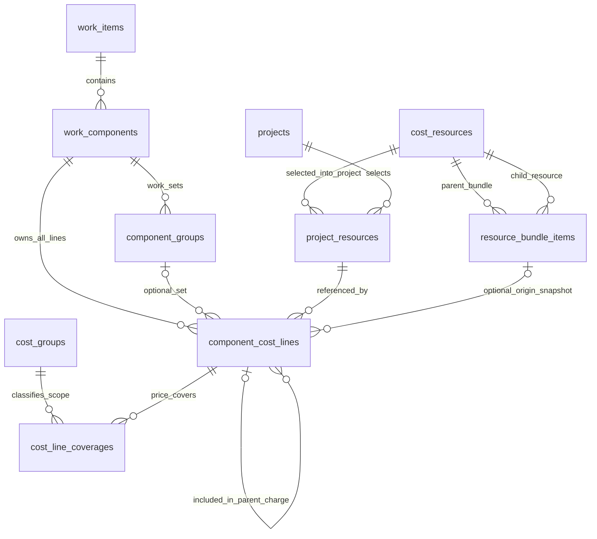

# แบบ Relation 18 ตาราง — รายการงาน/ชุด และส่วนประกอบภายใน

> **แบบเอกสารล่าสุดเพื่อทบทวน: 22 ตารางธุรกิจ** เพิ่มคลังรายการทำราคาต่อหน่วยส่วนกลาง 4 ตาราง เลือกใช้ใน Keyplan แล้วสำเนาลงโครงการ คงสูตรและ snapshot ดู [Relation 22 ตาราง](RELATION-22-RATE-TEMPLATES.md) รอบนี้แก้เฉพาะเอกสาร โค้ดและ SQLite ยัง 18 ตาราง ไม่เชื่อมออนไลน์ ข้อความเดิมที่ยังไม่รวมคลังต้นแบบเป็นขอบเขตก่อนคำยืนยันรอบนี้

> **อัปเดตการทดลอง:** มีฐาน SQLite และหน้ากรอกข้อมูลตาม 18 ตารางในเครื่องแล้ว [ดูคู่มือ](LOCAL-APP-18-GUIDE.md) ยังไม่ติดตั้งหรือเชื่อมฐานออนไลน์ และไม่ได้แทนการตรวจสิทธิ์/locking ของแบบเต็ม

วันที่ 23 ตุลาคม 2569 · แบบ relation ที่อนุมัติให้ทดลองโค้ดในเครื่องแล้ว · ยังไม่ติดตั้งฐานจริง

**ข้อสรุป: เสนอใช้ 18 ตารางธุรกิจ** = 16 ตารางเดิม + `component_groups` สำหรับรายการงาน/ชุดในโครงการ + `resource_bundle_items` สำหรับส่วนประกอบของสินค้าชุดในคลัง ไม่สร้างคลังวัตถุดิบหรือคลังราคาอีกชุด และใช้ `component_cost_lines` เดิมเก็บรายละเอียดที่นำไปใช้จริงในแต่ละชุดของโครงการ

แบบนี้แทนข้อจำกัดของ [แบบ 17 ตารางเดิม](RELATION-17-TABLES.md) ที่กลุ่มเป็นแผงเท่านั้นและเลือกวิธีผลิตทั้ง S001 แบบเดียว ฐานออนไลน์ยังเป็น 16 ตารางธุรกิจ โค้ดในเครื่องรองรับรายการงาน/ชุดแล้วในขอบเขต SAMPLE ดู [วิธีทดลองและข้อจำกัด](LOCAL-WORK-SETS-TRIAL.md) ไม่เปลี่ยน SQL migration RPC หรือข้อมูลจริง

## 1. โครงสร้างที่ผู้ใช้เห็น

```text
B01 เคาน์เตอร์ครัว
└─ S001 ตู้เตี้ย — ปริมาณและหน่วยขาย เช่น 3.50 เมตร
   ├─ BODY งานโครงตัวตู้ — เลือกซื้อสำเร็จรูป
   │  ├─ โครง Modular รุ่น 800 × 2 ใบ — คิดราคาและซื้อ
   │  ├─ โครง Modular รุ่น 600 × 2 ใบ — คิดราคาและซื้อ
   │  └─ ส่วนที่โรงงานรวมให้ — รายละเอียดอ้างอิง ไม่ซื้อซ้ำ
   ├─ DOOR งานชุดหน้าบาน — เลือกซื้อสำเร็จรูป
   │  ├─ ชุดหน้าบานตามสเปก × 2 ชุด — คิดราคาและซื้อ
   │  ├─ บานพับที่รวมในชุด — เปิดดูได้ ไม่บวกเงิน/ซื้อแยก
   │  └─ ลามิเนตปิดผิวเพิ่ม — คิดเพิ่มเฉพาะเมื่อชุดไม่ได้รวม
   ├─ DRAWER งานชุดลิ้นชัก — เลือกผลิตเอง
   │  └─ ไม้อัด / ผิวปิด / รางเลื่อน / กาว / ค่าแรง — คิดแยกรายการ
   └─ งานติดตั้งหรือต้นทุนร่วม — ทำเป็นรายการงาน หรือบรรทัดต้นทุนตรง
```

ผังเป็นตัวอย่างทางเลือก ไม่ได้ยืนยันว่า Modular หรือหน้าบานจริงรวมวัสดุใด ต้องตรวจสเปก/Index ของสินค้าที่เลือก รุ่นที่รวมและไม่รวมลามิเนตหรือบานพับใช้คนละรหัสเมื่อเป็นคนละสินค้า

S001 เลือก “งานโครงตัวตู้ / ชุดหน้าบาน / ชุดลิ้นชัก” ก่อน แล้วเปิดตารางรายละเอียดของชุด ไม่เริ่มด้วยการเลือกวัตถุดิบล่างสุดในตารางเดียวกับชุดทั้งหมด

แต่ละรายการงาน/ชุดเลือกวิธีได้เอง เช่น โครงซื้อ Modular แต่หน้าบานผลิตเอง วิธีซื้อ/ผลิตเป็นของชุดนั้น ไม่เป็นสวิตช์ที่ล้างรายการอื่นทั้ง S001

## 2. ทำไมเป็น 18 ไม่ใช่เพิ่มตารางทุกระดับ

| หน้าที่ | เก็บที่ใด |
|---|---|
| งานที่ขาย S001 | work_components เดิม |
| รายการงาน/ชุด เช่น BODY, DOOR, DRAWER | component_groups ตาราง 17 ขยายจากกลุ่มแผง |
| สินค้าที่ซื้อเป็นชุด และวัตถุดิบ/อุปกรณ์รายชิ้น | cost_resources คลังเดียวกัน แยกชนิดรายการ |
| ชุดในคลังประกอบด้วยสินค้าใด จำนวนเท่าไร และรวม/ไม่รวม | resource_bundle_items ตาราง 18 |
| ชุดและวัสดุที่เลือกใช้จริงในโครงการ พร้อมราคา/ขอบเขตฉบับนั้น | component_cost_lines เดิม เพิ่มตัวเชื่อมและประเภทบรรทัด |
| ขอบเขตที่ราคาครอบคลุม เพื่อกันคิดซ้ำ | cost_groups / cost_line_coverages เดิม |

ตาราง 18 จำเป็นสำหรับความสัมพันธ์สินค้าชุดหนึ่งต่อหลายชิ้นส่วน เช่น หน้าบานรุ่นหนึ่งมีบานพับรุ่นที่ระบุ 2 ตัวต่อชุด และสินค้าเดียวกันนำไปใช้ได้หลายโครงการ ข้อมูลนี้ไม่ควรอยู่เพียงในชื่อสินค้า ช่องข้อความ หรือสร้างรายการวัตถุดิบใหม่ซ้ำทุกครั้ง

ไม่เพิ่มตารางแยก “ราคาแต่ละชุด” หรือ “snapshot ส่วนประกอบอีกชุด” เพราะใช้ทะเบียนราคาเดิมและบรรทัดต้นทุนโครงการเดิมได้ จึงยังไม่จำเป็นต้องเป็น 19 ตารางสำหรับขอบเขตนี้

จำนวนนี้ไม่รวมตารางระบบ auth หรือข้อเสนอทะเบียนแท็กบนคลาวด์ที่ยังไม่ทำ และไม่รวมคลังสูตรผลิตเองใช้ซ้ำทั้งบริษัท แบบ 18 ตารางนี้ไม่ได้เพิ่มคลังสูตรผลิตเองดังกล่าวโดยปริยาย

## 3. รายชื่อตารางครบ 18 ตาราง

| ลำดับ | ตาราง | หน้าที่ในแบบล่าสุด |
|---|---|---|
| 1 | companies | บริษัท |
| 2 | members | ตัวตนผู้จัดทำ |
| 3 | company_memberships | บัญชีกับบริษัท 1:1 |
| 4 | projects | โครงการ สถานะและ version |
| 5 | areas | พื้นที่และห้อง |
| 6 | work_items | Keyplan เช่น B01 |
| 7 | work_components | งานที่คิดราคาขาย เช่น S001 |
| 8 | work_categories | หมวดงาน |
| 9 | units | หน่วยอ้างอิง |
| 10 | cost_types | ประเภทต้นทุนวัสดุ อุปกรณ์ ค่าแรง และอื่น ๆ |
| 11 | cost_resources | คลังสินค้า/วัสดุ/ชุดร่วมกัน เพิ่ม resource_kind |
| 12 | component_cost_lines | บรรทัดของแต่ละชุด เก็บราคา snapshot และแยกของที่คิดเงินกับของที่รวมแล้ว |
| 13 | project_resources | ทรัพยากรที่เลือกเข้าโครงการหนึ่งครั้งต่อรหัส |
| 14 | modular_products | รายละเอียดสินค้าตู้ Modular ไม่ใช่ตัวเลือกวิธีผลิตทั้ง S001 |
| 15 | cost_groups | หมวดขอบเขตสำหรับตรวจต้นทุนซ้ำ |
| 16 | cost_line_coverages | ขอบเขตราคาของบรรทัดและสถานะ BUNDLED/DETAIL |
| 17 | component_groups | รายการงาน/ชุดในงานย่อย เลือกซื้อ/ผลิตแยกกัน |
| 18 | resource_bundle_items | สินค้า/อุปกรณ์ที่รวม หรือไม่รวมในสินค้าชุดในคลัง |

## 4. แผนภาพความสัมพันธ์



ส่วนประกอบในคลังกับบรรทัดในโครงการเป็นคนละเรื่อง: ตาราง 18 คือคำอธิบายสินค้ารุ่นปัจจุบัน เมื่อเลือกใช้จึงสำเนารายละเอียดและ version ลงบรรทัดโครงการ ไม่อ่านข้อมูลชุดล่าสุดมาย้อนเปลี่ยนโครงการเดิม

## 5. ขยาย component_groups เป็นรายการงาน/ชุดทั่วไป

คง PK `component_group_id`, FK `component_id`, รหัส/ชื่อ, ลำดับ, เปิดใช้, หมายเหตุและเวลาระบบจากแบบ 17 ตาราง ปรับความหมายและเพิ่มช่องต่อไปนี้:

| ช่อง | แบบที่เสนอ | ความหมาย |
|---|---|---|
| group_code / group_name | TEXT บังคับ; UNIQUE(component_id, group_code) | BODY งานโครงตัวตู้ / DOOR ชุดหน้าบาน / DRAWER ชุดลิ้นชัก เป็นต้น |
| assembly_kind | CARCASS / DOOR / DRAWER / OTHER | หน้าที่ของชุด ไม่อนุมานจากชื่อหรือรหัส |
| sourcing_method | BUY / MAKE; ร่างที่ยังไม่เลือกใช้ NULL | ซื้อสำเร็จรูป หรือผลิตเอง เลือกแยกต่อรายการงาน/ชุด |
| calculation_method | MANUAL / PANEL_AREA | วิธีถอดปริมาณของชุด ไม่ใช่วิธีซื้อสินค้า |
| group_quantity / group_unit_id | NUMERIC(18,6) และ FK units; จำเป็นเมื่อใช้ฐาน GROUP_QUANTITY | จำนวนชุด/งานของกลุ่ม แยกจากเมตรขายของ S001 |
| panel_area_m2 / plywood_sides / laminate_sides | ตามกติกาพื้นที่ด้านเดียวเดิม เฉพาะสูตรที่ใช้ | ใช้เมื่อมีบรรทัดอิงพื้นที่ ไม่บังคับชุดซื้อสำเร็จรูปให้กรอกไม้โครง/ไม้อัด |

ข้อบังคับในแบบ:

- ไม่ใช้ `work_components.construction_method = CUSTOM/VS_MODULAR` เป็นตัวควบคุมทั้ง S001 อีกต่อไป การย้ายข้อมูลเดิมต้อง preview และระบุวิธีของแต่ละชุด ไม่กระจายค่าทั้งงานให้ทุกชุดโดยอัตโนมัติ
- BUY มีบรรทัดสินค้าชุดที่ต้องซื้อจริง อาจหลายรุ่น/หลายขนาดภายในงานโครง เช่น Modular 800 และ 600 แยกบรรทัด และมีรายการเพิ่มนอกขอบเขตได้เมื่อยืนยันแล้ว
- MAKE ใช้รายการวัสดุ อุปกรณ์ ค่าแรงตามจริง รวมเป็นต้นทุนของชุดนั้นได้ ไม่ต้องสร้างสินค้าสำเร็จรูปปลอมหรือราคาเหมารวมแผงซ้ำ ถ้าเลือกอุปกรณ์ย่อยที่ขายเป็นชุดยังต้องตรวจของที่รวมมาด้วยเช่นกัน
- เลือกวิธีเฉพาะกลุ่มที่เปลี่ยน ต้องแสดงของเดิม/ของใหม่/ส่วนที่คงไว้ก่อนยืนยัน ไม่ล้าง BODY เพราะเปลี่ยน DOOR ไม่เก็บต้นทุน BUY และ MAKE ที่ถูกแทนแล้วให้ active ซ้อนกัน
- กลุ่มยังเป็นรายการในโครงการ ไม่ใช่คลังชุดราคาขาย ไม่มี margin หรือราคาขายแยกซ้ำกับ S001 ต้นทุนกลุ่มเป็นผลรวมเพื่อแสดงผล
- แบบรุ่นนี้มีชั้นรายการงาน/ชุดหนึ่งชั้นใต้ S001 ยังไม่เพิ่มกลุ่มซ้อนกลุ่มหรือสูตรผลิตหลายชั้นอัตโนมัติ ซื้อชุดแล้วเปิดดูชิ้นส่วนที่รวมมาเป็นรายละเอียดของสินค้านั้นได้

## 6. ทะเบียนสินค้าเดิมและตารางใหม่ resource_bundle_items

เพิ่ม `cost_resources.resource_kind` เป็น ITEM / BUNDLE / SERVICE โดยแยกจาก cost_type: บานพับเป็น ITEM สินค้าหน้าบานพร้อมบานพับเป็น BUNDLE และงานค่าแรงเป็น SERVICE ส่วน cost_type ยังบอกประเภทต้นทุนเดิม ไม่เพิ่มทะเบียนราคาชุดอีกแห่ง

ราคา BUNDLE อยู่ใน cost_resources.purchase_unit_price เดิม รายละเอียด Modular ยังอยู่ตาราง 14 และอ้าง resource เดียวกัน สินค้า Modular ที่เลือกเป็น BUNDLE ใช้ตาราง 18 อธิบายของที่รวมได้ ไม่ย้ายราคาหรือขนาดไปเก็บซ้ำ

| ช่องตาราง 18 | ข้อกำหนดที่เสนอ | ความหมาย |
|---|---|---|
| bundle_item_id | UUID PK | รหัสส่วนประกอบของสินค้าชุด |
| bundle_resource_id | UUID FK → cost_resources, NOT NULL | สินค้าชุดแม่ ชนิด BUNDLE |
| child_resource_id | UUID FK → cost_resources, NOT NULL | วัสดุ/อุปกรณ์/บริการที่ระบุได้จริงในคลังเดียวกัน |
| inclusion_status | INCLUDED / EXCLUDED / UNKNOWN | รวมในราคาชุด / ไม่รวม / ยังไม่ทราบ |
| quantity_per_parent_usage_unit | NUMERIC(20,8), > 0 เมื่อทราบ; NULL เมื่อยังไม่ทราบ | เช่น บานพับ 2 ตัวต่อ 1 ชุดหน้าบาน ไม่ใช่ต่อกล่องขนส่งถ้าหน่วยใช้เป็นชุด |
| child_usage_unit_id | UUID FK units | หน่วยของชิ้นส่วน ต้องตรงกับ resource ที่อ้าง |
| scope_code / description | TEXT ไม่ว่างสำหรับ scope | ตำแหน่ง/หน้าที่ เช่น HINGE หรือ DRAWER_SLIDE แยกส่วนจริง ไม่ใช้ชื่อสินค้าเป็นตัวตัดสินซ้ำ |
| source_reference / review_status | แหล่งอ้างอิง และ PENDING / CONFIRMED | ใบราคา/Index/เอกสารรุ่นสินค้าที่ใช้ยืนยัน |
| is_active / sort_order / created_at / updated_at | ตามกติกาเดิม | สถานะ ลำดับ และเวลาระบบ |

ความครบและข้อบังคับ:

- แม่/ลูกต้องเป็นของบริษัทเดียวกัน ห้ามแม่เท่าลูก; UNIQUE(bundle_resource_id, child_resource_id, scope_code) หลัง normalize เพื่อไม่ใส่ชิ้นส่วน scope เดิมซ้ำ
- รุ่นแรกไม่รองรับ BUNDLE ซ้อน BUNDLE ในตารางนี้ เพื่อไม่สร้าง BOM หลายชั้นโดยไม่ได้ตกลง ถ้าสินค้ามีชุดย่อยที่ต้องแยกจัดการให้ระบุข้อจำกัดก่อนขยายแบบ ไม่แบนหรือเดาปริมาณมาทับเงียบ ๆ
- ตาราง 18 **ไม่เก็บราคาชิ้นส่วนสำหรับบวกเข้าราคาชุด** รายการ INCLUDED เป็นข้อมูลว่าซื้อชุดแล้วได้อะไร ไม่ใช่สูตรต้นทุนผลิตของโรงงาน
- การเพิ่ม/แก้/ปิดส่วนประกอบในชุดต้องเพิ่ม version ของ cost_resources แม่ใน transaction เดียวกัน ตามกติกา version ของทะเบียนเดิม ป้องกันการใช้ BOM คนละฉบับกับราคาหรือขอบเขตที่เลือก
- เพิ่มสถานะความครบของรายละเอียดชุดบน resource: `bundle_detail_status = PARTIAL / COMPLETE` และ `bundle_scope_review_status = PENDING / CONFIRMED` พร้อมแหล่งอ้างอิง สำเนาไปโครงการด้วย จำนวนรายการลูกเป็นศูนย์ไม่ได้แปลว่าไม่รวมอะไร
- ถ้าผู้ขายไม่เปิดเผยชิ้นส่วนภายในครบ ให้บอก PARTIAL เก็บขอบเขตที่ยืนยันได้จากเอกสารโดยตรง ไม่สร้างรหัสวัตถุดิบสมมติหรือใช้ 0 แทนสิ่งที่ไม่ทราบ ไม่ต้องถอดต้นทุนโรงงานจึงจะซื้อสินค้าชุดได้ แต่ขอบเขตที่จะใช้ตรวจซ้ำต้องยืนยันให้ครบก่อนตรวจรับงานจริง
- การปิดส่วนประกอบที่เคยถูกเลือกเข้าโครงการใช้ is_active ไม่ลบแถวอ้างอิงหรือ cascade ลบ snapshot เก่า ส่วน FK ที่มาจากคลังไม่ใช้แทนข้อมูล snapshot
- ข้อมูลชุดที่เลือกแล้วต้องมี resource/version และข้อมูล snapshot ของขอบเขต ณ ครั้งนั้น การแก้คลังภายหลังไม่เปลี่ยนบรรทัดในโครงการย้อนหลัง

### ข้อปรับความครบของข้อมูลสำหรับชิ้นส่วนที่ใช้อ้างอิงเท่านั้น

บานพับที่รวมในราคาชุดอาจทราบรุ่น/จำนวน แต่ไม่มีราคาขายแยก แบบใหม่นี้จึงต้องผ่อนข้อบังคับเดิมของ cost_resources และ project_resources: ราคาอ้างอิงซื้อเดี่ยว วันที่ราคา หน่วยซื้อ/ขนาดบรรจุและขั้นซื้อที่ยังไม่ทราบให้เป็น NULL ได้ขณะใช้เป็น reference เท่านั้น โดยยังบังคับตัวตน สเปกและหน่วยใช้ที่แน่นอน ไม่ใส่ราคา 0 หรือสมมติบรรจุภัณฑ์ให้ผ่าน schema

ถ้าจะนำ resource เดียวกันไปเป็น CHARGEABLE ต้องตรวจข้อมูลซื้อ/ตัวแปลง/ขั้นซื้อและราคาที่ใช้ให้ครบตามกติกาเดิมก่อนคำนวณและตรวจรับ การใช้เป็น reference ไม่ได้ทำให้ผ่านสถานะ VERIFIED สำหรับซื้อแยกโดยอัตโนมัติ ราคาแม่ของชุดต้องครบในฐานะรายการที่คิดเงิน แม้รายละเอียดราคาซื้อเดี่ยวของลูกจะไม่ครบ

การแปลงหน่วยของ reference ใช้จำนวนต่อชุดและหน่วยใช้ลูก ไม่หาร yield ซื้อเดี่ยวที่ไม่ทราบ ไม่ควรให้เครื่องคำนวณปฏิเสธราคาลูกที่เป็น NULL ก่อนแยก line_kind ช่องทาง Excel ในอนาคตต้องแสดงว่าเป็นข้อมูลซื้อเดี่ยวที่ยังไม่ครบและคง NULL ไม่แปลงช่องว่างเป็น 0 หรือรับรายการนั้นเป็นราคาพร้อมซื้อ ทั้งหมดเป็นข้อปรับแบบ ยังไม่แก้ตัวนำเข้า/ส่งออกปัจจุบัน

## 7. ใช้ component_cost_lines เดิมเก็บรายละเอียดในโครงการ

คงตัวเชื่อมงาน/กลุ่ม/ทรัพยากร อัตรา หน่วย เผื่อเศษ ราคาและขอบเขต snapshot จากแบบก่อน เพิ่ม/ปรับดังนี้:

| ช่อง | ข้อกำหนดที่เสนอ | ความหมาย |
|---|---|---|
| line_kind | CHARGEABLE / INCLUDED_REFERENCE / EXCLUDED_REFERENCE | คิดเงินจริง / รวมในราคาบรรทัดแม่แล้ว / ยังไม่รวมในชุด |
| parent_bundle_cost_line_id | UUID self-FK; บังคับสำหรับบรรทัดอ้างอิง | บรรทัดสินค้าชุดที่รับผิดชอบรายละเอียดนี้ |
| source_bundle_item_id | UUID FK ตาราง 18, nullable | ที่มาจากคลังชุด ถ้ามี |
| bundle_resource_version_snapshot | BIGINT > 0 เมื่ออ้างชุด | ฉบับสินค้าชุดที่นำมาใช้ ไม่ใช่ข้อมูลล่าสุดเสมอ |
| inclusion/quantity/scope/source snapshots | ค่าที่เลือกใช้ครั้งนั้น | เก็บสถานะรวม/ไม่รวม จำนวนต่อชุด หน่วย ขอบเขตและหลักฐานที่ใช้ ณ ครั้งนั้น |
| quantity_source | เพิ่ม GROUP_QUANTITY / PARENT_BUNDLE_USAGE | จำนวนรายการงาน/ชุด หรือจำนวนใช้งานของบรรทัดสินค้าชุดแม่ แยกจาก MANUAL และฐานพื้นที่เดิม |
| need_resolution | PENDING / ADDED_AS_CHARGE / NOT_REQUIRED สำหรับ EXCLUDED_REFERENCE | ของที่ชุดไม่รวมต้องตรวจว่าจะเพิ่มหรือไม่จำเป็น พร้อมเหตุผลและผู้ยืนยันจาก session |
| resolved_charge_line_id | UUID self-FK, nullable | บรรทัดที่เพิ่มจริงเพื่อรับผิดชอบของที่ชุดไม่รวม ถ้ามี |

ข้อบังคับและความหมาย:

1. CHARGEABLE เท่านั้นมีผลต่อต้นทุนและสรุปซื้อ (ค่าแรงยังแยกเหมือนเดิม) สินค้าชุดที่ซื้อเป็น CHARGEABLE ของ resource ชนิด BUNDLE ส่วนวัสดุที่ผลิตเองหรือของเพิ่มนอกชุดเป็น CHARGEABLE ของ resource ที่เลือกจริง
2. INCLUDED_REFERENCE และ EXCLUDED_REFERENCE เก็บราคาสำหรับคิดต้นทุนเป็น NULL โดยมีเหตุผล/สถานะชัด ไม่ใช้ราคา 0 เพื่อแกล้งว่าราคาครบ รายละเอียดไม่ถูกนำไป SUM ต้นทุนหรือซื้อแยก
3. parent ของบรรทัดอ้างอิงต้องเป็น CHARGEABLE ชนิด BUNDLE ใน component และ component_group เดียวกัน parent ห้ามเป็นบรรทัดอ้างอิงหรือเป็นตัวเอง ใช้ FK คู่/การตรวจ transaction ป้องกันชี้ข้ามชุด ข้ามงาน ข้ามบริษัท และวงวน
4. บรรทัดอ้างอิงใช้ `quantity_source = PARENT_BUNDLE_USAGE`: จำนวนชิ้นส่วนอ้างอิง = จำนวนใช้ของบรรทัดชุดแม่ × จำนวนชิ้นส่วนต่อหน่วยใช้ของแม่ตาม snapshot ไม่คูณ group_quantity หรือเมตรขายซ้ำอีกชั้น ถ้าจำนวนต่อชุดไม่ทราบใช้ NULL และแสดงว่าไม่ทราบ ไม่สรุปเป็น 0 ชิ้น
5. บรรทัด reference ไม่ใส่เผื่อเศษเพิ่มเติมของชิ้นส่วนเอง ไม่มีการเพิ่มเผื่อหรือหักส่วนเกินเพื่อทำให้จำนวนซื้อของแยกเปลี่ยนโดยไม่ได้รับคำยืนยัน จำนวนอ้างอิงกับจำนวนของที่ได้รับหลังปัดซื้อทั้งชุดต้องระบุคนละความหมาย ไม่สร้างสต็อกจริงในรุ่นนี้
6. ระบุความไม่ซ้ำของ reference ด้วยแม่ + source_bundle_item_id + scope ที่ใช้จริง (กรณีสร้างอ้างอิงเองไม่มี source ID ต้องตรวจแม่/ลูก/scope ใน transaction) ไม่ทำสำเนาลูกเดียวกันซ้ำเพียงเพราะเปิดชุดอีกครั้ง ส่วน source_bundle_item_id เป็นที่มา ไม่ใช่แหล่งข้อมูลที่ดึงสดมาคำนวณ การเปลี่ยนคลังจะไม่เปลี่ยน reference snapshots เดิม การปิดใช้ข้อมูลในคลังไม่ลบหลักฐานของโครงการที่เคยเลือก
7. ไม่มี UNIQUE(component_id, project_resource_id) หรือ UNIQUE(group_id, resource_id) ที่ห้ามวัสดุซ้ำทั้งกลุ่ม เพราะชุดซื้อสองรุ่นอาจรวมบานพับรหัสเดียวกันได้ และสองกลุ่มอาจใช้วัสดุเดียวกันจริง ตรวจ identity ของบรรทัดแม่ + scope และกฎการคิดซ้ำแทน
8. ยกเลิกข้อจำกัดแบบแผงที่บังคับหนึ่ง FRAME/PLYWOOD/LAMINATE/ADHESIVE ต่อกลุ่มทั่วไป รายการงาน/ชุดมีหลายบรรทัดต่อบทบาทได้เมื่อ scope ต่างกัน ไม่ใช้บทบาทหรือตัวรหัสวัสดุเพียงอย่างเดียวตัดสินว่าซ้ำ กรณีสูตรพื้นที่ต้องระบุฐานพื้นที่/ขอบเขตของแต่ละบรรทัดให้ชัดก่อนใช้จริง
9. ต้นทุนตรงของ component ยังใช้ group NULL ได้สำหรับต้นทุนร่วมที่ยืนยันแล้ว ในหน้าจอหลักให้เริ่มจากรายการงาน/ชุด ไม่ย้อนรวมชุดซื้อกับวัตถุดิบทุกกลุ่มเป็นรายการเลือกชั้นเดียว

## 8. กติกาป้องกันของที่รวมในชุดถูกคิดซ้ำ

ใช้บทบาทของบรรทัดร่วมกับ cost_line_coverages เดิม ไม่ตรวจจากชื่อหรือรหัสวัสดุอย่างเดียว:

| กรณี | ผลที่ต้องเป็น |
|---|---|
| หน้าบานซื้อสำเร็จรูปมีบานพับ INCLUDED | ต้นทุนและซื้อที่หน้าบาน CHARGEABLE; บานพับเป็น INCLUDED_REFERENCE แสดง “รวมในชุด” |
| เพิ่มบานพับ CHARGEABLE ทับ scope ที่หน้าบานครอบคลุม | แจ้งชนและหยุดการยืนยัน/ล็อก ไม่คิดเพิ่มเงียบ ๆ และไม่ลบทิ้งเอง |
| ซื้อบานพับเพิ่มนอกจำนวน/ตำแหน่งที่รวม | เพิ่ม CHARGEABLE เฉพาะส่วนเพิ่มที่ผู้ใช้ระบุ มี scope/จำนวนและเหตุผลยืนยันต่างจากส่วนรวม |
| ชุดหน้าบานไม่รวมลามิเนต | แสดง EXCLUDED_REFERENCE/ขอบเขตไม่รวมให้ตรวจ ถ้าต้องใช้จึงเพิ่ม CHARGEABLE ลามิเนต พร้อมเชื่อมการแก้ขอบเขต |
| ผลิตหน้าบานเอง | วัสดุและบานพับที่ต้องจัดหาจริงเป็น CHARGEABLE ไม่มีบรรทัดราคาชุดหน้าบานมาบวกซ้ำ |
| บานพับรุ่นเดียวใช้ตัวตู้คนละตำแหน่งหรือคนละชุด | อนุญาตเมื่อเป็นคนละ scope; ไม่บล็อกเพียงเพราะรหัสเหมือนกัน |
| ไม่ทราบว่าชุดรวมรางเลื่อนหรือไม่ | แสดง PENDING/UNKNOWN ต้องตรวจ Index ไม่เดาว่ารวม/ไม่รวม ไม่ปิดยอดเป็นพร้อมใช้ |

coverage เชิงราคาของสินค้าชุดให้อ้าง CHARGEABLE แม่เพียงครั้งเดียว รายละเอียด INCLUDED_REFERENCE ไม่สร้าง coverage แบบคิดเงินซ้ำมาชนกับแม่เอง แต่ใช้เป็นหลักฐานบอกว่ารายการแม่ครอบคลุม resource/ส่วนงานใด

scope ต้องมีตัวเชื่อม component/group และบรรทัดแม่ของชุดในแบบเพิ่มจาก scope_key เดิม เช่น `component_group_id` และ `bundle_owner_cost_line_id` บน coverage พร้อมตรวจเจ้าของ ไม่ใช้ข้อความ BODY/DOOR หรือ EXTRA เป็นข้อยกเว้นลอย ๆ ที่ผู้ใช้เปลี่ยนชื่อแล้วหลบการตรวจได้ ต้องเทียบ scope ทั้งงาน → รายการงาน/ชุด → ตำแหน่งที่แม่ครอบคลุม และเทียบจำนวนที่ทราบด้วย

ตัวอย่างต้องใช้บานพับ 5 ตัว ชุดซื้อมี 4 ตัว: ระบบแสดง 4 ตัวที่รวมแล้ว และผู้ใช้ยืนยันของเพิ่ม 1 ตัว ไม่ตีความบานพับที่กรอก 5 ตัวเป็นของเพิ่ม 5 ตัวโดยอัตโนมัติ และไม่หักจำนวนเองหากยังไม่ได้ยืนยันความหมายของจำนวนที่กรอก

การตรวจซ้ำในฐานจริงต้องทำใน transaction เดียวกับ project version/lock ตามกติกาเดิม ไม่พึ่งการซ่อนปุ่มหน้าเว็บ และไม่ JOIN หลาย coverage แล้ว SUM เงินซ้ำ

## 9. ต้นทุนและสรุปซื้อ — ตัวอย่างตรวจความเข้าใจ

ตัวเลข SAMPLE: เลือกหน้าบาน 2 ชุด ราคาชุดละ 1,000 บาท แต่ละชุดรวมบานพับรหัส H01 จำนวน 2 ตัว ต้องการเพิ่มบานพับนอกชุดที่ยืนยันแล้วอีก 1 ตัว ราคาตัวละ 100 บาท

| บรรทัดใน DOOR | ประเภท | ปริมาณ | รวมต้นทุน | สรุปซื้อ |
|---|---|---:|---:|---|
| ชุดหน้าบานที่เลือก | CHARGEABLE | 2 ชุด | 2,000 บาท | ซื้อหน้าบาน 2 ชุด |
| H01 ที่รวมในหน้าบาน | INCLUDED_REFERENCE | 2 × 2 = 4 ตัว | รวมในราคาชุด ไม่บวกเงิน | ไม่ซื้อแยก |
| H01 เพิ่มนอกชุด | CHARGEABLE | 1 ตัว | 100 บาท | ซื้อ H01 เพิ่ม 1 ตัว |

ต้นทุนกลุ่ม DOOR = 2,100 บาท รายงานของที่ได้รับอธิบายได้ว่ามีบานพับรวมแล้ว 4 ตัวกับซื้อเพิ่ม 1 ตัว แต่สรุปซื้อไม่แสดงว่าต้องซื้อ H01 แยก 5 ตัว

ลำดับคำนวณ:

1. เลือกกลุ่มที่เปิดใช้ และวิธีซื้อ/ผลิตของแต่ละกลุ่ม
2. คำนวณจำนวนใช้ของ CHARGEABLE จากฐานที่ระบุ: MANUAL ตาม TOTAL/PER_UNIT เดิม, GROUP_QUANTITY ตามจำนวนชุดที่กรอก, หรือฐานพื้นที่ที่ยืนยันแล้ว ไม่คูณซ้ำหลายฐาน
3. คำนวณ INCLUDED/EXCLUDED_REFERENCE จากแม่เพื่อแสดงรายละเอียดเท่านั้น แยกจากตัวสะสมเงิน/วัสดุซื้อ
4. ต้นทุนกลุ่ม = ผลรวม CHARGEABLE ในกลุ่มก่อนปัด ต้นทุน S001 = รวม CHARGEABLE ทุกกลุ่มกับต้นทุนตรงครั้งเดียว ไม่บวก subtotal กลุ่มหรือราคาเหมารวมอีกชั้น กำไรยังอยู่ที่ S001 ตาม Master
5. สรุปซื้อรวมเฉพาะ CHARGEABLE ที่ต้องจัดหาและไม่ใช่ค่าแรง ตาม project_resource_id ทั้งโครงการก่อน CEILING ขั้นซื้อ สินค้าชุดรวมกับสินค้าชุดรหัสเดียวกัน; ชิ้นส่วน reference ไม่เข้า accumulator
6. ของเพิ่มต่างกลุ่มที่ใช้ H01 รหัสเดียวกันรวมซื้อได้ ส่วน H01 ที่แสดงว่า INCLUDED ไม่ถูกนำมารวมด้วย งบซื้อใช้ราคาอ้างอิงโครงการ ต้นทุนใช้จริงยังคง snapshot ของแต่ละบรรทัด
7. เมื่อเปลี่ยนจำนวนชุดแม่ ให้รายละเอียดที่รวมมาคำนวณตามแม่ใหม่ ไม่เปลี่ยนปริมาณของเพิ่มนอกชุดโดยเงียบ ๆ และไม่หักของเพิ่มด้วยส่วนเกินจากการปัดซื้อทั้งชุด

## 10. การคงฉบับข้อมูล สิทธิ์ และการย้ายจากต้นแบบ

- การเลือกชุดต้อง preview สเปก ราคา รุ่นข้อมูล ของที่รวม/ไม่รวม และสถานะความครบก่อนสร้าง snapshot บรรทัดสินค้าชุดและรายละเอียดต้องสำเร็จหรือย้อนกลับพร้อมกัน
- เปลี่ยน BUY ↔ MAKE เฉพาะ component_group ที่เลือก ใน DRAFT และ transaction เดียวกับ project lock/version แสดงรายการที่จะถูกแทนและรายการเพิ่มที่ต้องทบทวน ไม่เปลี่ยนชุดอื่น ไม่ปล่อย reference ลูกชี้แม่ที่ถูกนำออก
- การแก้คลังชุดเพิ่ม version แม่; การปรับโครงการให้ใช้ฉบับใหม่ต้องยืนยัน ไม่ sync ราคา ขอบเขต จำนวนต่อชุด หรือ reference เดิมอัตโนมัติ
- FK/บริการตรวจทุกสายบริษัทเดียวกัน สำหรับตาราง 18 ตรวจแม่/ลูกในบริษัทเดียวกัน สำหรับบรรทัดในโครงการตรวจ resource, group, parent และ resolution อยู่ในงานที่อนุญาต คลังกลางกับ snapshot ไม่อ่านข้ามบริษัทด้วยการส่ง ID มาเอง
- LOCKED ห้ามเปลี่ยนชุด วิธีจัดหา แม่/ลูก จำนวน และขอบเขต การคัดลอกโครงการต้องสร้าง ID ใหม่และ remap กลุ่ม/bundle parent/resolution พร้อมรักษา snapshot ไม่อ้างแม่ของโครงการต้นฉบับ
- ต้นแบบปัจจุบันยังมีสวิตช์ CUSTOM/VS_MODULAR ทั้ง S001 และกลุ่มแผงสองกลุ่ม ห้ามเรียกว่ารองรับแบบนี้แล้ว การย้ายต้อง preview จัดรายการเดิมเข้า BODY/DOOR/DRAWER และกำหนดวิธีแต่ละชุดจากผู้ใช้ ไม่เดาว่า FD01 รวมลามิเนตหรือบานพับรุ่นใดจากชื่อ
- ข้อมูล INCLUDED/EXCLUDED/UNKNOWN ต้องมาจากผู้ใช้หรือเอกสารผู้ขายที่ยืนยัน ไม่คัดลอกคลัง/ฐานเดิมมาใช้ทั้งชุด ไม่ย้ายข้อมูลจริงหรือเปลี่ยนฐานในรอบเอกสารนี้

## 11. เกณฑ์ตรวจรับก่อนลงมือพัฒนา

| ตัวอย่างตรวจ | ผลที่ต้องได้ |
|---|---|
| BODY ซื้อ Modular; DOOR ผลิตเอง; DRAWER ซื้อสำเร็จรูปใน S001 เดียวกัน | เลือกได้อิสระ ไม่บังคับวิธีเดียวทั้งงาน |
| เปิด DOOR | เห็นชุด/วัสดุของ DOOR พร้อมป้ายคิดเพิ่ม/รวมแล้ว/ยังไม่รวม ไม่ปะปนรายการกลุ่มอื่น |
| หน้าบาน 2 ชุด ชุดละ 1,000 รวมบานพับ 2 ตัว/ชุด | ต้นทุน 2,000 ซื้อหน้าบาน 2 ชุด บานพับ 4 ตัวเป็น reference ไม่ซื้อแยก |
| เพิ่ม H01 นอกชุด 1 ตัว ตัวละ 100 | ต้นทุน 2,100 ซื้อ H01 แยกเพียง 1 ตัว |
| เพิ่ม H01 ทับส่วนที่รวมโดยไม่ยืนยันขอบเขตเพิ่ม | แจ้งชนและหยุดตรวจรับ ไม่คิดเพิ่มหรือซ่อนรายการเอง |
| ชุดไม่รวมลามิเนต | รายการที่ต้องการยัง PENDING จนระบุว่าจะเพิ่มหรือไม่ต้องใช้พร้อมเหตุผล |
| วัสดุรหัสเดียวกันในหลายชุด | เก็บแยกบรรทัด รวมซื้อเฉพาะ chargeable ก่อนปัด |
| เปลี่ยนจำนวนแม่หรือรุ่นชุดในคลัง | จำนวน reference ในงานตามแม่ที่เลือก; งานเดิมคง snapshot จนยืนยันอัปเดต |
| scope เหมารวมทั้งงานชนวัสดุในกลุ่มย่อย | ตรวจพบ ไม่เลี่ยงด้วยการเปลี่ยนข้อความ scope |
| reference หลายแถวและ coverage หลายรายการ | ต้นทุนแม่ถูกคิดเพียงครั้งเดียว ไม่มี JOIN ทำยอดเพิ่ม |
| เปลี่ยนวิธีหนึ่งกลุ่ม / บันทึกชนกัน / ย้อนกลับเมื่อผิดพลาด | กลุ่มอื่นคงเดิม ไม่มีลูกกำพร้าหรือข้อมูลครึ่งชุด |
| อ้างกลุ่ม แม่ ลูก หรือ resource คนละบริษัท/โครงการ | ปฏิเสธทุกช่องทาง รวม export/copy |

รายละเอียดชื่อช่อง ชนิดข้อมูล และข้อบังคับใหม่ในเอกสารนี้เป็นแบบเสนอให้ตรวจทาน ไม่ใช่คำกล่าวว่ามี schema หรือผลทดสอบจริงแล้ว รอบนี้ตรวจเฉพาะความครบของเอกสาร รายชื่อตาราง และความสอดคล้องของตัวอย่าง ไม่มีการรัน migration หรือทดสอบฐาน 18 ตาราง


## ข้อยืนยันเพิ่มเติม: ค่าแรงอยู่ในกลุ่มงาน

ค่าแรงผลิต/ประกอบ และค่าแรงติดตั้งของแต่ละงานอยู่ใน component_cost_lines ภายใต้ component_groups ของงานนั้น รวมเป็นต้นทุนกลุ่มและต้นทุนต่อหน่วยขาย S001 ใช้คลัง resources เดิมชนิด LABOR ไม่เพิ่มตารางจาก 18 ตารางที่เสนอ ค่าแรงที่รวมในสินค้าชุดเป็นขอบเขตที่ห้ามคิดซ้ำ แยกจากค่าแรงนอกชุดที่คิดเพิ่มจริง ส่วนต้นทุนร่วมใช้เฉพาะรายการที่ไม่ผูกกลุ่มจริง ๆ ห้ามแยกค่าแรงรวมเดิมไปหลายกลุ่มโดยเดาสัดส่วน โค้ดในเครื่องใช้ laborPhase แยก PRODUCTION/INSTALLATION ดู LOCAL-WORK-SETS-TRIAL.md สำหรับนิยาม SAMPLE และผลตรวจ
