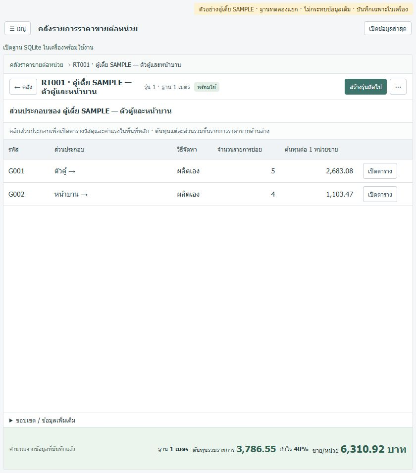
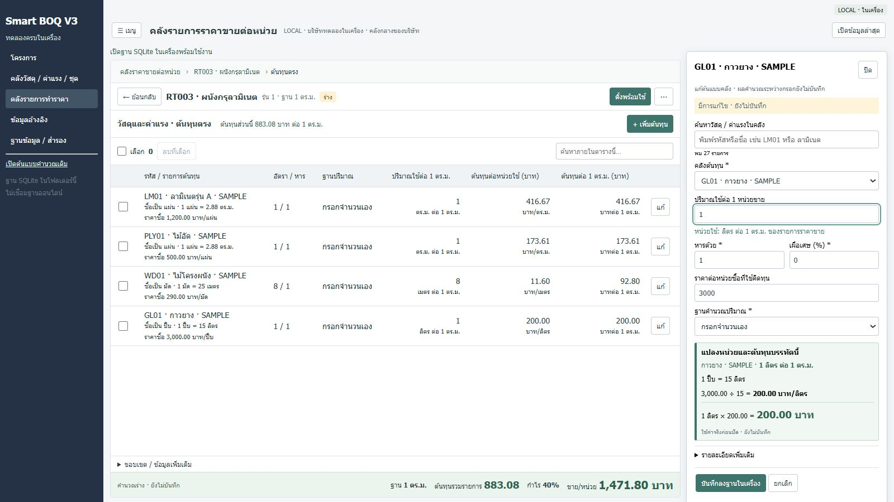
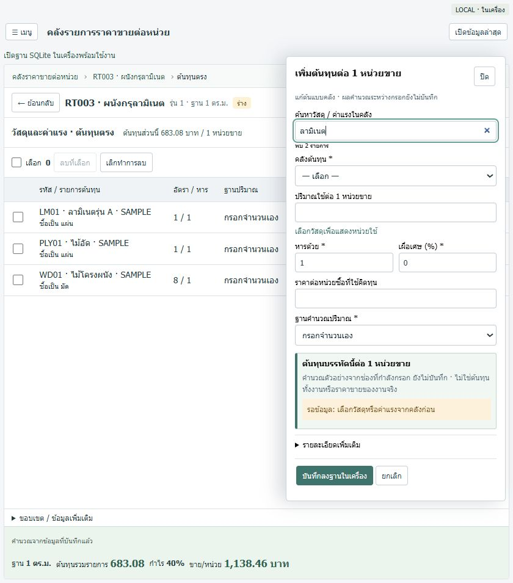
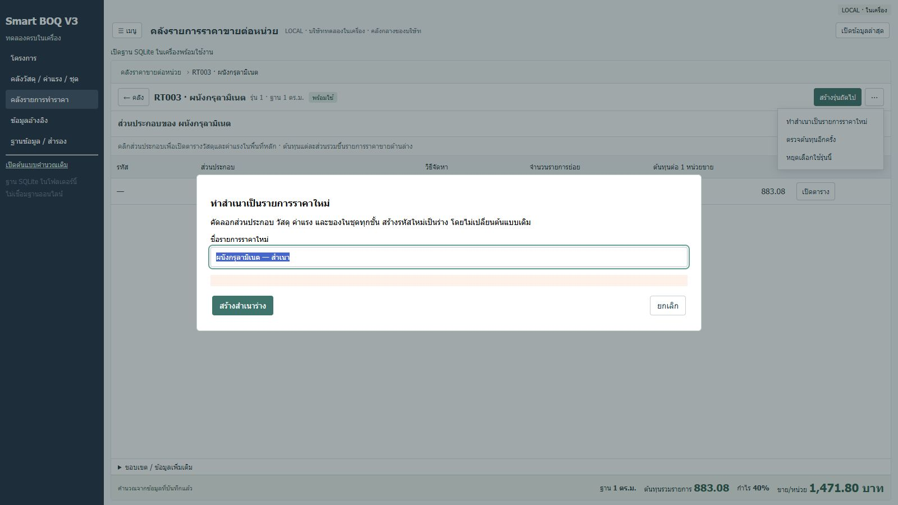

# Smart BOQ V3 — ภาพอ้างอิงและรายการตรวจรับ UX/UI

ฉบับ 1.0 · 24 ตุลาคม 2569 · ใช้คู่กับ [กติกา UX/UI 1.2](UX-UI-GUIDELINES.md) และ [MASTER](MASTER.md)

เอกสารนี้เก็บรูปแบบที่เจ้าของทดลองและให้บันทึกเป็นแนวทางร่วม เพื่อใช้ต่อในแชตอื่นโดยไม่ต้องอธิบายใหม่ ไม่ใช่ใบตรวจรับทุกฟังก์ชัน ทุกหน้า หรือราคาวัสดุจริง รอบจัดเอกสารนี้ไม่ได้แก้แอป/สูตร/ฐานข้อมูล และไม่ได้เชื่อมออนไลน์

## ขอบเขตที่ยืนยันและหลักฐาน

| เรื่อง | สถานะที่อ้างได้ | หลักฐาน/ขอบเขต |
|---|---|---|
| แบบ A เปิดตารางทีละชั้น | เจ้าของทดลองตู้เตี้ยแล้วระบุว่าตรงตามต้องการ และให้ใช้ในแอปหลัก | [การใช้แบบ A ในแอปหลัก](UI-RATE-A-MAIN-ACCEPTED-20261024.md) ไม่ได้สั่งแบ่งกลุ่มข้อมูลเดิมให้เอง |
| ทำสำเนาราคาใหม่ | เจ้าของระบุว่า “ทดลองแล้วใช้ได้” | [ผลพัฒนาทำสำเนา](RATE-CLONE-20261024.md) คัดลอกทุกชั้น รหัสใหม่ร่าง แยกจากรุ่นถัดไป |
| ตารางกระชับ/แผงขวา/ค้นหา/หน่วย/เพิ่ม–ลบ/คำนวณ/สถานะบันทึก | เจ้าของให้บันทึกแนวทางที่คุยและทดลองเป็นมาตรฐานร่วมในรอบนี้ | รายละเอียด UX01–UX10 ใน UX-UI-GUIDELINES.md; [เพิ่ม–ลบ](COST-LINES-ADD-DELETE-20261024.md); [ผลตรวจแต่ละรอบ](STATUS.md) ไม่หมายความว่าทุกกรณีทดสอบผ่านจากเจ้าของแล้ว |
| คลังวัสดุ ค่าแรง VS Modular | คงแนวทางตาราง/แผงขวา แท็ก เลือกหลายรายการ และเลิกทำที่อนุมัติไว้ | [ผลส่งคลัง](UI-CATALOG-WORKSPACE-20261024.md) ไม่เปลี่ยนเป็นตารางประกอบราคาหรือเพิ่มระดับเหนือ Keyplan |
| หน้าโครงการ หน้าอื่น จอทุกขนาด งานจริงครบโครงการ และข้อมูลคลังจริง | ยังไม่ปิดงานตรวจรับ | ใช้ [BACKLOG](BACKLOG.md) และ [DATA-REQUIREMENTS](DATA-REQUIREMENTS.md) ตามขอบเขต ไม่ตีความการรับหน้าคลังเป็นการรับทั้งหมด |

“ล็อก” คือใช้แนวทางปัจจุบันจนมีคำยืนยันใหม่ ไม่ใช่ห้ามแก้ข้อบกพร่องหรือให้ถามทุกการปรับระยะห่าง การเปลี่ยนสูตร/ข้อมูล/โครงสร้างธุรกิจ/ออนไลน์ต้องอยู่ในคำสั่งงานนั้น ภาพและเอกสารไม่เพิ่มอำนาจดำเนินการ

## ภาพอ้างอิง

เก็บภาพ JPEG ไว้ใน `docs/assets/ux-approved/` เพื่อเปิดได้จาก checkout อื่นโดยไม่ต้องมี artifacts เดิม ภาพทั้งหมดใช้ข้อมูล SAMPLE หรือสำเนาทดลอง ไม่ใช่ข้อมูลราคาใช้จริง ตัวเลขไม่ใช่ยอดที่ทุกงานต้องคำนวณให้เท่ากัน ไฟล์ภาพไม่ถูกแก้/ตัดต่อในรอบจัดเอกสารนี้ ใช้นามสกุล .jpg ให้ตรงกับเนื้อภาพต้นฉบับจากการจับหน้าจอ

### ภาพ 1 — แบบ A: ส่วนประกอบเป็นตารางหลัก

อ้างอิง UX01–UX03: ราคาต่อเมตร → ตัวตู้/หน้าบาน → ตารางวัสดุและค่าแรง พร้อมเส้นทางและย้อนกลับ ภาพจากฐานตู้เตี้ยแยกก่อนรับแบบ A ใช้อ้างอิงโครงหน้าเท่านั้น ชื่อหน่วยของตารางต้นทุนให้ใช้กติกาและภาพ 2 ซึ่งใหม่กว่า

### ภาพ 2 — แผงแก้ไข หน่วย และคำนวณทันที

อ้างอิง UX02, UX07–UX08: ซื้อกาวเป็นปี๊บ 3,000 บาท / 15 ลิตร = 200 บาท/ลิตร เมื่อกรอกใช้ 1 ลิตรต่อผนัง 1 ตร.ม. ต้นทุนกาวเป็น 200 บาทต่อผนัง 1 ตร.ม. หน่วยคงอยู่เมื่อแสดงผลร่าง ภาพนี้ **ยังไม่บันทึก** ใช้อ้างอิงการแสดงหน่วย ไม่ยืนยันว่า 1 ลิตรเป็นอัตราใช้งานจริง

### ภาพ 3 — ค้นหาวัสดุก่อนเลือก

อ้างอิง UX06: ค้นรหัส/ชื่อด้านบนตัวเลือก แสดง “พบ 2 รายการ” จากคำว่า “ลามิเนต” ล้างคำค้นเพื่อแสดงทั้งหมดได้ คำค้นไม่ใช่ข้อมูลต้นทุนและไม่บันทึกเป็นรายการใหม่

### ภาพ 4 — ทำสำเนาเป็นรายการใหม่

อ้างอิง UX09: เมนู ⋯ → ทำสำเนาเป็นรายการราคาใหม่ ตั้งชื่อก่อนสร้างรหัสใหม่เป็นร่าง ภาพฟอร์มนี้ยังไม่ได้กดสร้าง ไม่ใช่หลักฐานว่ามีสำเนาชื่อนี้ในฐานหลัก

## รายการตรวจรับสำหรับงานรอบถัดไป

เลือกข้อที่เกี่ยวข้องกับงานและส่วนที่อาจกระทบ รายงาน **ผ่าน / ไม่ผ่าน / ยังไม่ได้ตรวจ / ไม่เกี่ยวข้อง** พร้อมเหตุผล/หลักฐาน ห้ามใช้ภาพด้านบนหรือผล tests เก่าติ๊กผ่านรอบใหม่อัตโนมัติ งานเอกสารล้วนตรวจเอกสาร/ลิงก์/สกิลโดยไม่ต้องแก้แอปเพื่อทดสอบ

| รหัส | วิธีตรวจ | ผลที่ต้องเห็น |
|---|---|---|
| UX01 | เปิดต้นแบบ → ส่วนประกอบ → วัสดุ/ค่าแรง → ของในชุดถ้ามี แล้วย้อนกลับ | เป็นตารางหลักทีละชั้น เส้นทางและย้อนกลับตรงชั้น ไม่เปิด drawer แทนตาราง ไม่สร้างกลุ่มให้ข้อมูลเก่าเอง |
| UX02 | แยกคลิกแถว ปุ่มแก้ และติ๊กเลือก เปิด/ปิดแผง | ไม่สลับชั้นเพราะติ๊ก/กรอก ข้อมูลแถวถูกต้อง ไม่มีค่าของแถวก่อนค้าง |
| UX03 | ตรวจหน้ารายการและแผงที่ขนาดจอในขอบเขตงาน รวมข้อความยาว | อ่านภาษาไทยได้ หน่วย/ยอด/ปุ่มไม่ทับกัน ไม่เลื่อนผ่านหัวเรื่อง/การ์ดซ้ำก่อนถึงตาราง ระบุขนาดที่ตรวจจริง |
| UX04 | เพิ่มต้นทุน ลบหลายบรรทัด แล้วเลิกทำ | ไม่มีเปิดใช้/ปิดใช้รายบรรทัด ของในคลังยังอยู่ คืนจำนวน/ราคา/ตำแหน่งและยอด ชุดแม่คืนลูก/ขอบเขตครบ ไม่คิดเงินซ้ำ; ตรวจเงื่อนไข version ก่อนคืนทับ |
| UX05 | ค้น/กรอง เลือกทั้งหมด เปลี่ยนเงื่อนไขและจัดแท็กหลายรายการ | จำนวนตรงผลที่แสดง ไม่จัดการแถวที่ซ่อน การเปลี่ยนแท็กไม่เปลี่ยนราคา/หน่วย/สูตร |
| UX06 | ค้นรหัส ชื่อไทย คำที่ไม่พบ และล้างคำค้นหลังเลือกวัสดุ | ตัวเลือกและจำนวนตรงคำค้น วัสดุที่เลือกไม่หาย ราคาไม่เปลี่ยนเพียงเพราะค้นหา |
| UX07 | ตรวจหน่วยต่างกัน เช่น กาวปี๊บ→ลิตร หรือไม้อัดแผ่น→ตร.ม. | แสดงหน่วยซื้อ อัตราบรรจุ ราคาซื้อ บาทต่อหน่วยใช้ ปริมาณใช้ต่อฐานขาย และต้นทุนต่อฐานขายจาก snapshot; ไม่เรียกปริมาณใช้ว่าเป็นหน่วยขาย |
| UX08 | แก้จำนวน/ราคา ตรวจผลระหว่างกรอก บันทึก ปิดเปิดใหม่ และลองออกขณะมีค่าค้าง | ยอดและหน่วยเปลี่ยนพร้อมกันตามแกนเดิม ร่างไม่อ้างว่าบันทึกแล้ว มีบันทึก/ทิ้ง/อยู่ต่อ ตั้งพร้อมใช้แยกจากบันทึก; ไม่เดาข้อมูลว่างเป็นศูนย์ |
| UX09 | ทำสำเนาจากร่าง/พร้อมใช้ เปลี่ยนผิวในสำเนา และเทียบกับรุ่นถัดไป | สำเนารหัสใหม่ รุ่น 1 ร่าง ทุกชั้น/ความสัมพันธ์ครบ วัสดุไม่ซ้ำ ต้นฉบับ/โครงการเดิมคงเดิม รุ่นถัดไปรหัสเดิม; ยกเลิกหรือข้อมูลไม่ครบไม่ทิ้งสำเนาบางส่วน |
| UX10 | เทียบสูตรและ snapshot ก่อน/หลัง แล้วเลือกต้นแบบพร้อมใช้เข้า Keyplan ในฐานทดสอบ | สูตร margin/Decimal/การปัดเดิม หน่วยขายตรง กรอกปริมาณจริงไม่คูณซ้ำ โครงการเก่าไม่เปลี่ยนตามคลัง ไม่สร้าง auth/VAT/ออนไลน์นอกงาน |

แบบบันทึกผลแต่ละรอบ: **งาน/ขอบเขต:** … · **ฐานทดสอบ:** … · **ข้อที่ตรวจและสถานะ:** … · **ภาพ/ผลคำนวณ/tests ที่ใช้:** … · **ข้อที่ยังค้าง:** … · **คำยืนยันเจ้าของ (ถ้ามี):** …

ผลเทคนิคที่อ้างเป็นประวัติ: งานทำสำเนาล่าสุดมีชุดทดสอบรวม 191/191 และ build ผ่านตาม RATE-CLONE-20261024.md รอบจัดเอกสารนี้ตรวจความสอดคล้อง ลิงก์ ภาพ และสกิลเท่านั้น ไม่ได้รันตรวจแอปใหม่หรือรับรอง 191 กรณีจากเจ้าของ

## การดูแลเอกสารร่วม

1. กติกาพฤติกรรมหน้าจออยู่ใน UX-UI-GUIDELINES.md; กติกาธุรกิจอยู่ใน MASTER.md; ภาพ/สถานะ/รายการตรวจรับอยู่ในเอกสารนี้ ไม่ทำสำเนาทั้งชุดในสกิล
2. เมื่อมีคำยืนยันใหม่ อัปเดตเอกสารที่เกี่ยวข้องพร้อมวันที่ ขอบเขต และหลักฐาน ระบุว่าข้อใดแทนฉบับเก่า ไม่ต้องแก้เอกสารประวัติให้ดูเหมือนผ่านตั้งแต่แรก
3. AGENTS.md และสกิล smart-boq-ux-ui ชี้ให้ทุกแชตอ่านฉบับปัจจุบัน แชตที่เปิดค้างอาจต้องอ่านไฟล์ใหม่ก่อนทำงานต่อ ไม่อ้างว่าอัปเดตความจำของทุกแชตจากระยะไกลแล้ว
