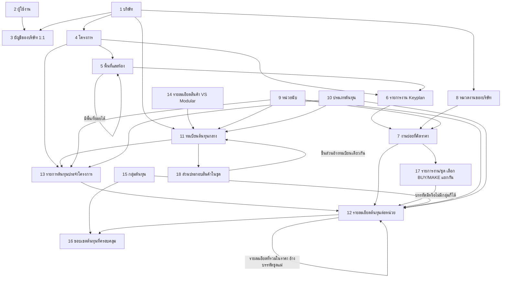
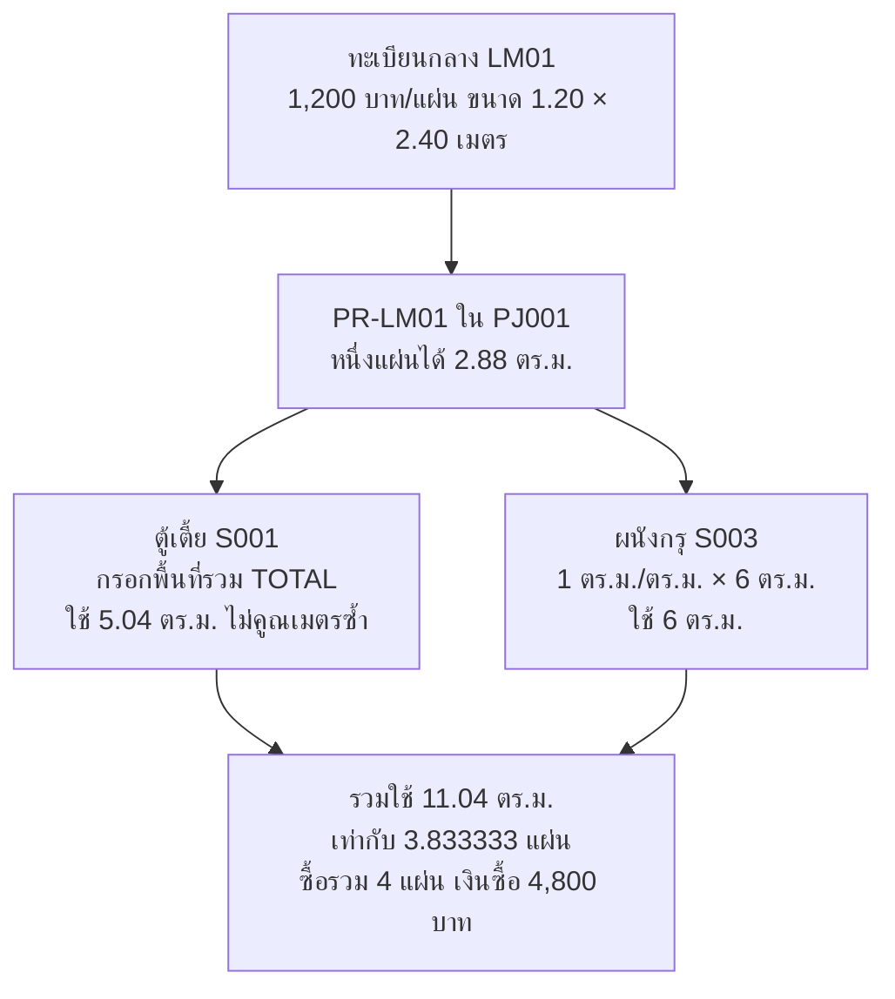
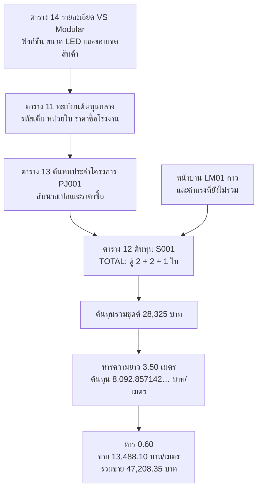

# เอกสารมาสเตอร์ Smart BOQ V3

> **รหัสต้นแบบล่าสุด:** สร้าง RT001, RT002 อัตโนมัติร่วมกันทั้งสร้างใหม่และบันทึกจากโครงการ คงรหัสเดิมและใช้รหัสเดียวเมื่อสร้างรุ่นถัดไป ไม่เพิ่มตารางหรือเปลี่ยนสูตร ดู [คู่มือ](LOCAL-APP-22-GUIDE.md)

> **เพิ่มการใช้งานล่าสุด:** บันทึกรายการทำราคาในโครงการเป็นต้นแบบร่างได้ พร้อมสำเนาต้นทุนและ snapshot เดิม ต้องตรวจอัตราต่อหน่วยก่อนพร้อมใช้ คงข้อมูลต้นทางและ 22 ตาราง ดู [คู่มือ](LOCAL-APP-22-GUIDE.md)

> **สถานะล่าสุด: ทดลอง SQLite 22 ตารางแล้ว** มีคลังรายการทำราคาต่อหน่วย เลือกใช้ใน Keyplan พร้อมสำเนาราคาและรุ่นเดิมของโครงการ ดู [คู่มือ 22 ตาราง](LOCAL-APP-22-GUIDE.md) ไม่เปลี่ยนเครื่องคำนวณและไม่เชื่อมออนไลน์ ข้อความเอกสารก่อนพัฒนาด้านล่างเป็นประวัติ

> **แบบเอกสารล่าสุดเพื่อทบทวน: 22 ตารางธุรกิจ** เพิ่มคลังรายการทำราคาต่อหน่วยส่วนกลาง 4 ตาราง เลือกใช้ใน Keyplan แล้วสำเนาลงโครงการ คงสูตรและ snapshot ดู [Relation 22 ตาราง](RELATION-22-RATE-TEMPLATES.md) รอบนี้แก้เฉพาะเอกสาร โค้ดและ SQLite ยัง 18 ตาราง ไม่เชื่อมออนไลน์ ข้อความเดิมที่ยังไม่รวมคลังต้นแบบเป็นขอบเขตก่อนคำยืนยันรอบนี้

> **คำยืนยันล่าสุดเรื่อง Keyplan:** ผู้ใช้กำหนดรหัสตามแบบผู้ออกแบบเอง เลือกห้องจากห้องของโครงการ กรอกชื่อ Keyplan และรายละเอียดสำหรับใบเสนอราคาภายหลัง (ไม่บังคับ) ยกเลิกการสร้าง B01 อัตโนมัติ ข้อมูลเดิมคงเดิม รหัส S001 ของรายการทำราคายังสร้างอัตโนมัติ สูตรเดิมและ local 18 ตารางไม่เปลี่ยน ยังไม่ได้สร้างระบบใบเสนอราคา

> **การกรอกห้องในเครื่อง:** เลือกห้องสำเร็จรูปหรือพิมพ์ชื่อเอง เลือกชั้น/โซนได้ สร้างรหัสอัตโนมัติและเติมเลขชื่อซ้ำเฉพาะชั้นเดียวกัน โดยคงห้องเดิมและสูตรเดิม ใช้ areas เดิม รวม 18 ตาราง ดูท้าย [คู่มือในเครื่อง](LOCAL-APP-18-GUIDE.md)

> **สถานะล่าสุด: มีแอปและฐาน SQLite ในเครื่อง 18 ตารางแล้ว** ตามคำยืนยันให้ทดลองกรอกข้อมูลครบ โดยไม่เชื่อมออนไลน์ ดู [LOCAL-APP-18-GUIDE.md](LOCAL-APP-18-GUIDE.md) ฐานออนไลน์/สิทธิ์จริงไม่ได้เปลี่ยน สถานะก่อนหน้านี้ที่บอกว่ายังเป็นข้อมูลในเบราว์เซอร์เป็นประวัติ

> **สถานะล่าสุด: ทดลองรายการงาน/ชุดในเครื่องแล้ว** เลือกซื้อสำเร็จรูปหรือผลิตเองแยกแต่ละชุด เก็บวัสดุแยกกลุ่มและไม่คิดของที่รวมในชุดซ้ำ ดู [วิธีทดลองและข้อจำกัด](LOCAL-WORK-SETS-TRIAL.md) แบบเป้าหมายยัง 18 ตารางธุรกิจ ฐานจริงไม่ได้แก้ไขและยังไม่ได้เผยแพร่รุ่นนี้

> **แบบเสนอ relation ล่าสุด: 18 ตารางธุรกิจ — รายการงาน/ชุด** เลือกซื้อสำเร็จรูปหรือผลิตเองแยกแต่ละชุด รองรับของที่รวมในราคาโดยไม่คิดซ้ำ ดู [RELATION-18-WORK-SETS.md](RELATION-18-WORK-SETS.md) แบบนี้แทนข้อจำกัดแผงอย่างเดียวและสวิตช์วิธีผลิตทั้ง S001 ฐานจริงยัง 16 ตารางธุรกิจ โค้ดในเครื่องปรับเป็นรายการงาน/ชุดแล้ว ดูสถานะทดลองล่าสุดด้านบน

> **สถานะโค้ดทดลองก่อนแบบชุด 18 ตาราง:** ตารางกลุ่มแผงเปิดวัสดุด้านล่างและเก็บบรรทัดแยกกลุ่มในเบราว์เซอร์แล้ว รวมวัสดุเฉพาะตอนสรุปซื้อ ดู [วิธีทดลองและผลตรวจ](LOCAL-PANEL-RELATION-TRIAL.md) ฐานออนไลน์ยัง 16 ตารางธุรกิจ ไม่ได้ติดตั้ง relation 17 ตาราง ข้อความที่บอกว่ายังไม่ปรับโค้ดด้านล่างเป็นสถานะก่อนรอบนี้

> **ประวัติแบบ relation แผง 17 ตารางธุรกิจ** เพิ่ม component_groups และเก็บวัสดุแยกตามกลุ่มก่อนรวมสรุปซื้อ ดู [แบบ relation 17 ตาราง](RELATION-17-TABLES.md) ฐานที่สร้างจริงยัง 16 ตารางธุรกิจ รอบนี้เปลี่ยนเอกสารเท่านั้น ข้อความ 16 ตาราง/ยอดตัวอย่าง CUSTOM เดิมด้านล่างเป็นประวัติก่อนปรับแบบ เว้นส่วนที่ระบุสถานะฐานที่สร้างจริง

โครงสร้างฐานข้อมูล 16 ตาราง รวม VS Modular กลุ่มต้นทุน และขอบเขตตรวจซ้ำ สูตรต้นทุนต่อหน่วย กำไร 40 เปอร์เซ็นต์ของราคาขาย และสรุปวัสดุสำหรับซื้อ

ฉบับ 1.9 — ฉบับรวมเพื่อออกแบบระบบใหม่ วันที่ 23 ตุลาคม 2569

สถานะล่าสุด: เจ้าของอนุมัติให้อัปเดตเว็บทดลองตามแบบ B01 แล้ว ดู [B01-WEB-TRIAL.md](B01-WEB-TRIAL.md) เว็บแยกสี่รายการและต้นทุนแล้ว แต่ยังไม่บันทึกโครงการ/Import ลงคลังหรือทำ migration ของแบบใหม่ ข้อความรอบแก้เอกสารในหัวข้อ 0.2/บันทึกท้ายเอกสารเป็นประวัติก่อนอัปเดตเว็บ

เอกสารนี้รวม Master 1.3 กับคำยืนยันล่าสุดของเจ้าของสำหรับระบบใหม่ ใช้เป็นแหล่งอ้างอิงของโครงการ smart-boq-new ปัจจุบันสร้างฐานข้อมูลและแกนคำนวณใน InsForge ระบบทดลองแยกแล้ว ดู [รายงานเฟส 2](PHASE-2-REPORT.md) ยังไม่มีแอปพร้อมใช้งานจริง ตัวเลขตัวอย่างเป็นข้อมูลสมมติ ไม่ใช่ราคาตลาด

ฉบับ 1.2 เพิ่มกลุ่มต้นทุนและขอบเขตตรวจซ้ำตามผลทบทวน รวม 16 ตาราง ข้อมูล VS Modular จริงยังรอรับจากคุณต๋อง ใช้ตัวเลขสมมติเพื่อตรวจสูตรเท่านั้น ตัวอย่าง CUSTOM หัวข้อ 6 กับ VS Modular หัวข้อ 12 เป็นทางเลือกแยกกัน รายการข้อมูลที่ต้องเตรียมอยู่หัวข้อ 15

## 0 กติกาที่รวมจากคำยืนยันล่าสุด

- สร้างแอปใหม่และโครงการฐานข้อมูลใหม่แยกจากเดิม ไม่ย้าย schema/function/migration หรือข้อมูลทดลองทั้งชุด
- ใช้ Vercel สำหรับหน้าบ้าน และ InsForge สำหรับหลังบ้าน ไม่ใช้ Custom Compute ในแผนเริ่มต้น
- หนึ่งบัญชีต่อหนึ่งบริษัท ไม่มีทีม/สลับบริษัท/การอนุมัติหลายระดับ ไม่เพิ่มระบบผูกเครื่อง
- รุ่นแรกทำประมาณราคาและสรุปงบซื้อ ไม่เพิ่มใบเสนอราคาลูกค้า ภาษี ส่วนลด สต็อก หรือ PO
- แยกฐานพัฒนา/ทดสอบกับฐานใช้งานจริง ตัวอย่าง SAMPLE ห้ามปะปนในฐานใช้งาน
- ไม่กำหนดกฎวัดงาน เผื่อเศษ ขนส่ง หรือฐานราคาซื้อที่ยังไม่ครบแทนเจ้าของ ต้องอธิบายและถามก่อนทำส่วนที่ขึ้นกับคำตอบ
- D01 ยืนยันให้ผู้ใช้กรอกความยาวขายเองเป็นเมตรตามแบบจริง ระบบไม่รวมแผงข้าง/ชิ้นปิดช่อง หรือหักช่องเว้นให้อัตโนมัติ ใช้ค่าที่กรอกเป็น quantity ของงานที่ขายเป็นเมตร
- D02 ยืนยันให้ผู้ใช้กรอกพื้นที่ปิดผิวหน้าบานรวมเองเป็นตารางเมตรตามแบบจริง ผู้ใช้รวมด้านที่ปิดผิวและพิจารณาขอบ/ช่องเปิดเอง ระบบไม่ถอดพื้นที่จากขนาดตู้ ไม่คูณสองด้านหรือหักช่องให้อัตโนมัติ
- พื้นที่หน้าบานเป็นปริมาณใช้รวมของต้นทุนปิดผิว (TOTAL) แยกจากความยาวขาย ไม่คูณความยาวขายซ้ำ กาวใช้ฐานพื้นที่ที่กรอกตามอัตราครอบคลุมที่ตรวจแล้ว ตัวอย่าง 1.44 ตร.ม./เมตรในหัวข้อ 6/12 คงไว้เป็นตัวอย่างตรวจสูตร ไม่ใช่อัตราบังคับงานจริง และไม่เติมเผื่อเศษเอง
- ส่งออกทั้ง Excel (.xlsx) และ PDF ใช้ผลคำนวณและชุดข้อมูลเดียวกันตาม REQ09 ไม่เพิ่มใบเสนอราคาลูกค้า
- รุ่นแรกต้อง export Excel ของคลังวัสดุ ค่าแรง และ VS Modular เพื่อแก้ไขและ import กลับได้โดยไม่ซ้ำ เตรียมฐานข้อมูลรองรับตั้งแต่เฟส 2 ตามหัวข้อ 0.1 และ [แบบนำเข้า–ส่งออกคลัง](CATALOG-EXCEL.md) ยังไม่รวมการนำเข้าโครงการ/Keyplan/งานย่อย/ต้นทุนโครงการ
- เจ้าของอนุมัติเฟส 2 แล้ว: สร้าง InsForge ระบบทดลองใหม่ ฐานข้อมูลและแกนคำนวณ รวมรองรับ Excel ตามฉบับล่าสุด แยกจากเดิม ห้ามย้ายข้อมูล เปลี่ยนระบบเดิม หรือลบข้อมูล และยังไม่เปิดระบบใช้งานจริง
- เจ้าของขอลิงก์ทดสอบแล้ว: เผยแพร่เว็บทดลองตรวจสูตรและรูปแบบ Excel บน Vercel ใหม่ได้ตาม [TRIAL-LINK.md](TRIAL-LINK.md) ยังไม่เปิดบันทึกโครงการ/Import เข้าคลังหรือถือว่าหน้าบ้านเต็มเสร็จ ส่วนสิทธิ์ที่ค้างยังต้องตรวจด้วยบัญชีจริง

ที่มา: Master 1.3 ต้นฉบับ SHA256 `9083e48ffb469120c339a2e04740299df07959dc46778952c20ab3d57d88efd1` และคำยืนยันเจ้าของในแชต ดู [สถานะและประเด็นที่ต้องตอบ](DESIGN.md#ประเด็นที่ยังไม่กำหนดแทนเจ้าของ)

### 0.1 Excel สำหรับแก้คลังและนำกลับเข้าระบบ — ยืนยันขอบเขตแล้ว

- ไฟล์ .xlsx มีรหัสรายการภายในและรุ่นข้อมูลติดไปด้วย ใช้จับคู่รายการเดิมภายในบริษัทของบัญชีที่เข้าสู่ระบบ ไม่ใช้ชื่อรายการจับคู่และไม่เชื่อถือ company_id จากไฟล์
- แถวเดิมจับคู่ด้วย resource_id และตรวจ version; แถวเพิ่มใหม่เว้น resource_id/version ใช้ resource_code ที่ไม่ซ้ำภายในบริษัท ถ้ารหัสมีอยู่แล้วต้องแสดงว่าเป็นรายการเดิมให้ตรวจ ไม่สร้างซ้ำหรือทับเงียบ ๆ
- รหัสรายการที่ export แล้วไม่แก้ resource_id หรือ resource_code เพื่อเปลี่ยนตัวตน/สเปกสินค้า หากต้องการต่างรุ่น สี ขนาดบรรจุหรือความหมาย ใช้รายการรหัสใหม่ตามกติกาทะเบียนเดิม
- ตรวจไฟล์และแสดงรายการเพิ่ม/แก้/ไม่เปลี่ยน/ผิด/ขัดแย้งก่อนยืนยันบันทึก ไม่บันทึกบางแถวเงียบ ๆ ถ้าเกิดข้อผิดพลาดระหว่างยืนยันให้ย้อนกลับทั้งชุด
- นำไฟล์เดิมเข้าซ้ำต้องไม่สร้างซ้ำ แถวที่ข้อมูลตรงปัจจุบันถือว่าไม่เปลี่ยน แม้ version ในไฟล์เก่า; ถ้าค่าไม่ตรงและ version เก่าต้องหยุดให้ตรวจ ไม่ทับงานใหม่
- แถวที่หายจากไฟล์ไม่ใช่คำสั่งลบ ไม่มีคำสั่งลบถาวรใน Excel ใช้ is_active เพื่อหยุดใช้รายการได้
- VS Modular ใช้ resource_id เดียวกับ cost_resources ราคาอยู่ใน cost_resources แห่งเดียว การเพิ่ม/แก้ข้อมูลทั้งคู่ต้องสำเร็จหรือย้อนกลับพร้อมกัน
- เพิ่ม version BIGINT NOT NULL DEFAULT 1 CHECK > 0 ใน cost_resources และ created_at/updated_at ที่ระบบกำหนด การเปลี่ยนรายละเอียด modular_products ต้องเพิ่ม version ของ cost_resources แม่ด้วย ช่องเหล่านี้ผู้ใช้แก้ผ่าน Excel ไม่ได้
- ทุกช่องทางแก้คลังต้องตรวจ version และใช้ข้อจำกัด UNIQUE ของฐานข้อมูลร่วมกัน รองรับกรณีเพิ่มรายการเดียวกันพร้อมกัน ไม่พึ่งการตรวจหน้าเว็บอย่างเดียว
- นำเข้าราคาไม่เท่ากับยืนยันว่าราคา/ขอบเขตตรวจแล้ว และไม่แก้ snapshot ของโครงการเดิมโดยอัตโนมัติ ไม่รับยอดต้นทุน/ราคาขายที่แก้ในไฟล์มาแทนเครื่องคำนวณ
- คง 16 ตารางธุรกิจ ไม่เพิ่มตารางราคา Excel ซ้ำอีกชุด ทดสอบวงจร export → แก้ → preview → ยืนยัน → export ตรวจกลับ ในระบบทดลองก่อนใช้ข้อมูลจริง

## 0.2 โครงสร้าง B01 ฉบับ 1.7 ที่เจ้าของยืนยันล่าสุด

B01 เคาน์เตอร์ครัว 1 ชุด เป็นหัวข้อรวม S001 ตู้เตี้ย 3.50 เมตร, S002 ท็อปหิน 2.10 ตร.ม., S003 ผนังกรุลามิเนต 6 ตร.ม., S004 ซิงก์พร้อมอุปกรณ์ 1 ชุด แต่ละแถวมีตารางต้นทุนของตัวเอง หน่วยขาย/ปริมาณมาก่อนการเลือกวัสดุ วิธีผลิตเลือกเฉพาะตู้ภายในตารางต้นทุน พื้นที่หน้าบานอยู่ในรายละเอียดต้นทุนตู้

“1 ชุด” เป็นคำอธิบายชุดงาน B01 ในตัวอย่าง ไม่สร้างตัวคูณปริมาณลูกอัตโนมัติ ไม่เพิ่มตารางแยกต่อชิ้น ไม่เพิ่มคลังสูตรใช้ซ้ำทั้งบริษัทโดยยังไม่ได้ตกลง ดู [โครงสร้างและยอดคำนวณฉบับใหม่](B01-STRUCTURE.md) ข้อความนี้เป็นสถานะตอนทบทวนเอกสารฉบับ 1.7; ต่อมาปรับโค้ดในเครื่องตามหัวข้อ 0.3 แล้ว ฐานออนไลน์ยังไม่ได้ขยายตามแบบใหม่

## 0.3 กติกาปัจจุบันของต้นแบบกลุ่มงาน/ชุด — คำยืนยันเพิ่มเติม 23 ตุลาคม 2569

ใช้หัวข้อนี้ร่วมกับ [RELATION-18-WORK-SETS.md](RELATION-18-WORK-SETS.md) เป็นกติกาล่าสุดในส่วนที่ขยายจากฉบับก่อน รายงานภาพรวมและช่องว่างก่อนใช้จริงอยู่ใน [สรุปงานและผลทบทวนมาสเตอร์](WORK-SUMMARY-AND-MASTER-REVIEW.md)

- B01 แยก S001–S004 ตามหัวข้อ 0.2; S001 ขายเป็นเมตร มีปริมาณขายและ margin ที่งานย่อย ไม่สร้าง margin ซ้ำในกลุ่ม
- ใต้ S001 เป็นกลุ่มงาน/ชุด เช่น BODY, DOOR, DRAWER เลือก BUY/MAKE แยกกัน แทนสวิตช์ CUSTOM/VS_MODULAR ที่ควบคุมทั้ง S001 ในตัวอย่างรุ่นเก่า
- สำหรับกลุ่มที่คำนวณแผง พื้นที่แผงคือพื้นที่ด้านเดียว ผู้ใช้เลือกด้านบุไม้อัดและด้านปิดผิว: ไม้อัด = พื้นที่แผง × ด้านบุ; ลามิเนต = พื้นที่แผง × ด้านที่ปิดผิว ไม่เกินด้านบุ ไม่มีการเดามิติตู้/ช่องเว้น สูตรนี้ขยาย D02 แบบกรอกพื้นที่ปิดผิวรวมเดิม ไม่คูณด้านที่ผู้ใช้รวมมาแล้วซ้ำ
- อัตราไม้โครง กาว เผื่อเศษ และปริมาณวัสดุ/แรงที่ต้องใช้ให้ผู้ใช้ระบุและตรวจตามงานจริง ไม่สร้างค่าเผื่อหรืออัตราบังคับแทนเจ้าของ
- วัสดุ ค่าแรงผลิต/ประกอบ และค่าแรงติดตั้งอยู่ในกลุ่มงานของตน เก็บ snapshot และตัวตนบรรทัดแยกกัน ต้นทุนร่วมใช้เฉพาะรายการที่ไม่ผูกกลุ่มจริง ไม่แบ่งค่าแรงรวมเดิมโดยเดาสัดส่วน
- รายการเพิ่มนอกชุดต้องระบุเหตุผลและตำแหน่งที่ใช้ก่อนยืนยันจำนวนเพิ่ม โดยคงข้อความ/จำนวนไว้เมื่อแก้แล้วต้องยืนยันใหม่ ต้นแบบในเครื่องทำขั้นนี้แล้วตาม [LOCAL-EXTRA-SCOPE-TRIAL.md](LOCAL-EXTRA-SCOPE-TRIAL.md) แต่ยังไม่แทนการตรวจตำแหน่งและผู้ยืนยันจาก session บน server
- สินค้าชุดที่รวมวัสดุหรือแรงแล้วคิดราคาที่แม่ครั้งเดียว รายละเอียดที่รวมเป็นอ้างอิงไม่คิดซ้ำ ของที่ชุดไม่รวมต้องพิจารณาเพิ่มจริงหรือยืนยันไม่ต้องใช้ ของที่ไม่ทราบใช้ null/PENDING ไม่แทนด้วยศูนย์
- แยกคอลัมน์วัสดุ/สินค้าชุด แรงผลิตคิดเพิ่ม แรงติดตั้งคิดเพิ่ม ต้นทุนรวม และต้นทุนต่อหน่วยขาย เมื่อผู้ขายไม่แยกราคาแรงภายในชุด คงราคาเต็มในสินค้าชุด ไม่เดาต้นทุนแรงจากราคาเหมารวม
- ต้นทุนกลุ่มต่อเมตร = ต้นทุนกลุ่มก่อนปัด ÷ ปริมาณขาย S001; รวมเป็นต้นทุน S001 ครั้งเดียวแล้วใช้สูตร margin/การปัดเดิมในหัวข้อ 5 ไม่คูณเมตรขายกับพื้นที่แผงซ้ำ
- เก็บบรรทัดแยกกลุ่มและทางเลือกวิธีที่ไม่ได้ใช้งานไว้ แต่คิดเฉพาะวิธีที่เปิดใช้ สรุปซื้อรวมวัสดุ CHARGEABLE ตามทรัพยากรโครงการก่อนปัดขั้นซื้อ ไม่รวม LABOR หรือของที่รวมในชุดเป็นวัสดุซื้อ
- แบบเป้าหมาย 18 ตารางธุรกิจ = 16 เดิม + component_groups + resource_bundle_items ค่าแรงใช้ตารางเดิม ไม่เพิ่มทะเบียนราคาซ้ำ และยังไม่รองรับชุดซ้อนชุด/กลุ่มซ้อนกลุ่ม
- สถานะปัจจุบันเป็นโค้ด SAMPLE ในเครื่อง ยังไม่ติดตั้ง relation ใหม่หรือรับรองการล็อก/สิทธิ์จริง ผล local tests ไม่ทดแทน FK/RLS/transaction/coverage และการรับรองบน server

ข้อความวิธีผลิตทั้ง S001 พื้นที่ D02 เดิม และตัวเลขรวมสามงานย่อยในหัวข้อเก่าเป็นประวัติของตัวอย่างนั้น ไม่ใช้ทับกติกาใหม่ข้างต้น ข้อกำหนดหน่วย สิทธิ์ snapshot การรับรอง และรายงานที่ไม่ถูกแทนยังมีผลครบ ไม่ถือว่าข้อที่ยังพัฒนาไม่ครบได้รับการยกเว้น

## 0.4 แอปและฐานข้อมูลในเครื่อง — อนุมัติให้พัฒนาเพื่อทดลองแล้ว

เจ้าของยืนยันให้ทำทั้งหน้ากรอกโครงการ/พื้นที่/Keyplan/รายการทำราคา/กลุ่ม/คลัง และฐานข้อมูลในเครื่องครบ 18 ตาราง ใช้ SQLite เฉพาะ smart-boq-new คงสมการต้นทุน margin และการปัดเดิม ไม่เชื่อมฐานออนไลน์ แทนการเก็บเฉพาะร่างเบราว์เซอร์ในเส้นทางหน้าแรก แต่เก็บต้นแบบเดิม /trial.html ไว้เทียบโดยปิด RPC ออนไลน์แล้ว

มี PK/FK/UNIQUE และการตรวจความเป็นเจ้าของโครงการใน local API เก็บทศนิยมและ snapshot เป็นข้อความต่อแถว ใช้ Decimal คำนวณ ตัวตนบริษัท/ผู้จัดทำท้องถิ่นไม่ได้แทน session หรือสิทธิ์บนฐานจริง ไม่ถือว่าติดตั้ง PostgreSQL/RLS หรือผ่านเกณฑ์ LOCKED แล้ว ดูคู่มือและข้อจำกัดใน LOCAL-APP-18-GUIDE.md ผลทดสอบล่าสุด 108 กรณีผ่าน

## 1 ข้อตกลงหลัก

- หนึ่งบัญชีต่อหนึ่งบริษัท และหนึ่งบริษัทต่อหนึ่งบัญชี ไม่มีสลับบริษัท ทีมภายใน การเชิญสมาชิก หรือสิทธิ์หลายระดับตามคำยืนยันเจ้าของ
- โครงการเก็บข้อมูลเจ้าของโครงการหรือผู้ว่าจ้าง แยกจากบริษัทผู้เสนอราคา
- พื้นที่มีลำดับย่อยได้ เช่น อาคาร → ชั้น → ห้อง
- Keyplan ไม่ซ้ำทั้งโครงการ และผูกกับพื้นที่ติดตั้งหนึ่งแห่ง
- งานย่อยหนึ่งรายการมีหนึ่งหมวดงาน หนึ่งหน่วยขาย หนึ่งปริมาณจริง และหนึ่งเปอร์เซ็นต์กำไรเป้าหมาย
- วัสดุ ค่าแรง และอุปกรณ์อยู่ในทะเบียนต้นทุนเดียวกัน แยกด้วยประเภทต้นทุน
- วัสดุกลางหนึ่งตัวเลือกเข้าโครงการครั้งเดียว แล้วหลายงานย่อยอ้างอิงร่วมกันได้
- หน่วยซื้อไม่จำเป็นต้องตรงกับหน่วยใช้คำนวณหรือหน่วยขาย ต้องมีสูตรแปลงที่ตรวจสอบได้
- ใช้กำไรเป้าหมาย 40% ของราคาขายในตัวอย่าง ผู้ใช้ปรับเปอร์เซ็นต์แต่ละงานย่อยได้
- ราคาขายในตัวอย่างอิงต้นทุนตามปริมาณใช้ แสดงงบซื้อเต็มหน่วยแยกต่างหาก ไม่กระจายค่าวัสดุเหลือเข้าทุกงานโดยอัตโนมัติ
- ไม่เผื่อเศษ ไม่มีสต็อกตั้งต้น ไม่รวม VAT ส่วนลด ค่าใช้จ่ายอื่นที่ยังไม่ระบุ และยังไม่วิเคราะห์การจัดตัดวัสดุ
- ตัวเลขตู้เตี้ยและซิงค์คงตามตัวอย่างเดิม ส่วนผนังกรุใช้สูตรไม้ ลามิเนต ไม้อัด กาว และค่าแรงล่าสุด

## 2 ภาพรวมความสัมพันธ์ — แบบเป้าหมาย 18 ตาราง

ทะเบียนกลาง → รายการต้นทุนประจำโครงการ → บรรทัดต้นทุนงานย่อย เป็นความสัมพันธ์หนึ่งต่อหลายในแต่ละช่วง ไม่สร้าง LM01 ซ้ำเมื่อใช้ร่วมกันหลายงาน

## 3 แบบ 18 ตาราง — มี SQLite ในเครื่องแล้ว ยังไม่ติดตั้งการเปลี่ยนแปลงออนไลน์

PK หมายถึงรหัสภายในที่ไม่ซ้ำในตาราง FK หมายถึงรหัสเชื่อมไปยังตารางอื่น ทุกตารางมี created_at และตารางที่แก้ไขได้มี updated_at ระบบสร้างเวลาให้เอง ช่องชื่อที่บังคับต้องไม่ว่างหลังตัดช่องว่าง รหัสธุรกิจตัดช่องว่างและใช้รูปแบบตัวอักษรเดียวกันก่อนตรวจซ้ำ

### 1 บริษัท companies

| ช่องข้อมูล | ข้อกำหนด | ความหมาย |
| --- | --- | --- |
| company_id | PK | รหัสบริษัท |
| company_name | บังคับ | ชื่อบริษัทผู้เสนอราคา |
| address, phone | บังคับ | ที่อยู่และเบอร์ติดต่อ |
| email, tax_id, logo_file_ref | เลือกกรอก | อีเมล เลขผู้เสียภาษี และไฟล์โลโก้ |
| is_active | บังคับ | สถานะบริษัท |

บริษัทเป็นเจ้าของโครงการ หมวดงาน และทะเบียนต้นทุน โลโก้เก็บเป็นที่อ้างอิงไฟล์ ไม่เก็บไฟล์รูปขนาดใหญ่ในแถวข้อมูล

### 2 ผู้ใช้งาน members

| ช่องข้อมูล | ข้อกำหนด | ความหมาย |
| --- | --- | --- |
| member_id | PK | รหัสผู้ใช้ |
| auth_subject | บังคับและไม่ซ้ำ | รหัสจากระบบเข้าสู่ระบบ ไม่ใช่รหัสผ่าน |
| display_name, email | บังคับ | ชื่อที่ใช้แสดงเป็นผู้จัดทำและอีเมล |
| phone | เลือกกรอก | เบอร์ติดต่อ |
| is_active | บังคับ | สถานะผู้ใช้ |

ข้อมูลผู้ใช้ไม่ใช่ข้อมูลบริษัท ห้ามเก็บรหัสผ่านแบบข้อความ

### 3 การผูกบัญชีกับบริษัท company_memberships

| ช่องข้อมูล | ข้อกำหนด | ความหมาย |
| --- | --- | --- |
| membership_id | PK | รหัสความเป็นสมาชิก |
| company_id, member_id | FK บังคับ | บริษัทและผู้ใช้ |
| role | ค่าระบบคงที่ OWNER | ไม่มีหน้าเลือกบทบาทหรือทีม บัญชีบริษัทเดียวทำงานของบริษัทตนเมื่อผ่านกฎข้อมูล |
| is_active | บังคับ | สถานะสิทธิ์ในบริษัทนี้ |

UNIQUE(company_id) และ UNIQUE(member_id) บังคับความสัมพันธ์ 1:1 ในระบบใหม่ ตารางนี้เป็นตัวเชื่อมภายในสำหรับผู้จัดทำและการแยกข้อมูล ไม่ใช่ระบบทีม บัญชีที่ปิดใช้งานยังคงเป็นผู้จัดทำของข้อมูลเดิมได้ แต่เข้าแก้ข้อมูลไม่ได้

### 4 โครงการ projects

| ช่องข้อมูล | ข้อกำหนด | ความหมาย |
| --- | --- | --- |
| project_id | PK | รหัสภายใน |
| company_id | FK บังคับ | บริษัทผู้เสนอราคา |
| project_code, project_name | บังคับ | รหัสและชื่อโครงการ |
| owner_name | บังคับ | ชื่อเจ้าของโครงการหรือผู้ว่าจ้าง |
| contact_name, contact_phone | เลือกกรอก | ผู้ติดต่อของโครงการ |
| location_text, map_url | เลือกกรอก | ที่ตั้งและลิงก์แผนที่ |
| pricing_conditions, description | เลือกกรอก | เงื่อนไขที่กระทบราคาและข้อมูลทั่วไป |
| start_date | เลือกกรอก | วันที่เริ่มโครงการ |
| prepared_by_membership_id | FK บังคับ | ผู้จัดทำหลักซึ่งอยู่บริษัทเดียวกัน |
| pricing_status, locked_at | บังคับ / ตามสถานะ | DRAFT หรือ LOCKED และเวลาล็อก |
| version, is_archived | บังคับ | ควบคุมการแก้พร้อมกันและซ่อนโครงการเก่า |

UNIQUE(company_id, project_code) เงื่อนไขแบบข้อความไม่เพิ่มราคาเอง ต้องแปลงผลกระทบเป็นต้นทุนที่มีจำนวนเงินชัดเจน

### 5 พื้นที่และห้อง areas

| ช่องข้อมูล | ข้อกำหนด | ความหมาย |
| --- | --- | --- |
| area_id | PK | รหัสพื้นที่ |
| project_id | FK บังคับ | โครงการ |
| parent_area_id | FK เลือกกรอก | พื้นที่แม่ในโครงการเดียวกัน |
| area_code, area_name | บังคับ | รหัสและชื่อพื้นที่ |
| area_type | บังคับ | BUILDING / FLOOR / ROOM / ZONE |
| pricing_note | เลือกกรอก | ข้อจำกัดของพื้นที่ที่มีผลต่อราคา |
| sort_order | บังคับ | ลำดับแสดงผล |

UNIQUE(project_id, area_code) ห้ามชี้ parent กลับมาที่ตัวเองหรือสร้างวงวน และห้ามพื้นที่แม่อยู่ต่างโครงการ

### 6 รายการงาน Keyplan work_items

| ช่องข้อมูล | ข้อกำหนด | ความหมาย |
| --- | --- | --- |
| work_item_id | PK | รหัสภายใน |
| project_id, area_id | FK บังคับ | โครงการและพื้นที่ติดตั้ง |
| keyplan_code, work_name | บังคับ | รหัสตามแบบและชื่อรายการงาน |
| description | เลือกกรอก | รายละเอียดรวม |
| sort_order | บังคับ | ลำดับแสดงผล |

UNIQUE(project_id, keyplan_code) area_id ต้องอยู่ใน project_id เดียวกัน แม้อยู่คนละห้องก็ใช้ B01 ซ้ำในโครงการเดียวกันไม่ได้

### 7 งานย่อยที่คิดราคา work_components

| ช่องข้อมูล | ข้อกำหนด | ความหมาย |
| --- | --- | --- |
| component_id | PK | รหัสงานย่อย |
| work_item_id, category_id | FK บังคับ | Keyplan และหมวดงานในบริษัทเดียวกัน |
| component_code | บังคับในแบบฉบับ 1.7 | รหัสรายการภายใน Keyplan เช่น S001–S004; UNIQUE(work_item_id, component_code) หลัง normalize; FK ยังอ้าง component_id ไม่อ้างรหัสข้อความ |
| component_name | บังคับ | ชื่องานย่อย |
| specification, note | เลือกกรอก | สเปก ขอบเขตและหมายเหตุ |
| quantity, selling_unit_id | จำนวนและ FK บังคับ | ปริมาณจริงและหน่วยขาย |
| facade_area_m2 | เลือกกรอก NUMERIC(20,6) >= 0 | พื้นที่ปิดผิวหน้าบานรวมที่ผู้ใช้กรอกเองตาม D02 แยกจาก quantity ไม่เปลี่ยนตามความยาวขายอัตโนมัติ; งานที่ไม่มีหน้าบานใช้ NULL |
| target_margin_percent | บังคับ | กำไรเป้าหมายของราคาขาย ตั้งแต่ 0 แต่ต่ำกว่า 100 |
| construction_method | ช่องของแบบเดิมที่ต้องทบทวนตอนย้าย | ไม่ใช้เป็นตัวควบคุมทั้ง S001 ในแบบล่าสุด; sourcing_method BUY/MAKE อยู่ใน component_groups แต่ละรายการงาน/ชุด |
| sort_order | บังคับ | ลำดับแสดงผล |

แบบฉบับ 1.7 กำหนดหน่วยขายและปริมาณก่อนเปิดต้นทุน งานหิน ผนัง และซิงก์ไม่ต้องเลือกวิธีผลิตตู้ component_code เป็นข้อมูลระบุตำแหน่งในรายการ ไม่ใช่ตัวเลือกชนิดงาน ห้ามตัดสินหน่วยหรือวิธีผลิตจากรหัส S001/ชื่อภาษาไทยอย่างเดียว การกำหนด DEFAULT CUSTOM ให้ทุกงานเดิมต้องเลิกใช้เมื่อพัฒนารุ่นถัดไป ยังไม่รัน migration ในรอบนี้

ตัวอย่างกำไร 40 ใช้สูตรหาร 0.60 ไม่ใช้ต้นทุนคูณ 1.40 ไม่บังคับชื่อหรือหน่วยขายไม่ซ้ำใน Keyplan

### 8 หมวดงาน work_categories

| ช่องข้อมูล | ข้อกำหนด | ความหมาย |
| --- | --- | --- |
| category_id | PK | รหัสหมวด |
| company_id | FK บังคับ | บริษัทเจ้าของหมวด |
| category_code, category_name | บังคับ | รหัสและชื่อ เช่น พื้น ผนัง ฝ้า เฟอร์นิเจอร์ ประปา |
| sort_order, is_active | บังคับ | ลำดับและสถานะ |

UNIQUE(company_id, category_code) บริษัทเพิ่มหมวดได้ ไม่ต้องเพิ่มคอลัมน์ในตารางงาน

### 9 หน่วยนับ units

| ช่องข้อมูล | ข้อกำหนด | ความหมาย |
| --- | --- | --- |
| unit_id | PK | รหัสหน่วย |
| unit_code, unit_name, symbol | บังคับ | รหัส ชื่อ และสัญลักษณ์ |
| dimension | บังคับ | LENGTH / AREA / VOLUME / COUNT |
| allowed_for_sale, is_active | บังคับ | ใช้เป็นหน่วยขายได้หรือไม่ และสถานะ |

unit_code ไม่ซ้ำ ข้อมูลกลางใน MVP ใช้ เมตร ตร.ม. ชุด เป็นหน่วยขาย และมี แผ่น มัด ปี๊บ ลิตร ใบ เป็นหน่วยต้นทุน หน่วยขายชุดเป็น COUNT เช่นเดียวกับบรรจุภัณฑ์ แต่ความหมายยังต่างกันตามรายการวัสดุ

### 10 ประเภทต้นทุน cost_types

| ช่องข้อมูล | ข้อกำหนด | ความหมาย |
| --- | --- | --- |
| cost_type_id | PK | รหัสประเภท |
| type_code, type_name | บังคับ | MATERIAL วัสดุ / EQUIPMENT อุปกรณ์ / LABOR ค่าแรง / OTHER อื่น ๆ |
| is_active | บังคับ | สถานะ |

type_code ไม่ซ้ำ หมวดงานกับประเภทต้นทุนเป็นคนละเรื่อง เช่น หมวดผนังมีทั้งวัสดุและค่าแรง

### 11 ทะเบียนต้นทุนกลาง cost_resources

| ช่องข้อมูล | ข้อกำหนด | ความหมาย |
| --- | --- | --- |
| resource_id | PK | รหัสภายใน |
| company_id | FK บังคับ | บริษัทเจ้าของรายการ |
| resource_code, resource_name | บังคับ | รหัส เช่น LM01 และชื่อรายการ |
| resource_kind | บังคับในแบบใหม่ | ITEM / BUNDLE / SERVICE แยกชนิดสินค้ารายชิ้น สินค้าชุด และบริการ ไม่ใช่ cost_type |
| bundle_detail_status, bundle_scope_review_status | เฉพาะ BUNDLE | PARTIAL/COMPLETE และ PENDING/CONFIRMED พร้อมแหล่งยืนยันของที่รวม/ไม่รวม สำเนาไปโครงการ |
| specification | เลือกกรอก | ยี่ห้อ รุ่น สี ขนาด |
| cost_type_id | FK บังคับ | ประเภทต้นทุน |
| purchase_unit_id, usage_unit_id | FK บังคับ | หน่วยซื้อและหน่วยที่ใช้คำนวณ |
| purchase_unit_price | บังคับก่อนใช้คิดเงิน/ซื้อแยก | ราคาซื้อต่อหนึ่งหน่วยซื้อ; ลูกที่ใช้อ้างอิงว่ารวมในชุดอย่างเดียวและยังไม่มีราคาเดี่ยว ใช้ NULL ตามแบบ 18 ไม่แทน 0 |
| conversion_method | บังคับ | DIRECT / COUNT / COUNT_LENGTH / AREA / VOLUME |
| pack_count, length_m, width_m, volume_l | ตามวิธีแปลง | จำนวนบรรจุ ความยาว ความกว้าง หรือปริมาตร |
| purchase_increment | บังคับ > 0 | ขั้นการซื้อ เช่น 1 แผ่น หรือ 0.01 ตร.ม. |
| coverage_area_per_purchase | เลือกกรอก > 0 | พื้นที่งานที่หนึ่งหน่วยซื้อทำได้ เช่น กาว 28.80 ตร.ม. |
| coverage_note | เลือกกรอก | ขอบเขตอัตราครอบคลุม เช่น รวมทาสองพื้นผิวแล้ว |
| price_updated_at, is_active | บังคับ | วันที่ยืนยันราคาและสถานะ |
| version | BIGINT บังคับ > 0 ระบบกำหนด | ตรวจไฟล์ Excel เก่าและการแก้พร้อมกัน รายละเอียดโมดูลาร์ใช้รุ่นของแม่ร่วมกัน |
| created_at, updated_at | TIMESTAMPTZ ระบบกำหนด | เวลาสร้างและแก้ ไม่ใช้แทน version |

UNIQUE(company_id, resource_code) หนึ่งรหัสแทนสเปกและขนาดบรรจุที่แน่นอน หากต่างสี รุ่น ขนาดบรรจุ หรือหน่วยที่มีความหมายต่างกัน ให้ใช้รหัสใหม่ ไม่แก้ความหมายเดิมย้อนหลัง

### 12 รายละเอียดต้นทุนต่อหน่วย component_cost_lines

| ช่องข้อมูล | ข้อกำหนด | ความหมาย |
| --- | --- | --- |
| cost_line_id | PK | รหัสบรรทัด |
| component_id | FK บังคับ | งานย่อย |
| component_group_id | FK เลือกกรอก → component_groups | NULL สำหรับต้นทุนตรง; ถ้ามีค่าต้องเป็นกลุ่มของ component เดียวกัน |
| line_role | บังคับในแบบใหม่ | หน้าที่ในรายการงาน/ชุด เช่น FRAME / PLYWOOD / LAMINATE / ADHESIVE / OTHER ไม่บังคับอย่างละหนึ่งต่อกลุ่มทั่วไป |
| quantity_source | บังคับในแบบใหม่ | MANUAL / GROUP_QUANTITY / PANEL_AREA / PLYWOOD_AREA / LAMINATE_AREA / PARENT_BUNDLE_USAGE ไม่คูณฐานซ้ำ |
| line_kind | บังคับในแบบ 18 | CHARGEABLE / INCLUDED_REFERENCE / EXCLUDED_REFERENCE; มีแต่ CHARGEABLE ที่รวมเงินและซื้อ |
| parent_bundle_cost_line_id | self-FK สำหรับ reference | ชุดแม่ CHARGEABLE ชนิด BUNDLE ใน component/group เดียวกัน ไม่ชี้ข้ามงานหรือวงวน |
| source_bundle_item_id, bundle_resource_version_snapshot | ที่มาและฉบับที่ใช้ | อ้างตาราง 18 ถ้ามี เก็บ snapshot จำนวนต่อชุด หน่วย สถานะรวม/ไม่รวม ขอบเขตและหลักฐาน ไม่อ่านคลังใหม่ย้อนหลัง |
| need_resolution, resolved_charge_line_id | เฉพาะของที่ไม่รวม | รอพิจารณา / เพิ่มแล้ว / ไม่ต้องใช้ พร้อมบรรทัดที่รับผิดชอบจริงและเหตุผล |
| project_resource_id | FK บังคับ | รายการต้นทุนประจำโครงการ ไม่อ้างทะเบียนกลางซ้ำอีกช่อง |
| description_snapshot | บังคับ | ชื่อและสเปกที่ใช้กับงานครั้งนี้ |
| cost_type_id, purchase_unit_id, usage_unit_id | ประเภท/หน่วยใช้บังคับ; หน่วยซื้อบังคับสำหรับ CHARGEABLE | reference ที่ไม่ทราบข้อมูลซื้อเดี่ยวไม่สมมติหน่วยซื้อ ต้องใช้หน่วยชิ้นส่วนที่ระบุได้จริง |
| purchase_price_snapshot | บังคับสำหรับ CHARGEABLE | ราคาซื้อที่ใช้คำนวณครั้งนี้; reference ใช้ NULL พร้อมสถานะว่ารวมแล้ว/ยังไม่รวม ไม่ใช้ราคา 0 แทน |
| yield_per_purchase_snapshot | บังคับ > 0 สำหรับ CHARGEABLE | เช่น 2.88 ตร.ม./แผ่น; reference ที่ยังไม่ทราบบรรจุใช้ NULL และคำนวณจากจำนวนต่อชุดแม่แทน |
| usage_numerator, usage_denominator | บังคับ / ตัวหาร > 0 | สูตรอัตราใช้ต่อหนึ่งหน่วยขาย เช่น 15 ÷ 28.80 ลิตร/ตร.ม. |
| waste_percent | บังคับ >= 0 | เผื่อวัสดุ ตัวอย่างใช้ 0 ไม่เพิ่มเผื่อเอง |
| quantity_basis | บังคับ | PER_UNIT = อัตราใช้ต่อหนึ่งหน่วยขาย / TOTAL = จำนวนรวมของงานย่อยนี้ |
| cost_group_id | FK บังคับ → cost_groups | กลุ่มหลักของต้นทุนบรรทัดนี้ ใช้จัดหมวด ไม่ได้ยืนยันว่าทุกรายการในกลุ่มซ้ำกัน |
| scope_review_status | บังคับ | PENDING / CONFIRMED ตรวจขอบเขตรวมและไม่รวมแล้วหรือยัง |
| pricing_data_status | บังคับ | SAMPLE / UNVERIFIED / VERIFIED แยกราคาสมมติ ราคาที่ยังไม่ตรวจ และราคาจริงที่ยืนยันแล้ว |
| note, sort_order | เลือกกรอก / บังคับ | เหตุผลปรับเฉพาะงานและลำดับ |

หลายบรรทัดอ้าง project_resource_id เดียวกันได้ รวมถึงต่างกลุ่มของงานเดียวกัน ห้ามตั้ง UNIQUE(component_id, project_resource_id) แต่ละบรรทัดมีอัตราใช้และราคาทุนของตัวเอง ไม่เก็บ subtotal ที่ผู้ใช้แก้เอง หน่วย/ประเภทที่เป็น snapshot ไม่ sync ตามทะเบียนปัจจุบัน หาก TOTAL สูตร usage_numerator / usage_denominator เป็นปริมาณรวมของงานย่อย ไม่ใช่อัตราต่อเมตร ใช้จำนวนใบจริงและห้ามคูณ quantity ซ้ำ

### 13 รายการต้นทุนประจำโครงการ project_resources

| ช่องข้อมูล | ข้อกำหนด | ความหมาย |
| --- | --- | --- |
| project_resource_id | PK | รหัสตัวเชื่อมวัสดุกับโครงการ |
| project_id, resource_id | FK บังคับ | โครงการและทะเบียนกลางของบริษัทเดียวกัน |
| name_snapshot, specification_snapshot | บังคับ / เลือกกรอก | ชื่อและสเปกที่กำหนดใช้ในโครงการ |
| cost_type_id, purchase_unit_id, usage_unit_id | FK บังคับ | ประเภทและหน่วยของโครงการ |
| purchase_unit_price | บังคับ | ราคาซื้ออ้างอิงของโครงการ |
| conversion_method, pack_count, length_m, width_m, volume_l | ตามวิธีแปลง | สำเนาวิธีแปลงและค่าที่ใช้กับโครงการ |
| purchase_increment | บังคับ > 0 | ขั้นซื้อที่ใช้สรุปจัดซื้อ |
| coverage_area_per_purchase, coverage_note | เลือกกรอก | อัตราครอบคลุมและขอบเขตที่ใช้กับโครงการ |
| note, is_active | เลือกกรอก / บังคับ | หมายเหตุและสถานะ |

UNIQUE(project_id, resource_id) เลือก LM01 เข้าโครงการครั้งเดียว ถ้าใช้แล้วห้ามเปลี่ยนความหมายหน่วยหรือขนาดบรรจุ ให้ใช้รหัสวัสดุใหม่หากสเปกเปลี่ยน ราคาปรับได้เฉพาะ DRAFT และไม่เปลี่ยนบรรทัดต้นทุนเดิมอัตโนมัติ

ในแบบ 18 ทรัพยากรที่ใช้เป็น reference เท่านั้นยอมให้ข้อมูลซื้อเดี่ยวที่ยังไม่ทราบ เช่น ราคา วันที่ราคา หน่วยซื้อ/บรรจุ/ขั้นซื้อเป็น NULL ได้ แต่ต้องมีตัวตนและหน่วยใช้ที่แน่นอน ก่อนใช้เป็น CHARGEABLE ต้องครบตามกติกาซื้อเดิม ห้ามใส่ 0 หรือสมมติบรรจุให้ผ่าน ดูรายละเอียดใน RELATION-18-WORK-SETS.md

### 14 รายละเอียดสินค้า VS Modular modular_products

ตารางเฉพาะสินค้าตู้ เชื่อมแบบหนึ่งต่อหนึ่งกับทะเบียนต้นทุนกลาง ไม่แยกทะเบียนราคาอีกชุดหนึ่ง ตารางนี้เป็นตารางที่ 14 ในโครงสร้างรวม 16 ตาราง

| ช่องข้อมูล | ข้อกำหนด | ความหมาย |
|---|---|---|
| resource_id | PK และ FK → cost_resources | สินค้าหนึ่งรหัสมีรายละเอียดโมดูลาร์ได้หนึ่งแถว |
| function_code | บังคับ | รหัสฟังก์ชัน เช่น b รอชื่อจริงจาก Index ไม่คาดเดาความหมาย |
| width_mm, height_mm, depth_mm | บังคับ > 0 | ขนาดสินค้าเป็นมิลลิเมตร |
| led_code | บังคับ | 0 ไม่มีไฟ / 1 แนวตั้ง / 2 แนวนอน ตามที่ยืนยัน |
| included_scope | บังคับก่อนใช้ราคา | รายการแผง อุปกรณ์ และ LED ที่โรงงานรวมให้จริง |
| excluded_scope | บังคับก่อนใช้ราคา | ส่วนที่ต้องเพิ่ม เช่น หน้าบาน ท็อป ขนส่ง หรือติดตั้ง |
| index_reference | เลือกกรอก | เลขหรือไฟล์อ้างอิง Index ของโรงงาน |
| created_at, updated_at | ระบบกำหนด | วันเวลาสร้างและแก้ไข |

resource_code ใน cost_resources เก็บรหัสเต็ม เช่น b-0800-0750-0600-1 แล้วแยกข้อมูลข้างต้นสำหรับค้นหาและตรวจขนาด ห้ามให้รหัสเต็มกับช่องขนาดไม่ตรงกัน ราคาใช้ purchase_unit_price ของ cost_resources และ snapshot ตามสายเดิม ไม่เก็บราคาซ้ำใน modular_products

ใช้ supplier price หรือราคาซื้อจากโรงงาน VS Modular เป็นฐานต้นทุนงานรับเหมา ไม่ใช้ต้นทุนผลิตของโรงงาน และไม่อ้างว่าส่วนต่างที่คำนวณเป็นกำไรรวมทั้งโรงงานกับงานรับเหมา LED ของรหัส 1/2 และอุปกรณ์ภายในต้องตรวจขอบเขตจาก Index ก่อนเพิ่มต้นทุนแยก ห้ามเพิ่มซ้ำสิ่งที่รวมในสินค้าตามรหัสแล้ว

เมื่อเลือกสินค้าเข้าโครงการ ต้องสำเนารหัส ขนาด LED ขอบเขตรวม/ไม่รวม และ Index ที่ใช้ลง specification_snapshot ของ project_resources แล้วสำเนารายละเอียดที่ใช้ลง description_snapshot ของบรรทัดต้นทุน การแก้ modular_products ภายหลังต้องไม่เปลี่ยนความหมายของงานที่คิดราคาแล้ว

### 15 กลุ่มต้นทุน cost_groups

| ช่องข้อมูล | ชนิดและข้อกำหนด | ความหมาย |
|---|---|---|
| cost_group_id | PK ใช้ชนิดเดียวกับ PK ตารางหลัก | รหัสกลุ่ม |
| group_code | VARCHAR(40) UNIQUE NOT NULL | รหัสกลุ่มคงที่ตามหัวข้อ 14.1 |
| group_name | TEXT NOT NULL | ชื่อภาษาไทย |
| sort_order | INTEGER NOT NULL DEFAULT 0 CHECK >= 0 | ลำดับ |
| is_active | BOOLEAN NOT NULL DEFAULT true | เปิดใช้ |
| created_at, updated_at | TIMESTAMPTZ NOT NULL | เวลาที่ระบบกำหนด |

เป็นข้อมูลอ้างอิงกลางที่เตรียมไว้ในระบบ ไม่แก้ความหมายรหัสที่เคยใช้แล้ว การเพิ่มกลุ่มใหม่ภายหลังต้องกำหนดขอบเขตและกติกาให้ตรงกันทุกบริษัท ไม่อนุญาตให้สมาชิกทั่วไปเปลี่ยนความหมายกลุ่มเพื่อลบคำเตือน

### 16 ขอบเขตต้นทุนที่ครอบคลุม cost_line_coverages

| ช่องข้อมูล | ชนิดและข้อกำหนด | ความหมาย |
|---|---|---|
| coverage_id | PK ใช้ชนิดเดียวกับ PK ตารางหลัก | รหัสแถวขอบเขต |
| cost_line_id | FK → component_cost_lines NOT NULL | บรรทัดที่รับผิดชอบต้นทุน |
| cost_group_id | FK → cost_groups NOT NULL | กลุ่มที่ราคาบรรทัดนี้ครอบคลุม อาจต่างจากกลุ่มหลักของบรรทัด |
| scope_key | VARCHAR(120) NOT NULL | ส่วนงานจริงที่ใช้เทียบซ้ำภายใน component |
| component_group_id, bundle_owner_cost_line_id | FK เพิ่มในแบบ 18 ตาม scope | ระบุกลุ่มและบรรทัดชุดเจ้าของขอบเขต ตรวจตรงกับ component/บริษัท ไม่ใช้เปลี่ยนข้อความ scope เพื่อหลบการตรวจซ้ำ |
| coverage_mode | VARCHAR(10) NOT NULL CHECK IN ('BUNDLED','DETAIL') | ครอบคลุมเต็ม scope หรือเป็นรายการย่อย |
| note | TEXT NULL | คำอธิบายหรือแหล่งยืนยันขอบเขต |
| created_at, updated_at | TIMESTAMPTZ NOT NULL | เวลา |

UNIQUE(cost_line_id, cost_group_id, scope_key) และ index(cost_group_id, scope_key, cost_line_id) ใช้เชื่อมกลับ component ผ่าน cost_line ห้าม sum ราคาโดย join coverage ตรง ๆ เพราะหนึ่งบรรทัดมีหลาย coverage ให้รวมเงินจาก cost_lines เพียงครั้งเดียว แล้วใช้ EXISTS หรือ query แยกสำหรับตรวจขอบเขต

การตรวจ BUNDLED ชน DETAIL หรือ BUNDLED อีกบรรทัดเป็นกฎข้ามหลายแถว ไม่สามารถใช้ UNIQUE แถวนี้แทนได้ ต้องตรวจในบริการ/ฟังก์ชันฐานข้อมูลที่ควบคุมการเขียน ตรวจภายใน transaction และล็อก project ร่วมกับกฎ version เดิม เพื่อป้องกันสองคำสั่งเพิ่มขอบเขตชนกันพร้อมกัน

ค่าใหม่ของ cost_lines: cost_group_id เป็น FK NOT NULL; scope_review_status เป็น VARCHAR(10) NOT NULL DEFAULT 'PENDING' CHECK IN ('PENDING','CONFIRMED'); pricing_data_status เป็น VARCHAR(10) NOT NULL DEFAULT 'UNVERIFIED' CHECK IN ('SAMPLE','UNVERIFIED','VERIFIED') กำหนดเป็น CONFIRMED/VERIFIED ได้เมื่อผู้มีสิทธิ์ตรวจเอกสารและขอบเขตแล้ว ห้ามให้ client ตั้งค่าเองโดยไม่มีการตรวจสิทธิ์

ก่อน LOCKED ต้องให้บรรทัดที่ใช้คำนวณทุกบรรทัดมี coverage อย่างน้อยหนึ่งแถวและ CONFIRMED/VERIFIED ไม่มีข้อขัดแย้งค้างอยู่ ตาราง coverage และกลุ่มที่นำมาใช้ต้องอยู่ภายใต้กฎล็อก/สิทธิ์/การคัดลอกเดียวกับต้นทุน ข้อมูลเดิมที่ยังจัดกลุ่มไม่ครบเก็บเป็น DRAFT ได้ ไม่ทิ้งหรือตั้งว่ายืนยันแล้วอัตโนมัติ

### 17 รายการงาน/ชุด component_groups — ขยายแบบกลุ่มแผงเดิม

| ช่องข้อมูล | ข้อกำหนด | ความหมาย |
|---|---|---|
| component_group_id / component_id | UUID PK / FK → work_components | รายการงาน/ชุดของงานย่อยหนึ่งงาน |
| group_code / group_name | ไม่ว่าง; UNIQUE(component_id, group_code) | เช่น BODY งานโครง, DOOR ชุดหน้าบาน, DRAWER ชุดลิ้นชัก |
| assembly_kind | CARCASS / DOOR / DRAWER / OTHER | หน้าที่ของชุด ไม่เดาจากชื่อ |
| sourcing_method | BUY / MAKE; ร่างยังไม่เลือกเป็น NULL ได้ | เลือกซื้อ/ผลิตเฉพาะชุด ไม่บังคับทั้ง S001 |
| calculation_method | MANUAL / PANEL_AREA | วิธีถอดปริมาณ ไม่ใช่วิธีจัดหา |
| group_quantity / group_unit_id | จำนวนและ FK หน่วยตามฐานที่ใช้ | ไม่คูณเมตรขายซ้ำ |
| panel_area_m2 / plywood_sides / laminate_sides | ใช้เฉพาะสูตรพื้นที่ | คงความหมายพื้นที่ด้านเดียวตามที่ยืนยัน |
| is_active / sort_order / note / created_at / updated_at | กติกาเดิม | เปิดใช้ ลำดับ และบันทึก |

กลุ่มไม่มีราคาซื้อหรือ margin ของตัวเอง ต้นทุนมาจาก CHARGEABLE ที่อยู่ในกลุ่ม สินค้าที่ซื้อเป็นชุด ราคาอยู่ใน resource และ snapshot บรรทัดของสินค้านั้น อุปกรณ์ที่รวมในสินค้าชุดอยู่ระดับรายละเอียดอ้างอิงและไม่บวกซ้ำ ยังคงต้นทุนตรง group NULL สำหรับต้นทุนร่วมที่ยืนยันแล้วได้

### 18 ส่วนประกอบสินค้าชุด resource_bundle_items — ตารางเพิ่มในแบบล่าสุด

| ช่องข้อมูล | ข้อกำหนด | ความหมาย |
|---|---|---|
| bundle_item_id | UUID PK | รายการส่วนประกอบในคลังชุด |
| bundle_resource_id / child_resource_id | FK → cost_resources บริษัทเดียวกัน | สินค้าแม่ชนิด BUNDLE กับชิ้นส่วนที่ระบุจริง |
| inclusion_status | INCLUDED / EXCLUDED / UNKNOWN | รวม/ไม่รวม/ยังไม่ทราบ |
| quantity_per_parent_usage_unit / child_usage_unit_id | จำนวนและหน่วยใช้ลูก | NULL ถ้ายังไม่ทราบจำนวน ไม่แทนด้วย 0 |
| scope_code / description / source_reference / review_status | ขอบเขตและหลักฐาน | ตรวจจาก Index/เอกสารผู้ขาย ไม่เดาจากชื่อ |
| is_active / sort_order / created_at / updated_at | กติกาเดิม | สถานะและเวลา |

UNIQUE(bundle_resource_id, child_resource_id, scope_code) หลัง normalize ห้ามแม่เท่าลูก รุ่นนี้ไม่ซ้อน BUNDLE ภายใน BUNDLE การแก้ส่วนประกอบต้องเพิ่ม version แม่ใน transaction เดียวกัน ไม่เก็บราคาลูกเพื่อบวกเข้าราคาซื้อชุด และไม่สร้างคลังสูตรผลิตเองใช้ซ้ำทั้งบริษัทโดยปริยาย

รายละเอียด FK, snapshot, ข้อมูลซื้อเดี่ยวที่อาจยังไม่ครบ, สูตรจำนวนอ้างอิงจากแม่, scope และเกณฑ์ตรวจรับฉบับล่าสุดใช้ [RELATION-18-WORK-SETS.md](RELATION-18-WORK-SETS.md) แทนข้อจำกัดแผงอย่างเดียวและข้อห้ามมีบรรทัดบทบาทซ้ำของแบบ 17 ตาราง ยังไม่ใช่ schema ที่ติดตั้งแล้ว

## 4 วิธีแปลงหน่วยที่ระบบรองรับ

ใช้แบบสูตรสำเร็จพร้อมช่องตัวเลข ไม่รับข้อความสูตรอิสระจากผู้ใช้ และไม่ให้ AI ประเมินสูตรราคาเอง หน่วยผลลัพธ์ต้องตรงกับวิธีแปลง

| วิธี | ค่าที่กรอก | ปริมาณใช้งานต่อหน่วยซื้อ | ตัวอย่าง |
| --- | --- | --- | --- |
| DIRECT | ไม่ต้องกรอกตัวคูณ | 1 โดยหน่วยซื้อ = หน่วยใช้ | ค่าแรง 1 ตร.ม. = 1 ตร.ม. |
| COUNT | pack_count | pack_count | กล่อง 10 ตัว → 10 ตัว/กล่อง |
| COUNT_LENGTH | pack_count และ length_m | จำนวนเส้น × ความยาว | 10 × 2.50 = 25 เมตร/มัด |
| AREA | width_m และ length_m | กว้าง × ยาว | 1.20 × 2.40 = 2.88 ตร.ม./แผ่น |
| VOLUME | volume_l | ปริมาตรลิตร | 15 ลิตร/ปี๊บ |

ปริมาณที่ได้ต่อหน่วยซื้อเป็นค่าคำนวณจากช่องข้างต้น ไม่ให้ผู้ใช้กรอกซ้ำอีกช่องหนึ่ง ส่วน yield_per_purchase_snapshot ในบรรทัดต้นทุนเป็นสำเนาผลคำนวณ ณ เวลานำมาใช้ เพื่อคำนวณงานเดิมซ้ำได้แม้ข้อมูลอ้างอิงเปลี่ยน

DIRECT ต้องมีหน่วยซื้อและหน่วยใช้เหมือนกัน; COUNT ให้หน่วยใช้เป็นหน่วยนับ; COUNT_LENGTH ให้หน่วยใช้เป็นเมตร; AREA ให้หน่วยใช้เป็น ตร.ม.; VOLUME ให้หน่วยใช้เป็นลิตร ค่าเฉพาะวิธีต้อง > 0 และช่องที่ไม่ใช้ให้เป็น NULL

อัตราครอบคลุมเป็นคุณสมบัติการใช้งาน ไม่ใช่การแปลงปริมาตรเป็นพื้นที่แบบสากล สำหรับกาว GL01: 10 แผ่น × 2.88 = 28.80 ตร.ม./ปี๊บ จึงใช้อัตรากาว 15 ÷ 28.80 ลิตรต่อ ตร.ม. ต้องสำเนาสูตรนี้ลงบรรทัดต้นทุนเมื่อเลือกใช้ ไม่คูณสองพื้นผิวซ้ำ

## 5 สูตรคำนวณมาตรฐาน

### 5.1 ต้นทุนต่อหนึ่งหน่วยขาย

1. ราคาต่อหน่วยใช้งาน = ราคาซื้อต่อหน่วยซื้อ ÷ ปริมาณใช้งานที่ได้ต่อหน่วยซื้อ
2. ปริมาณที่กรอก = usage_numerator ÷ usage_denominator; อัตราใช้สุทธิของ PER_UNIT = ปริมาณที่กรอก; อัตราใช้สุทธิของ TOTAL = ปริมาณที่กรอก ÷ quantity ของงานย่อย โดย quantity ต้อง > 0
3. อัตราใช้รวมเผื่อ = อัตราใช้สุทธิ × (1 + waste_percent ÷ 100)
4. ต้นทุนบรรทัดต่อหนึ่งหน่วยขาย = อัตราใช้รวมเผื่อ × ราคาต่อหน่วยใช้งาน
5. ต้นทุนงานย่อยต่อหน่วย = ผลรวมต้นทุนทุกบรรทัด ทั้งวัสดุ อุปกรณ์ ค่าแรง และต้นทุนอื่นที่ระบุ

ตัวอย่างนี้ waste_percent = 0 ทุกบรรทัด จึงไม่มีการเผื่อเศษ ค่าวัสดุสีไม่เพิ่มเองเพราะยังไม่ได้ระบุ มีเฉพาะค่าแรงช่างสี

### 5.2 กำไรเป้าหมายของราคาขาย

ราคาขายต่อหน่วย = ต้นทุนงานย่อยต่อหน่วย ÷ (1 − target_margin_percent ÷ 100)

กำไร 40% ใช้ตัวหาร 0.60 หมายถึงราคาขาย 100 บาท มีต้นทุน 60 บาทและส่วนต่าง 40 บาท ห้ามใช้ต้นทุน × 1.40 เพราะเป็นคนละวิธี

ผู้ใช้กรอกเปอร์เซ็นต์ที่งานย่อย ค่าเริ่มต้นในตัวอย่างคือ 40 แต่ต้องมองเห็นและแก้ได้ กำไรเป้าหมายต้องตั้งแต่ 0 และน้อยกว่า 100

### 5.3 ยอดรวมและการปัดเศษ

- ใช้ decimal ที่มี precision อย่างน้อย 28 หลัก ห้ามใช้ binary floating point เป็นแหล่งคำนวณราคา
- เก็บราคาและมิติทั่วไปเป็น NUMERIC(20,6), quantity เป็น NUMERIC(18,6), margin/waste เป็น NUMERIC(9,4), อัตราและตัวแปลง snapshot เป็น NUMERIC(28,12); usage_numerator และ usage_denominator เป็น NUMERIC(20,8) ตัวหารต้อง > 0
- คำนวณผลหารและรวมบรรทัดด้วยความละเอียดสูง ไม่ปัดเงินแต่ละบรรทัดเป็นสองตำแหน่งก่อนรวม
- ราคาขายต่อหน่วย = ROUND_HALF_UP(ราคาที่คำนวณจากต้นทุนและ margin, 2)
- ต้นทุนรวมงานย่อย = ROUND_HALF_UP(ปริมาณงานจริง × ต้นทุนต่อหน่วยก่อนปัดเพื่อแสดงผล, 2)
- ราคาขายรวมงานย่อย = ROUND_HALF_UP(ปริมาณงานจริง × ราคาขายต่อหน่วยที่ปัดเป็นสองตำแหน่งแล้ว, 2)
- ยอด Keyplan = รวมยอดงานย่อยที่ปัดแล้ว; ยอดโครงการ = รวมยอด Keyplan ไม่ปัดรายงานรวมอีกวิธี
- ส่วนต่างตามต้นทุนใช้ = ราคาขายรวม − ต้นทุนรวม อัตราจริงอาจต่างจาก 40% เล็กน้อยจากการปัด และยังไม่ใช่กำไรสุทธิ
- จำนวน 0 อนุญาตในร่าง แต่ก่อนล็อก quantity และอัตราใช้ต้อง > 0 และต้องมีต้นทุนครบ; ราคาศูนย์ต้องให้ผู้ใช้ยืนยัน ไม่ตั้งค่า 0 แทนข้อมูลที่ยังไม่ทราบ

### 5.4 ปริมาณใช้รวมและจำนวนซื้อ

ปริมาณใช้ของบรรทัด PER_UNIT = ปริมาณงานจริง × อัตราใช้รวมเผื่อ; สำหรับ TOTAL = ปริมาณรวมที่กรอก × (1 + waste_percent ÷ 100) ไม่คูณปริมาณงานซ้ำ

รวมปริมาณใช้ตาม project_resource_id ให้ครบทั้งโครงการก่อนปัดจำนวนซื้อ ห้ามรวมจากชื่อวัสดุอย่างเดียว และไม่รวมค่าแรงในรายการซื้อวัสดุ

จำนวนซื้อก่อนปัด = ปริมาณใช้รวม ÷ ปริมาณใช้งานต่อหน่วยซื้อ

จำนวนซื้อ = CEILING(จำนวนซื้อก่อนปัด ÷ purchase_increment) × purchase_increment

งบซื้อ = จำนวนซื้อ × ราคาซื้อต่อหน่วยของโครงการ

วัสดุบรรจุเป็นแผ่น มัด ปี๊บ หรือชุด ใช้ purchase_increment=1; วัสดุวัดปริมาณ เช่น หินซื้อเป็น ตร.ม. ใช้ขั้นที่ผู้ขายขายได้ ตัวอย่างกำหนด 0.01 ตร.ม. ไม่บังคับปัดเป็น 1 ตร.ม.

ปริมาณเหลือตามทฤษฎี = จำนวนซื้อ × ปริมาณต่อหน่วยซื้อ − ปริมาณใช้รวม ปริมาณนี้ยังไม่ใช่ยอดคงเหลือจริงและไม่ได้ยืนยันว่าตัดนำกลับมาใช้ได้ทั้งหมด

กรณีราคาบรรทัดต้นทุนไม่เท่าราคาอ้างอิงโครงการ ให้รายงานเปรียบเทียบราคาต่างกัน ไม่แก้ราคาเก่าอัตโนมัติ หากหน่วยหรือความหมายตัวแปลงต่างกันต้องหยุดสรุปซื้อและให้ตรวจรายการก่อน

## 6 ข้อมูลตัวอย่าง B01 ทางเลือก CUSTOM

บริษัทตัวอย่าง VS Interior ผู้ใช้คุณต๋องเป็น OWNER และผู้จัดทำหลัก โครงการ PJ001 บ้านคุณ ก พื้นที่ A01 บ้านหลัก → A02 ชั้น 1 → A03 ห้องครัว รายการ B01 เคาน์เตอร์ครัวอยู่ที่ A03 ทุกงานย่อยใช้กำไรเป้าหมาย 40%

| รหัส | งานย่อย | หมวดงาน | ปริมาณจริง | หน่วยขาย |
| --- | --- | --- | --- | --- |
| S001 | ตู้เตี้ย | เฟอร์นิเจอร์ | 3.50 | เมตร |
| S002 | ท็อปหิน | เฟอร์นิเจอร์ | 2.10 | ตร.ม. |
| S003 | ผนังกรุตกแต่ง | ผนัง | 6 | ตร.ม. |
| S004 | ซิงค์พร้อมอุปกรณ์ | ประปา | 1 | ชุด |

### 6.1 ทะเบียนต้นทุนและการแปลงหน่วย

ทุกแถวเป็นของบริษัทเดียวกัน และเลือกเข้า PJ001 หนึ่งครั้งต่อรหัส เป็นรายการ project_resources เช่น PR-LM01 อ้าง resource LM01

| รหัส | รายการ | หน่วยซื้อ | ราคา/หน่วยซื้อ | ได้ปริมาณใช้ | วิธีแปลง |
| --- | --- | --- | --- | --- | --- |
| PN01 | ไม้โครงและแผ่นตู้ตามสูตรเดิม | แผ่น | 1,000.00 | 1 แผ่น | DIRECT |
| LM01 | ลามิเนตรุ่น A สีไม้ | แผ่น | 1,200.00 | 2.88 ตร.ม. | AREA |
| ST01 | ท็อปหินแกรนิต | ตร.ม. | 3,000.00 | 1 ตร.ม. | DIRECT |
| HW01 | บานพับและอุปกรณ์ตู้ | ชุด | 800.00 | 1 ชุด | DIRECT |
| ED01 | กาวและวัสดุปิดขอบตู้ | ชุด | 300.00 | 1 ชุด | DIRECT |
| PLY01 | ไม้อัดผนังกรุ | แผ่น | 500.00 | 2.88 ตร.ม. | AREA |
| WD01 | ไม้โครงผนัง | มัด | 290.00 | 25 เมตร | COUNT_LENGTH |
| GL01 | กาวยาง | ปี๊บ | 3,000.00 | 15 ลิตร | VOLUME |
| SK01 | อ่างซิงค์ | ใบ | 3,000.00 | 1 ใบ | DIRECT |
| FA01 | ก๊อกน้ำ | ชุด | 1,200.00 | 1 ชุด | DIRECT |
| DR01 | สะดืออ่างและท่อน้ำทิ้ง | ชุด | 600.00 | 1 ชุด | DIRECT |
| LB01 | ค่าแรงผลิตตู้เตี้ย | เมตร | 1,400.00 | 1 เมตร | DIRECT |
| LB02 | ค่าแรงติดตั้งตู้เตี้ย | เมตร | 600.00 | 1 เมตร | DIRECT |
| LB03 | ค่าแรงช่างไม้ผนังกรุ | ตร.ม. | 1,000.00 | 1 ตร.ม. | DIRECT |
| LB04 | ค่าแรงช่างสีเก็บงาน | ตร.ม. | 800.00 | 1 ตร.ม. | DIRECT |
| LB05 | ค่าแรงติดตั้งซิงค์และต่อท่อ | ชุด | 800.00 | 1 ชุด | DIRECT |

ไม้ PN01 ของตู้เตี้ยเป็นสเปกเดิมราคา 1,000 บาท/แผ่น ต่างจากไม้อัด PLY01 ของผนังกรุราคา 500 บาท/แผ่น จึงไม่รวมรหัสกัน กาวและวัสดุปิดขอบ ED01 ต่างจากกาวยาง GL01 และไม่แทนกันโดยอัตโนมัติ

### 6.2 S001 ตู้เตี้ย ต่อ 1 เมตร

| รหัส | รายการ | ปริมาณใช้ต่อหน่วยขาย | ทุน/หน่วยใช้ | ต้นทุนต่อหน่วยขาย |
| --- | --- | --- | --- | --- |
| PN01 | ไม้โครงและแผ่นตู้ตามสูตรเดิม | 1.5 แผ่น | 1,000 | 1,500 |
| LM01 | ลามิเนตรุ่น A สีไม้ | TOTAL 5.04 ตร.ม. ÷ 3.50 เมตร = เทียบเท่า 1.44 ตร.ม./เมตร | 416.666667 | 600 |
| HW01 | บานพับและอุปกรณ์ตู้ | 1 ชุด | 800 | 800 |
| ED01 | กาวและวัสดุปิดขอบตู้ | 1 ชุด | 300 | 300 |
| LB01 | ค่าแรงผลิตตู้เตี้ย | 1 เมตร | 1,400 | 1,400 |
| LB02 | ค่าแรงติดตั้งตู้เตี้ย | 1 เมตร | 600 | 600 |

ต้นทุนรวมต่อหน่วยตู้ 5,200 บาท → ราคาขายกำไร 40% เท่ากับ 8,666.67 บาท/เมตร ไม่รวมท็อปหิน S002

### 6.2.1 S002 ท็อปหิน ต่อ 1 ตร.ม.ขาย

| รหัส | รายการ | ปริมาณใช้ต่อ ตร.ม.ขาย | ทุน/หน่วยใช้ | ต้นทุนต่อ ตร.ม.ขาย |
|---|---|---|---|---|
| ST01 | หินท็อปตามขอบเขตตัวอย่าง | 1 ตร.ม. | 3,000 | 3,000 |

กรอกพื้นที่ขายรวม 2.10 ตร.ม.เอง ตัวเลข 3.50 × 0.60 = 2.10 อธิบายที่มาจากแบบ ไม่ใช่การอนุมัติช่องคูณมิติอัตโนมัติ ต้นทุนรวม 6,300.00 บาท ขาย 5,000.00 บาท/ตร.ม. รวมขาย 10,500.00 บาท กำไร 40% ตามสูตรเดิม ไม่เพิ่มค่าแรงหินหรือเผื่อเศษเอง

### 6.3 S003 ผนังกรุตกแต่ง ต่อ 1 ตร.ม.

| รหัส | รายการ | ปริมาณใช้ต่อหน่วยขาย | ทุน/หน่วยใช้ | ต้นทุนต่อหน่วยขาย |
| --- | --- | --- | --- | --- |
| WD01 | ไม้โครงผนัง | 8 เมตร | 11.6 | 92.8 |
| LM01 | ลามิเนตรุ่น A สีไม้ | 1 ตร.ม. | 416.666667 | 416.666667 |
| PLY01 | ไม้อัดผนังกรุ | 1 ตร.ม. | 173.611111 | 173.611111 |
| GL01 | กาวยาง | 15 ÷ 28.8 ลิตร | 200 | 104.166667 |
| LB03 | ค่าแรงช่างไม้ผนังกรุ | 1 ตร.ม. | 1,000 | 1,000 |
| LB04 | ค่าแรงช่างสีเก็บงาน | 1 ตร.ม. | 800 | 800 |

ต้นทุนรวมต่อหน่วย 2,587.244444 บาท → ราคาขายกำไร 40% เท่ากับ 4,312.07 บาท/ตร.ม.

### 6.4 S004 ซิงค์พร้อมอุปกรณ์ ต่อ 1 ชุด

| รหัส | รายการ | ปริมาณใช้ต่อหน่วยขาย | ทุน/หน่วยใช้ | ต้นทุนต่อหน่วยขาย |
| --- | --- | --- | --- | --- |
| SK01 | อ่างซิงค์ | 1 ใบ | 3,000 | 3,000 |
| FA01 | ก๊อกน้ำ | 1 ชุด | 1,200 | 1,200 |
| DR01 | สะดืออ่างและท่อน้ำทิ้ง | 1 ชุด | 600 | 600 |
| LB05 | ค่าแรงติดตั้งซิงค์และต่อท่อ | 1 ชุด | 800 | 800 |

ต้นทุนรวมต่อหน่วย 5,600 บาท → ราคาขายกำไร 40% เท่ากับ 9,333.33 บาท/ชุด

ตัวเลข 1.44 ตร.ม./เมตรในตาราง CUSTOM เป็นฐานอธิบายต้นทุนตัวอย่างเท่านั้น การกรอกจริงตามฉบับ 1.7 ให้กรอกพื้นที่หน้าบานรวม 5.04 ตร.ม.เป็น TOTAL ซึ่งในตัวอย่างนี้ให้ต้นทุนเท่ากัน ไม่ใช้ความยาวขายคูณพื้นที่ซ้ำ

ลามิเนตตู้เตี้ยเดิมใช้ 0.50 แผ่นต่อเมตร เปลี่ยนหน่วยแสดงสูตรเป็น 0.50 × 2.88 = 1.44 ตร.ม.ต่อเมตร เพื่อรวมใช้กับผนังได้ โดยต้นทุนลามิเนตตู้ยังเท่าเดิมคือ 600 บาทต่อเมตร

### 6.5 การใช้ LM01 ร่วมกัน

ต้นทุน LM01 ตามปริมาณใช้: ตู้ 2,100 บาท + ผนัง 2,500 บาท = 4,600 บาท; ซื้อ 4 แผ่น = 4,800 บาท; เหลือพื้นที่ตามทฤษฎี 0.48 ตร.ม. มูลค่า 200 บาท ไม่รับประกันว่าตัดใช้งานได้ทั้งหมด

ถ้าปัดซื้อแยก ตู้ 1.75 แผ่นปัดเป็น 2 และผนัง 2.083333 แผ่นปัดเป็น 3 จะรวม 5 แผ่น จึงต้องรวมใช้ก่อนปัด

### 6.6 สรุปต้นทุนและราคาขาย B01 ทางเลือก CUSTOM

| งานย่อย | รายการ | ปริมาณ | ต้นทุน/หน่วยก่อนปัด | ขาย/หน่วย | ต้นทุนรวม | ราคาขายรวม |
| --- | --- | --- | --- | --- | --- | --- |
| S001 | ตู้เตี้ย | 3.50 เมตร | 5,200 | 8,666.67 | 18,200.00 | 30,333.35 |
| S002 | ท็อปหิน | 2.10 ตร.ม. | 3,000 | 5,000.00 | 6,300.00 | 10,500.00 |
| S003 | ผนังกรุตกแต่ง | 6 ตร.ม. | 2,587.244444 | 4,312.07 | 15,523.47 | 25,872.42 |
| S004 | ซิงค์พร้อมอุปกรณ์ | 1 ชุด | 5,600 | 9,333.33 | 5,600.00 | 9,333.33 |

ต้นทุนรวม B01 **45,623.47 บาท** ราคาขายรวม **76,039.10 บาท** ส่วนต่างตามต้นทุนใช้ **30,415.63 บาท** ก่อน VAT และค่าใช้จ่ายอื่นที่ยังไม่ระบุ

### 6.7 สรุปวัสดุซื้อรวม B01

สมมติ PJ001 มีเพียง B01 จึงใช้ยอดนี้เป็นยอดซื้อโครงการ หากเพิ่ม Keyplan อื่นต้องรวมปริมาณใช้งานอื่นก่อนปัดใหม่ ตารางนี้ไม่มีค่าแรง

| รหัส | วัสดุ/อุปกรณ์ | ปริมาณใช้รวม | หน่วยซื้อก่อนปัด | จำนวนซื้อ | งบซื้อ บาท |
| --- | --- | --- | --- | --- | --- |
| PN01 | ไม้โครงและแผ่นตู้ตามสูตรเดิม | 5.25 แผ่น | 5.25 | 6 แผ่น | 6,000.00 |
| LM01 | ลามิเนตรุ่น A สีไม้ | 11.04 ตร.ม. | 3.833333 | 4 แผ่น | 4,800.00 |
| ST01 | ท็อปหินแกรนิต | 2.1 ตร.ม. | 2.1 | 2.1 ตร.ม. | 6,300.00 |
| HW01 | บานพับและอุปกรณ์ตู้ | 3.5 ชุด | 3.5 | 4 ชุด | 3,200.00 |
| ED01 | กาวและวัสดุปิดขอบตู้ | 3.5 ชุด | 3.5 | 4 ชุด | 1,200.00 |
| PLY01 | ไม้อัดผนังกรุ | 6 ตร.ม. | 2.083333 | 3 แผ่น | 1,500.00 |
| WD01 | ไม้โครงผนัง | 48 เมตร | 1.92 | 2 มัด | 580.00 |
| GL01 | กาวยาง | 3.125 ลิตร | 0.208333 | 1 ปี๊บ | 3,000.00 |
| SK01 | อ่างซิงค์ | 1 ใบ | 1 | 1 ใบ | 3,000.00 |
| FA01 | ก๊อกน้ำ | 1 ชุด | 1 | 1 ชุด | 1,200.00 |
| DR01 | สะดืออ่างและท่อน้ำทิ้ง | 1 ชุด | 1 | 1 ชุด | 600.00 |

งบซื้อวัสดุและอุปกรณ์รวม **31,380.00 บาท** ค่าแรงรวม **18,600.00 บาท** รวมงบซื้อและค่าแรง **49,980.00 บาท**

| มุมที่แสดง | วัสดุและอุปกรณ์ | ค่าแรง | รวม |
| --- | --- | --- | --- |
| ต้นทุนตามปริมาณใช้ | 27,023.47 | 18,600.00 | 45,623.47 |
| งบซื้อเต็มหน่วยและค่าแรง | 31,380.00 | 18,600.00 | 49,980.00 |

ส่วนต่างระหว่างงบซื้อกับมูลค่าวัสดุใช้คือ **4,356.53 บาท** มาจากวัสดุที่ซื้อเกินปริมาณใช้ตามสูตร ในตัวอย่างราคาซื้อทั้งสองระดับเท่ากัน ส่วนเงินขายหักงบซื้อและค่าแรงคือ **26,059.10 บาท** เป็นเพียงส่วนต่างของงบตัวอย่าง ไม่ใช่กำไรสุทธิ และไม่ใช่กำไร 40% เมื่อคิดบนฐานซื้อเต็มหน่วย

หากต้องการกำไร 40% บนต้นทุนซื้อเต็มหน่วยจริง ต้องกำหนดการกระจายต้นทุนวัสดุเหลือกลับสู่งานย่อยเพิ่มก่อน ไม่เปลี่ยนฐานคำนวณเองและไม่กระจายซ้ำหลายงาน

## 7 กฎข้อมูลและการคงราคาเดิม

- ตารางธุรกรรมใช้ PK ภายในแบบ BIGINT identity หรือ UUID ให้เลือกแบบเดียวตามระบบจริง รหัสตัวอย่าง PJ001, B01, LM01, PR-LM01 เป็นรหัสธุรกิจ/รหัสอธิบาย ไม่บังคับให้ใช้เป็น PK
- ใช้ Foreign key และ UNIQUE ตามที่ระบุ; ปริมาณ/ราคาไม่ติดลบ; ตัวหาร ตัวแปลง และขั้นซื้อต้อง > 0; เปอร์เซ็นต์กำไรต้อง < 100
- project_resource ต้องเป็นวัสดุของบริษัทเดียวกับโครงการ; cost_line ต้องอ้าง project_resource ของโครงการเดียวกับงานย่อย; category และผู้จัดทำต้องอยู่บริษัทเดียวกัน
- ตรวจสิทธิ์จาก session ฝั่ง server ทุกครั้ง รวม export และ URL ที่เปิดด้วย id โดยตรง ไม่เชื่อ company_id จาก client อย่างเดียว
- หน่วยและประเภทต้นทุนเป็นข้อมูลอ้างอิงกลาง ผู้ใช้ทั่วไปเลือกใช้ แต่ไม่แก้ความหมายหน่วยเดิมที่มีการอ้างอิงแล้ว
- เมื่อเลือกทะเบียนเข้าโครงการ ให้สำเนาสเปก ราคา และตัวแปลง; เมื่อเลือกเข้า cost_line ให้สำเนาราคาซื้อ ตัวแปลง หน่วยและสเปกที่ใช้ครั้งนั้นอีกระดับ
- การปรับทะเบียนกลางไม่เปลี่ยนโครงการหรือบรรทัดเดิม; การปรับราคาโครงการไม่เปลี่ยนบรรทัดเดิม ต้องมีคำสั่งแสดงก่อน/หลังให้ผู้ใช้ยืนยัน โดยอัปเดตเป็นชุดใน transaction
- ขนาดบรรจุหรือหน่วยที่ใช้แล้วห้ามเปลี่ยนความหมายย้อนหลัง หากรายการเปลี่ยนจริงให้เพิ่มรหัสใหม่และปิดรหัสเก่า ไม่ลบข้อมูลที่เคยอ้างอิง
- ไม่ย้าย parent หรือเจ้าของของรายการที่สร้างแล้วโดยตรง หากต้องย้ายให้คัดลอกผ่านคำสั่งที่ตรวจสิทธิ์ทุกระดับ
- ใช้ DRAFT และ LOCKED ที่โครงการ การล็อกคุ้มครองข้อมูลราคา/สเปก/ปริมาณ/พื้นที่/รายการประจำโครงการและรายการลูกทั้งหมด รวมการเพิ่มลบ
- ทุกคำสั่งที่แก้ชุดราคาล็อกแถว project ใน transaction ตรวจ expected version และสถานะก่อนแก้ แล้วเพิ่ม version; ถ้าชนให้แจ้งโหลดใหม่ ไม่เขียนทับ
- ล็อกพร้อมการบันทึกต้อง serialize ที่ project แถวเดียวกัน ป้องกันต้นทุนเปลี่ยนหลังล็อก; ฐานข้อมูลหรือช่องเขียนที่ควบคุมต้องบังคับกฎนี้ ไม่อาศัยการปิดปุ่มบนหน้าจออย่างเดียว
- locked อ่านและ export ได้ แต่ไม่ปลดล็อกย้อนหลังใน MVP ต้องคัดลอกเป็นโครงการรหัสใหม่เพื่อแก้ไข
- 16 ตารางนี้ยังไม่มีใบเสนอราคาหลายฉบับ ประวัติแก้ไขเต็มรูปแบบ หรือ snapshot โลโก้/ที่อยู่บริษัทในเอกสารที่ออกแล้ว ก่อนสร้างระบบออกใบเสนอราคาจริงต้องเพิ่มแบบเอกสารและ version ตามขอบเขตนั้น

## 8 การคำนวณและค้นข้อมูลให้เร็ว

- สร้างดัชนีตามสายค้น บริษัท → โครงการ → พื้นที่/Keyplan → งานย่อย → ต้นทุน และ project_resources → บรรทัดที่ใช้
- UNIQUE ที่มีอยู่แล้วสร้างดัชนีรองรับ ไม่สร้างดัชนีชุดเดียวกันซ้ำ
- จุดค้นหลัก: memberships(company_id,member_id); projects(company_id,is_archived,updated_at); areas(project_id,parent_area_id,sort_order); work_items(project_id,keyplan_code) และ (area_id,sort_order); components(work_item_id,sort_order); project_resources(project_id,resource_id); cost_lines(component_id,sort_order) และ (project_resource_id); resources(company_id,resource_code)
- ดัชนี Foreign key อื่นพิจารณาจาก query จริง ไม่สร้างทุกช่องโดยไม่มีเหตุผล
- โหลดข้อมูลตามโครงการ/หน้าจอที่เปิด ใช้ pagination ในรายการยาว และดึงต้นทุนเป็นกลุ่ม หลีกเลี่ยงเรียก query ทีละบรรทัด
- คำนวณจาก snapshot ในบรรทัดต้นทุน ไม่ย้อนอ่านราคากลางทุกครั้ง แปลงหน่วยด้วยสูตรสำเร็จและตัวเลขที่มีอยู่ ไม่เรียก AI คำนวณ
- ใช้ชุดสูตรกลางเดียวกันสำหรับหน้าจอ export และรายงาน; รวมวัสดุด้วย GROUP BY project_resource_id และรวมค่าแรงแยกตามประเภท
- เริ่มจากยอดสรุปที่คำนวณได้ ไม่เก็บผลรวมซ้ำหลายตาราง หากผลทดสอบช้าจึงเพิ่ม cache พร้อมกฎ invalidation ที่ครบ
- จำนวนตารางไม่ใช่ตัวตัดสินความเร็ว ต้องวัด query API และเวลาแสดงผลด้วยข้อมูลใกล้เคียงการใช้งานจริงก่อนรับรองประสิทธิภาพ

## 9 หน้าจอที่ผู้ใช้ต้องเห็น

1. ตั้งค่าบริษัทและผู้ใช้งาน
2. เปิดโครงการ กรอกเจ้าของ สถานที่ เงื่อนไข และพื้นที่/ห้อง
3. เลือกวัสดุและค่าแรงเข้ารายการประจำโครงการ ถ้าไม่มีในทะเบียนให้เพิ่มและเลือกเข้าพร้อมกัน
4. เพิ่ม Keyplan และงานย่อย เลือกหมวด หน่วยขาย และปริมาณจริง
5. เปิดสูตรต้นทุน เลือกวัสดุ เห็นหน่วยซื้อ → ตัวแปลง → หน่วยใช้ → อัตราใช้ → ต้นทุนต่อหน่วย
6. กรอกกำไรเป้าหมาย เห็นราคาขายต่อหน่วยและยอดรวม
7. ดูสองมุมคู่กัน คือสรุปราคาขาย และสรุปปริมาณใช้/หน่วยซื้อรวมโครงการ

ผู้ใช้ไม่ต้องเขียนสูตรเอง ไม่ต้องคีย์รหัสภายใน และไม่ต้องเปิดตารางฐานข้อมูลแยกกัน

## 10 เกณฑ์ตรวจรับเอกสารและระบบในอนาคต

| กรณี | ผลที่ต้องได้ |
|---|---|
| ไม้โครง 290 บาท/มัด 10 เส้น ยาว 2.50 เมตร | ได้ 25 เมตร/มัด ราคา 11.60 บาท/เมตร |
| LM01 ขนาด 1.20 × 2.40 ราคา 1,200 | ได้ 2.88 ตร.ม./แผ่น ราคา 416.666666… บาท/ตร.ม. |
| กาว 15 ลิตร ราคา 3,000 ครอบคลุม 10 แผ่น รวมสองผิว | ใช้ 15/28.80 ลิตร/ตร.ม. ต้นทุน 104.166666… บาท/ตร.ม. ไม่คูณสองซ้ำ |
| ผนังกรุรวมค่าแรง 1,000 และ 800 ต่อ ตร.ม. | ต้นทุน 2,587.244444… บาท/ตร.ม. |
| กำไร 40% ของขาย | ผนังขาย 4,312.07 บาท/ตร.ม. รวม 6 ตร.ม. 25,872.42 บาท |
| LM01 ร่วมตู้และผนัง | ใช้ 11.04 ตร.ม. ซื้อรวม 4 แผ่น 4,800 บาท |
| B01 ครบสามงานย่อย | ต้นทุน 45,623.47 ขาย 76,039.10 ส่วนต่าง 30,415.63 บาท |
| งบซื้อและค่าแรง B01 | วัสดุ/อุปกรณ์ 31,380 ค่าแรง 18,600 รวม 49,980 บาท |
| เปลี่ยนราคากลาง LM01 | งานเดิมไม่เปลี่ยนจนยืนยันอัปเดต |
| วัสดุเดิม 100 รายการ โครงการต้องการ 10 มีใหม่ 5 | กลางเป็น 105 โครงการเลือก 10 ไม่สร้างของเดิมซ้ำ |
| เปิดวัสดุประจำโครงการ | แสดงเลือกไว้/ใช้แล้วจากการมี cost_line อ้างอิง ไม่กรอกสถานะซ้ำ |
| margin = 100 หรือตัวหารแปลง = 0 | ปฏิเสธก่อนคำนวณ |
| บรรทัดทุนอ้างวัสดุคนละโครงการ/บริษัท | ปฏิเสธ |
| แก้พร้อมกันหรือแก้โครงการ LOCKED | ปฏิเสธตาม version/สถานะ |
| เพิ่ม parent พื้นที่วนกลับหรือต่างโครงการ | ปฏิเสธ |

## 11 ขอบเขตระบบและสถานะก่อนเพิ่มตัวเลือก

เอกสารนี้เป็นมาสเตอร์สำหรับตรวจทานและใช้เป็นฐานพัฒนาภายหลัง ได้ตรวจสูตรและยอดตัวอย่างด้วย decimal แล้ว ยังไม่ได้สร้าง migrations ทดสอบฐานข้อมูลจริง วัดความเร็ว หรือแก้คำสั่ง/สกิลของเอเจนต์

ระบบสต็อก การหักของคงเหลือ การจัดตัดแผ่นจริง การจัดซื้อ/รับของ ใบเสนอราคาหลายฉบับ ภาษี/ส่วนลด และการกระจายค่าวัสดุเหลือเข้าราคาขาย เป็นขอบเขตที่จะกำหนดเพิ่มเติม ไม่ถือว่ามีอยู่แล้วใน 16 ตารางนี้

## 12 ทางเลือก VS Modular สำหรับ B01

ฉบับ 1.1 เพิ่มตัวเลือกโครงตู้ VS Modular โดยใช้ราคาซื้อจากโรงงานเป็นต้นทุน เอกสารยังไม่แก้เอเจนต์หรือโปรแกรมจริง ข้อมูลรหัสสินค้า ราคา ขอบเขตหน้าบาน และค่าแรงเพิ่มเติมในหัวข้อนี้เป็นตัวเลขสมมติเพื่ออธิบายวิธีคิด รอ Index และราคาซื้อจริงของโรงงานก่อนใช้เสนอราคา

### 12.1 เลือกวิธีต้นทุนของชุดตู้

- วิธี A คือ CUSTOM ตามตัวอย่างหัวข้อ 6 ตู้เตี้ยใช้วัสดุและค่าแรงผลิตเดิม
- วิธี B คือ VS_MODULAR ตามหัวข้อนี้ แทนต้นทุน S001 ทั้งชุด ไม่ใช่นำไปบวกกับต้นทุนตู้แบบ CUSTOM
- ทั้งสองวิธีเป็นตัวอย่างทางเลือกของ B01 เดียวกัน คนละสถานการณ์ ห้ามรวมสองทางเลือกเข้าราคาโครงการพร้อมกัน
- เปลี่ยน construction_method แล้วต้องแสดงรายการเดิมที่จะถูกแทนให้ตรวจยืนยัน ไม่ลบหรือคงต้นทุนเดิมเงียบ ๆ ก่อนใช้ Index จริงยังไม่ทำการคำนวณชิ้นส่วนแผงหรืออุปกรณ์ภายในจากขนาดเอง

### 12.2 ตารางรหัสโครงตู้และจำนวนใบจริง

ตัวอย่าง B01 ตู้เตี้ยยาวเสนอราคา 3.50 เมตร ใช้ 5 ใบ สูง 750 ลึก 600 มม. รหัส b ยังไม่แปลเป็นฟังก์ชันใด รอข้อมูล Index ตัวอย่างนี้ลงท้าย 0 จึงไม่มี LED หน่วยซื้อและหน่วยใช้คือใบ ใช้ DIRECT ตัวแปลง 1

| รหัสโครงตู้ | กว้าง มม. | สูง มม. | ลึก มม. | LED | จำนวนใบ | ราคาซื้อสมมติต่อใบ | ต้นทุนรวม |
|---|---|---|---|---|---|---|---|
| b-0800-0750-0600-0 | 800 | 750 | 600 | ไม่มี | 2 | 4,000.00 | 8,000.00 |
| b-0600-0750-0600-0 | 600 | 750 | 600 | ไม่มี | 2 | 3,200.00 | 6,400.00 |
| b-0700-0750-0600-0 | 700 | 750 | 600 | ไม่มี | 1 | 3,600.00 | 3,600.00 |
| รวม | | | | | 5 ใบ | | 18,000.00 |

รวมความกว้าง = (2 × 800 + 2 × 600 + 1 × 700) ÷ 1,000 = 3.50 เมตร สำหรับตัวอย่างนี้เท่ากับความยาวเสนอราคา แต่ของจริงต้องตรวจแผงข้าง ช่องเว้น และชิ้นปิดช่อง ความยาวเสนอราคาไม่ใช่ผลรวมกว้างโมดูลาร์เสมอไป

ขอบเขตสมมติของราคาโครงตู้: รวมแผงตั้ง 2 แผง แผงนอนบน–ล่าง 2 แผง และแผงหลัง 1 แผงต่อใบ ไม่รวมหน้าบานและบานพับหน้าบาน ท็อปหิน ค่าแรงประกอบหน้าบาน/ติดตั้งหน้างาน และขนส่ง อุปกรณ์ภายในอื่น ๆ ต้องยืนยันตาม Index ไม่อนุมานว่ามีชั้นหรือลิ้นชักจากรหัส b

### 12.3 ส่วนที่ต้องเพิ่มนอกเหนือจากโครงตู้

หน้าบานในตัวอย่างซื้อเป็นชุดผลิตตามแบบ ราคา 4,200 บาท รวมวัสดุแกนหน้าบานและบานพับ แต่ยังไม่รวม LM01 กาว และค่าแรงประกอบ จึงไม่เพิ่มบานพับเดิม HW01 หรือไม้แผ่นตู้เดิม PN01 ซ้ำ ใช้รหัสหน้าบานใหม่ FD01 ตามขอบเขตนี้

| รายการ | วิธีกรอก | ปริมาณหรือสูตรสำหรับชุดตู้ 3.50 เมตร | ต้นทุนรวม บาท |
|---|---|---|---|
| โครงตู้ VS Modular 3 รหัส | TOTAL | 2 ใบ + 2 ใบ + 1 ใบ ตามราคาตารางก่อนหน้า | 18,000.00 |
| FD01 หน้าบานแกนพร้อมบานพับ ไม่รวมผิว | TOTAL | 1 ชุด × 4,200 บาท | 4,200.00 |
| LM01 ปิดผิวหน้าบาน | TOTAL | กรอกพื้นที่รวม 5.04 ตร.ม.; ราคา 1,200 ÷ 2.88 | 2,100.00 |
| GL01 กาวปิดผิวหน้าบาน | TOTAL | พื้นที่กรอก 5.04 × 15 ÷ 28.80 = 2.625 ลิตร × 200 | 525.00 |
| ค่าแรงประกอบหน้าบานและปิดผิว | PER_UNIT | 400 บาท/เมตร × 3.50 | 1,400.00 |
| ค่าแรงติดตั้งชุดตู้หน้างาน | PER_UNIT | 600 บาท/เมตร × 3.50 | 2,100.00 |
| รวมต้นทุนชุดตู้ | | | 28,325.00 |

อัตราใช้ LM01 1.44 ตร.ม./เมตรยกจากตัวอย่างเดิมเพื่อเปรียบเทียบ ไม่ใช่พื้นที่หน้าบานที่ถอดจาก Index จริง โครงการจริงต้องใส่พื้นที่หน้าบานที่ถอดจากแบบ และปรับกาวตามพื้นที่นั้น ค่าแรง 400 และ 600 เป็นราคาสมมติของงานที่ยังไม่รวมในสินค้า ส่วนท็อปตัวอย่างนี้สมมติว่าราคา 3,000 รวมงานหินตามขอบเขตที่เลือก ไม่มีค่าแรงหินบวกแยก หากผู้ขายไม่รวมต้องเพิ่มบรรทัดก่อนสรุป

ค่าขนส่งยังไม่ใส่จำนวนเงินในตัวอย่างและไม่ถือว่าเป็นศูนย์จริง หากมีต้องเพิ่มเป็นต้นทุนของงานหรือโครงการตามวิธีจัดสรรที่ยืนยันก่อนนำราคาไปใช้

### 12.4 สูตรจำนวนรวมและแปลงกลับเป็นราคาต่อเมตร

สำหรับบรรทัด TOTAL: ต้นทุนบรรทัดรวม = จำนวนที่กรอก × (ราคาซื้อต่อหน่วยซื้อ ÷ ตัวแปลง) × (1 + waste_percent ÷ 100)

สำหรับบรรทัด PER_UNIT: ต้นทุนบรรทัดรวม = อัตราใช้ต่อหนึ่งหน่วยขาย × ปริมาณงานจริง × (ราคาซื้อต่อหน่วยซื้อ ÷ ตัวแปลง) × (1 + waste_percent ÷ 100)

ต้นทุนชุดตู้รวม = ผลรวมต้นทุนบรรทัดรวมทั้งสองชนิด

ต้นทุนต่อเมตร = ต้นทุนชุดตู้รวม ÷ ความยาวเสนอราคา

ราคาขายต่อเมตร = ROUND_HALF_UP(ต้นทุนต่อเมตร ÷ (1 − 40 ÷ 100), 2)

ราคาขายชุดตู้ = ROUND_HALF_UP(ราคาขายต่อเมตรที่ปัดแล้ว × ความยาวเสนอราคา, 2)

| ขั้นคำนวณ | สูตร | ผลลัพธ์ บาท |
|---|---|---|
| ต้นทุนชุดตู้ | รวมโครงตู้ หน้าบาน ผิว กาว และแรงที่ยังไม่รวม ไม่รวมท็อป S002 | 28,325.00 |
| ต้นทุนต่อเมตร | 28,325 ÷ 3.50 | 8,092.857142… |
| ราคาขายต่อเมตร กำไร 40% | 8,092.857142… ÷ 0.60 แล้วปัด 2 ตำแหน่ง | 13,488.10 |
| ราคาขายชุดตู้ | 13,488.10 × 3.50 | 47,208.35 |

เมื่อเปลี่ยนความยาวเสนอราคา จำนวนตู้ TOTAL ต้องคงเดิมจนผู้ใช้แก้จำนวนตู้เอง ส่วนบรรทัด PER_UNIT เปลี่ยนตามความยาว ระบบต้องแสดงคำเตือนให้ตรวจความกว้างรวมตู้กับความยาวใหม่ จำนวนใบ TOTAL ต้องเป็นจำนวนเต็ม ไม่อนุญาต 0.5 ใบ และห้ามความยาวเสนอราคาเป็นศูนย์

### 12.5 การเชื่อมข้อมูลและไดอะแกรม

บรรทัดโครงตู้ทั้งสามใช้ project_resource คนละตัวตามรหัสสินค้า แต่ทุกตัวอ้าง component S001 เดียวกัน ตาราง modular_products ไม่เก็บจำนวนที่ใช้ในโครงการ จำนวนใบเป็นข้อมูลบรรทัดต้นทุนของงานนั้น ส่วน LM01 และ GL01 ใช้ project_resource ร่วมกับผนัง S003 ได้เหมือนเดิม

### 12.6 B01 เมื่อเลือก VS Modular แทนตู้แบบเดิม

ท็อปหิน S002 2.10 ตร.ม. ผนังกรุ S003 6 ตร.ม. และซิงค์ S004 1 ชุดคงตามสูตรล่าสุด ส่วนตู้เตี้ยเปลี่ยนเป็นตัวเลือก VS Modular ทั้งชุด

| งานย่อย | ปริมาณ | ต้นทุนรวม บาท | ราคาขายต่อหน่วย บาท | ราคาขายรวม บาท |
|---|---|---|---|---|
| S001 ตู้เตี้ย VS Modular รวมส่วนเพิ่ม | 3.50 เมตร | 28,325.00 | 13,488.10 | 47,208.35 |
| S002 ท็อปหินแยก | 2.10 ตร.ม. | 6,300.00 | 5,000.00 | 10,500.00 |
| S003 ผนังกรุ | 6 ตร.ม. | 15,523.47 | 4,312.07 | 25,872.42 |
| S004 ซิงค์พร้อมอุปกรณ์ | 1 ชุด | 5,600.00 | 9,333.33 | 9,333.33 |
| รวม B01 ทางเลือก VS Modular | | 55,748.47 | | 92,914.10 |

ส่วนต่างตามต้นทุนใช้ 37,165.63 บาท ก่อน VAT และค่าใช้จ่ายที่ยังไม่ระบุ ราคาขายรวมคำนวณจากราคาต่อหน่วยที่ปัดแล้ว จึงไม่จำเป็นต้องเท่ากับต้นทุนรวมที่ปัดแล้วหาร 0.60 พอดี

### 12.7 ปริมาณใช้และจำนวนซื้อทางเลือก VS Modular

LM01 รวมหน้าบาน 5.04 กับผนัง 6 เท่ากับ 11.04 ตร.ม. ซื้อรวม 4 แผ่นเช่นเดิม กาว GL01 รวมหน้าบาน 2.625 ลิตรกับผนัง 3.125 ลิตร เท่ากับ 5.75 ลิตร ซื้อ 1 ปี๊บ ไม่ปัดซื้อแยกสองงาน

| รายการ | ปริมาณใช้รวม | จำนวนซื้อ | งบซื้อ บาท |
|---|---|---|---|
| b-0800-0750-0600-0 | 2 ใบ | 2 ใบ | 8,000.00 |
| b-0600-0750-0600-0 | 2 ใบ | 2 ใบ | 6,400.00 |
| b-0700-0750-0600-0 | 1 ใบ | 1 ใบ | 3,600.00 |
| FD01 หน้าบานแกนพร้อมบานพับ | 1 ชุด | 1 ชุด | 4,200.00 |
| LM01 ลามิเนต รวมสองงาน | 11.04 ตร.ม. | 4 แผ่น | 4,800.00 |
| GL01 กาวยาง รวมสองงาน | 5.75 ลิตร | 1 ปี๊บ | 3,000.00 |
| ST01 ท็อปหิน | 2.10 ตร.ม. | 2.10 ตร.ม. ขั้นซื้อ 0.01 | 6,300.00 |
| WD01 ไม้โครงผนังกรุ | 48 เมตร | 2 มัด | 580.00 |
| PLY01 ไม้อัดผนังกรุ | 6 ตร.ม. | 3 แผ่น | 1,500.00 |
| อ่างซิงค์ ก๊อก และท่อน้ำทิ้ง | ตามรายการเดิม | อย่างละ 1 หน่วยซื้อ | 4,800.00 |
| รวมวัสดุ อุปกรณ์ และโครงตู้ | | | 43,180.00 |

ค่าแรงตู้ 3,500 + ผนัง 10,800 + ซิงค์ 800 = 15,100 บาท รวมงบซื้อและค่าแรง 58,280 บาท ต่างจากต้นทุนตามปริมาณใช้ 55,748.47 บาท เพราะซื้อวัสดุเต็มหน่วย ไม่เพิ่มความต่างนี้ซ้ำในต้นทุนขายเอง

รายการ PN01, HW01, ED01 และค่าแรงผลิตตู้เดิม LB01 ของวิธี CUSTOM ต้องไม่ติดมารวมในวิธี VS_MODULAR หากนำ LB02 มาใช้เป็นค่าแรงติดตั้งต้องใช้เพียงบรรทัดเดียว 600 บาท/เมตร ไม่บวกซ้ำกับค่าแรงติดตั้งในตารางนี้

## 13 เกณฑ์ตรวจรับเพิ่มเติมของ VS Modular

| กรณี | ผลที่ต้องได้ |
|---|---|
| เลือกโมดูลาร์ 800 สองใบ 600 สองใบ 700 หนึ่งใบ | 5 ใบ ความกว้างรวม 3.50 เมตร โครงตู้ 18,000 บาท |
| ใส่ TOTAL 2 ใบ ราคาซื้อ 4,000 บาท ในงานยาว 3.50 เมตร | ต้นทุนบรรทัดรวม 8,000 ไม่คูณ 3.50 ซ้ำ |
| รวมส่วนเพิ่มตามตัวอย่าง | ต้นทุนตู้ S001 28,325 บาท ขายต่อเมตร 13,488.10 บาท; ท็อป S002 แยก 6,300 บาท ขาย 10,500 บาท |
| รวม B01 แบบ VS Modular | ต้นทุน 55,748.47 ขาย 92,914.10 บาท |
| สรุป LM01 และ GL01 ร่วมกับผนัง | LM01 11.04 ตร.ม. ซื้อ 4 แผ่น; GL01 5.75 ลิตร ซื้อ 1 ปี๊บ |
| สรุปซื้อแบบ VS Modular | วัสดุและโครงตู้ 43,180 ค่าแรง 15,100 รวม 58,280 บาท |
| เปลี่ยนวิธี CUSTOM เป็น VS_MODULAR | ยืนยันรายการที่แทน ตรวจไม่เหลือต้นทุนโครงตู้และแรงผลิตเดิมซ้ำ |
| เปลี่ยนความยาวเสนอราคา | TOTAL คงจำนวนใบเดิม PER_UNIT เปลี่ยนตามความยาว พร้อมเตือนตรวจขนาด |
| กรอกจำนวนตู้ 0.5 ใบ หรือความยาว 0 | ปฏิเสธ |
| รหัส LED 1 หรือ 2 | แสดงรูปแบบไฟตาม Index ตรวจของที่รวม ไม่เพิ่มไฟซ้ำ |
| แก้ราคาซื้อโรงงานในทะเบียน | งานเดิมคง snapshot จนผู้ใช้ยืนยันปรับใน DRAFT |
| ใช้ข้อมูลสินค้าอีกบริษัท | ปฏิเสธตามสายสิทธิ์บริษัท |

โครงสร้างและตัวอย่างในฉบับนี้เพิ่มเพียงแบบข้อมูลและกติกาในเอกสาร ไม่ได้สร้างตารางจริงหรือปรับเอเจนต์ รอ Index รหัสและฟังก์ชันจริงเพื่อเติมสินค้า ไม่สร้างฟังก์ชันจากตัวอย่าง b เอง

## 14 กลุ่มต้นทุนและกติกาป้องกันการคิดซ้ำ

ฉบับ 1.2 เพิ่มตาราง cost_groups สำหรับรายชื่อกลุ่ม และ cost_line_coverages สำหรับขอบเขตที่บรรทัดต้นทุนรวมให้แล้ว รวมเป็น 16 ตาราง ไม่ใส่รายชื่อหลายกลุ่มรวมในช่องเดียว เพราะราคาซื้อหนึ่งบรรทัดอาจครอบคลุมโครงตู้และแรงผลิต แต่ไม่รวมหน้าบาน

### 14.1 กลุ่มเริ่มต้น

| รหัสกลุ่ม | ชื่อกลุ่ม | ขอบเขตที่ใช้ตรวจ |
|---|---|---|
| CARCASS_MATERIAL | วัสดุโครงตู้ | แผงตั้ง บน ล่าง หลัง และวัสดุโครงตามสเปก |
| CARCASS_PRODUCTION | ค่าแรงผลิตโครงตู้ | งานผลิตที่โรงงานหรือเวิร์กช็อป |
| DOOR_CORE | วัสดุแกนหน้าบาน | ไม่รวมผิวและบานพับ เว้นแต่มีขอบเขตครอบคลุมระบุไว้ |
| HARDWARE | อุปกรณ์ | บานพับ รางลิ้นชัก ชั้น และอะไหล่ แยก scope ของแต่ละชนิด |
| FINISH | วัสดุปิดผิว | เช่น LM01 แยกจากกาว |
| ADHESIVE | กาวและวัสดุประกอบผิว | ระบุชนิดและพื้นผิวใช้งาน |
| COUNTERTOP | วัสดุท็อป | หินหรือท็อปอื่นตามแบบ |
| COUNTERTOP_LABOR | ค่าแรงงานท็อป | เจาะ เก็บขอบ และติดตั้งตามขอบเขต |
| ASSEMBLY_LABOR | ค่าแรงประกอบและทำผิว | ระบุว่าทำโครง หน้าบาน หรือส่วนใด |
| INSTALL_LABOR | ค่าแรงติดตั้งหน้างาน | แยกจากค่าแรงผลิต |
| LED | ไฟและอุปกรณ์ LED | หลอด ราง ไดรเวอร์ และเดินสายตามรายการที่รวมจริง |
| TRANSPORT | ขนส่งและยกของ | แยกเที่ยวหรือบริการหากจำเป็น |
| OTHER | ต้นทุนอื่น | ต้องระบุขอบเขตชัด ไม่ใช้เพื่อหลบการตรวจซ้ำ |

กลุ่มต้นทุนไม่ใช่ประเภทต้นทุนหรือหมวดงาน เช่น LM01 อยู่หมวดงานเฟอร์นิเจอร์ ประเภทวัสดุ และกลุ่ม FINISH ทั้งสามช่องมีหน้าที่ต่างกัน กลุ่ม OTHER ใช้กับงานผนัง/ประปาได้ชั่วคราวเมื่อมีกลุ่มที่ยังไม่ได้ตั้ง แต่ต้องกรอกขอบเขตให้ตรวจได้

### 14.2 วิธีระบุขอบเขตเพื่อให้ระบบตรวจได้

แต่ละบรรทัดมี cost_group_id เป็นกลุ่มหลัก และมีแถวขอบเขตใน cost_line_coverages ได้หลายแถว ขอบเขตประกอบด้วยกลุ่ม + scope_key + รูปแบบการครอบคลุม

- BUNDLED หมายถึงราคาบรรทัดนี้ครอบคลุมงานกลุ่มนั้นครบตาม scope ที่ระบุ เช่น ซื้อโครงตู้รวมแรงผลิต
- DETAIL หมายถึงเป็นรายการต้นทุนย่อยของงานกลุ่มนั้น หลาย DETAIL อยู่ร่วมกันได้ เช่น แผงไม้หลายขนาดที่ใช้ประกอบโครงเดียวกัน
- scope_key เป็นรหัสขอบเขตคงที่ภายในงานย่อย เช่น CAB01.CARCASS, CAB01.DOOR.HINGE, CAB01.DOOR.FINISH หรือ CAB01.LED.DRIVER ไม่ใช้ชื่อวัสดุแทนขอบเขต
- ต้องใช้ scope_key เดียวกันสำหรับส่วนงานจริงเดียวกัน หากใช้รหัสต่างกันระบบจะตรวจความซ้ำไม่พบ จึงให้เลือกจากรายการขอบเขตของงานที่จัดเตรียมไว้ ไม่ให้พิมพ์สะกดเองโดยอิสระ
- MVP ยังไม่ทำตารางแม่ของ scope แยกต่างหาก บริการของงานย่อยสร้างและคืนรายการ scope ที่ใช้ร่วมกัน ตรวจรูปแบบและบันทึกซ้ำได้อย่างคงที่ scope ที่ไม่มีผู้ใช้อ้างอิงไม่ต้องเก็บไว้ต่างหาก หากต้องติดตามชิ้นงานเป็น entity อิสระในอนาคตจึงเพิ่มตารางนั้น
- เปรียบเทียบภายใน component เดียวกันและ scope เดียวกันเท่านั้น ไม่ถือว่า LM01 ของตู้กับผนังเป็นต้นทุนซ้ำ เพราะอยู่คนละงานย่อยและใช้งานคนละส่วน

ตัวอย่างโครงตู้ 5 ใบมี scope ตู้ CAB01–CAB05 แม้กรอกโครงรหัส 800 จำนวน TOTAL 2 ใบในบรรทัดเดียว บรรทัดนั้นต้องมี coverage แยกสำหรับ CAB01 และ CAB02 จึงตรวจว่าเพิ่มแผงหรือแรงผลิตซ้ำเฉพาะตู้ใดได้ แถว coverage เป็นข้อมูลตรวจขอบเขต ไม่เพิ่มจำนวนหรือเงินซ้ำอีกครั้ง

### 14.3 เงื่อนไขตรวจซ้ำ

| สิ่งที่พบใน component + กลุ่ม + scope เดียวกัน | การจัดการ |
|---|---|
| BUNDLED มากกว่าหนึ่งบรรทัด | ปฏิเสธการยืนยัน เพราะมีราคาครอบคลุมเต็มส่วนซ้ำ |
| BUNDLED กับ DETAIL อยู่พร้อมกัน | ปฏิเสธการยืนยัน ต้องนำรายการซ้ำออกหรือแก้ขอบเขตพร้อมเหตุผล |
| DETAIL หลายบรรทัด | อนุญาต เพราะอาจเป็นวัสดุย่อยที่ใช้ร่วมกัน แต่เตือนหากแหล่งวัสดุและปริมาณเหมือนกันทุกประการ |
| กลุ่มเหมือนกันแต่ scope ต่างกัน | อนุญาต เช่น อุปกรณ์คนละใบหรือคนละชนิด |
| ไม่มีข้อมูลขอบเขต / รอยืนยัน Index | ให้เก็บร่างได้ แต่แสดงรายการที่ตรวจไม่ได้และห้ามล็อกเป็นชุดราคาพร้อมใช้ |
| มีการเพิ่ม coverage ซ้ำบรรทัดเดิม | ปฏิเสธด้วย UNIQUE เพื่อไม่เกิดข้อมูลซ้ำ |

การตรวจนี้เป็นการตรวจตามขอบเขตที่บันทึก ไม่สามารถพิสูจน์จากชื่อกลุ่มอย่างเดียวว่ารวมครบหรือไม่มีรายการซ้ำจริง ผู้จัดทำต้องตรวจสเปกและขอบเขตจาก Index/ใบราคาด้วย หากบริการครอบคลุมเพียงบางส่วนให้แยก scope ให้เล็กพอ เช่น แยกวัสดุท็อปกับแรงติดตั้ง หรือแยกไฟกับไดรเวอร์ ไม่ระบุ BUNDLED ว่าครบทั้งกลุ่มโดยไม่มีหลักฐาน

### 14.4 การสลับวิธีผลิตใน B01

| ต้นทุน | CUSTOM | VS_MODULAR |
|---|---|---|
| โครงและแรงผลิตโครง | วัสดุโครงและแรงผลิตแยกบรรทัด | ราคาซื้อโครงตามรหัสสินค้าและจำนวนใบ |
| แกนหน้าบานและบานพับ | ต้องแยกขอบเขตจาก PN01/HW01 ให้ชัด | FD01 สมมติว่ารวมทั้งสองส่วน จึงมี coverage สำหรับแกนหน้าบานและบานพับ |
| LM01 และกาวหน้าบาน | ถอดตามพื้นที่จริง ระวัง ED01 ที่เป็นรายการรวม | เพิ่มเฉพาะที่ราคา FD01 ไม่รวม |
| ท็อปและแรงงานหิน | ตรวจขอบเขตราคาต่อ ตร.ม. | เช่นเดียวกัน ไม่เพิ่มแรงหินถ้ารวมแล้ว |
| แรงผลิตเดิม LB01 | ระบุว่าส่วนใดรวมอยู่ | ไม่นำมาติดกับราคาโครงสำเร็จที่รวมแรงผลิตแล้ว |
| ติดตั้ง LB02 | คิดหนึ่งครั้งตามงานที่ทำจริง | คิดหนึ่งครั้งตามงานที่โรงงานไม่รวม |

ระบบต้องแสดงรายการเดิม รายการใหม่ และส่วนที่คงไว้ ก่อนผู้ใช้ยืนยันการเปลี่ยนวิธี จากนั้นเปลี่ยนเป็นชุดใน transaction และคำนวณใหม่ ห้ามคงต้นทุนของทั้งสองวิธีเป็น active พร้อมกัน ข้อมูลตัวอย่าง CUSTOM กับ VS_MODULAR ในเอกสารไม่ใช่รายการที่มีผลพร้อมกัน

สำหรับ MVP หนึ่ง component ใช้โครงตู้เพียงวิธีเดียว หากบางส่วนผลิตเองและบางส่วนใช้โมดูลาร์ ให้แยกเป็นสอง component ภายใต้ Keyplan เดียวกัน พร้อมแบ่งปริมาณ/ขอบเขตโดยไม่ทับกัน

### 14.5 ผลตรวจตัวอย่างหลังเพิ่มกติกา

ยอดตัวอย่างยังคงเดิม เพราะเพิ่มข้อมูลจัดกลุ่มและกฎ ไม่เพิ่มต้นทุนใหม่ ในตัวอย่างเชิงตัวเลขไม่พบการรวม PN01, HW01, ED01 และ LB01 กับราคาโมดูลาร์ซ้ำ แต่ขอบเขต Index จริงยังรอรับ จึงยังไม่อ้างว่ารายการจริงผ่านการตรวจครบ

PN01 กับ ED01 ของตัวอย่างผลิตเองเป็นรายการรวมที่ยังต้องแตกสเปกซื้อจริงก่อนใช้ซื้อ ส่วน FD01 และราคางานเพิ่มของโมดูลาร์เป็นตัวเลขสมมติ scope_review_status/pricing_data_status ของตัวอย่างต้องแสดง PENDING/SAMPLE ตามข้อมูลที่ยังไม่ได้ยืนยัน

### 14.6 ตัวอย่างการจัดกลุ่มของ B01

| บรรทัดต้นทุน | กลุ่มหลัก | ขอบเขตที่ต้องระบุ | การตรวจ |
|---|---|---|---|
| โครงโมดูลาร์ 800 จำนวน 2 ใบ | CARCASS_MATERIAL | BUNDLED วัสดุโครงและแรงผลิตของ CAB01 กับ CAB02 แยกแถว | ห้ามบวกวัสดุโครง/แรงผลิตซ้ำของสองใบนี้ |
| โครงโมดูลาร์ 600 จำนวน 2 ใบ | CARCASS_MATERIAL | เช่นเดียวกันสำหรับ CAB03 และ CAB04 | ไม่ชนกับ CAB01/CAB02 เพราะคนละตู้ |
| โครงโมดูลาร์ 700 จำนวน 1 ใบ | CARCASS_MATERIAL | เช่นเดียวกันสำหรับ CAB05 | นับเงินราคาซื้อเพียงบรรทัดเดียว |
| FD01 หน้าบานและบานพับ 1 ชุด | DOOR_CORE | BUNDLED แกนหน้าบานและบานพับของ CAB01–CAB05 แยก scope ของแต่ละส่วน | เพิ่ม HW01 บานพับส่วนเดียวกันไม่ได้ |
| LM01 ปิดหน้าบาน | FINISH | DETAIL ผิวหน้าบานที่ปิดจริง | อยู่ร่วมกับ FD01 ได้ เพราะ FD01 ไม่รวมผิว |
| GL01 กาวหน้าบาน | ADHESIVE | DETAIL กาวของผิวเดียวกัน | อยู่ร่วมกับ LM01 ได้ เพราะคนละกลุ่มต้นทุน |
| ST01 ท็อปหินตามขอบเขตสมมติ | COUNTERTOP | BUNDLED วัสดุท็อปและแรงหินที่ผู้ขายรวมจริง แยกกลุ่ม coverage | ถ้าเพิ่มแรงหินส่วนเดียวกันให้แจ้งชน |
| แรงประกอบหน้าบาน | ASSEMBLY_LABOR | DETAIL งานประกอบและทำผิวหน้าบาน | ไม่ซ้ำแรงผลิตโครงตู้จากโรงงาน |
| LB02 แรงติดตั้งตู้ | INSTALL_LABOR | DETAIL ติดตั้งชุดตู้หน้างาน | เพิ่มแรงติดตั้งชุดเดียวกันซ้ำให้เตือน |
| LM01 ของผนัง S003 | FINISH | DETAIL ผิวผนังของ component S003 | ไม่ชนหน้าบาน S001 รวมเฉพาะปริมาณใช้เพื่อซื้อ |

ตารางนี้เป็นแผนจับคู่ขอบเขตสมมติ ไม่ใช่การยืนยัน Index ของโรงงาน การจัด scope รายตู้และแต่ละผิวของงานจริงต้องตรวจแบบอีกครั้ง โดยเฉพาะหน้าบานที่ทำคนละฟังก์ชันหรือมีหลายชิ้นในหนึ่งตู้

## 15 รายการข้อมูลที่คุณต๋องต้องเตรียม

ใช้ตารางนี้เป็นรายการส่งข้อมูล แยกสิ่งที่ต้องตัดสินใจก่อนพัฒนากับข้อมูลที่เติมภายหลังได้ ไม่ต้องส่ง Index หรือราคาจริงทันทีเพื่อปรับเอกสารรอบนี้

| รหัส | ข้อมูลที่ต้องเตรียม | ตัวอย่างข้อมูลที่ต้องการ | สถานะและเวลาที่ใช้ |
|---|---|---|---|
| D01 | ความยาวขาย | ผู้ใช้กรอกเมตรตามแบบจริงเอง | ยืนยันแล้ว ไม่สร้างสูตรวัดหรือรวม/หักชิ้นส่วนอัตโนมัติ |
| D02 | พื้นที่ปิดผิวหน้าบานรวม | ผู้ใช้กรอก ตร.ม. ตามแบบจริงเอง แยกจากเมตรขาย | ยืนยันแล้ว ใช้ปริมาณรวม ไม่ถอดพื้นที่/เพิ่มด้าน/หักช่องอัตโนมัติ |
| D03 | ขอบเขตงานผลิตเอง | PN01 รวมชิ้นส่วนอะไร ED01 รวมกาวและขอบอะไร LB01 รวมทำผิวหรือไม่ | ต้องกำหนดก่อนทำสูตร CUSTOM พร้อมใช้ |
| D04 | วิธีคิดเผื่อเศษ | วัสดุใดมีเผื่อ อัตราตั้งต้น และใครแก้ได้ | ต้องกำหนดก่อนใช้ราคาจริง ตัวอย่างยังใช้ 0 |
| D05 | ขนส่งและต้นทุนร่วม | คิดเหมารวม แยกรายการกลาง หรือเฉลี่ยตามเกณฑ์ใด | ต้องกำหนดก่อนสรุปราคาทั้งโครงการ |
| D06 | ฐานกำไรและวัสดุเหลือ | รับรองใช้ต้นทุนปริมาณใช้เป็นฐาน 40% หรือจะคิดบนยอดซื้อเต็มหน่วย | มาสเตอร์ปัจจุบันใช้ปริมาณใช้ แสดงงบซื้อแยก หากเปลี่ยนต้องกำหนดการกระจายก่อน |
| D07 | บัญชีผู้ใช้ | หนึ่งบัญชีต่อหนึ่งบริษัท ไม่มีทีม/เชิญสมาชิก/หลายบทบาท | ยืนยันแล้ว บัญชีบริษัททำงานของตนได้ แต่ server ยังบังคับข้อมูลครบและกฎล็อก |
| D08 | เป้าหมายรุ่นแรก | ประมาณราคาและสรุปงบซื้อ ไม่มีใบเสนอราคาลูกค้า | ยืนยันแล้ว ใช้ขอบเขตหัวข้อ 17 ไม่เพิ่มเอกสารขายหลายฉบับ |
| D09 | เงื่อนไขราคาซื้อ | สกุลเงิน ราคาก่อน/หลังภาษี ส่วนลด ขั้นซื้อ และวันที่มีผล | ต้องมีในข้อมูลจริงก่อนใช้ออกเสนอราคา ไม่คำนวณภาษีเองใน MVP นี้ |
| D10 | ขนาดงานสำหรับทดสอบความเร็ว | ไม่เกิน 20 Keyplan และ 5–6 งานย่อยต่อ Keyplan ใช้เครื่องเดียวเป็นหลัก | ยืนยันขนาดงานนี้แล้ว ยังต้องวัดเวลาจริง ไม่เพิ่มระบบผูกเครื่องหรือรับรองความเร็วล่วงหน้า |
| V01 | Index รหัสและฟังก์ชัน VS Modular | รหัสเต็ม ฟังก์ชัน กว้าง สูง ลึก LED | รอคุณต๋องส่งภายหลัง เติมสินค้าและทดสอบกับข้อมูลจริงได้เมื่อได้รับ |
| V02 | ราคาซื้อโรงงาน | รหัสสินค้า ราคาที่บริษัทรับเหมาซื้อ หน่วย และวันที่ยืนยัน | รอส่งภายหลัง ใช้ราคาสมมติเฉพาะตัวอย่าง |
| V03 | สิ่งที่รวมและไม่รวมในแต่ละรุ่น | แผง ชั้น ราง บานพับ ลิ้นชัก LED ไดรเวอร์ แรงประกอบ แพ็ก ขนส่ง | รอพร้อม Index ต้องครบก่อนตรวจซ้ำกับสินค้าจริง |
| V04 | รูปแบบไฟล์ตัวอย่างจริง | ไฟล์ Index/รายการราคา และ B01 ที่เคยทำราคาจริงหนึ่งชุด | รอภายหลัง ใช้ตรวจรหัสและทดสอบปลายทาง ไม่ถือว่าได้รับแล้ว |

ข้อมูลบริษัท โลโก้ และรายชื่อผู้ใช้สามารถเติมตอนตั้งค่าระบบ ส่วนทะเบียนวัสดุให้มีรหัส ชื่อ/สเปก หน่วยซื้อ ราคาซื้อ ขนาดหรือจำนวนบรรจุ และขั้นซื้อครบ ก่อนเลือกเข้าสูตรต้นทุน

รายละเอียดงานหินต้องระบุว่าเจาะ เก็บขอบ และติดตั้งรวมในราคาหรือไม่ รายละเอียดไฟต้องระบุไฟ ราง ไดรเวอร์ และเดินสายที่รวม เพื่อไม่เหลือรายการคลุมเครือที่อาจนับซ้ำ

## 16 เกณฑ์ตรวจรับเพิ่มหลังตรวจทาน

| กรณี | ผลที่ต้องได้ |
|---|---|
| ซื้อโมดูลาร์รวมวัสดุโครงและแรงผลิต แล้วเพิ่ม DETAIL ของโครง scope เดียวกัน | ปฏิเสธการยืนยันและระบุบรรทัดขัดกัน |
| FD01 รวมแกนหน้าบานและบานพับ แล้วเพิ่มบานพับแยกส่วนเดียวกัน | ปฏิเสธการยืนยัน |
| ไม้หลายแผงของโครงผลิตเองเป็น DETAIL ใน scope เดียวกัน | อนุญาต ไม่ตัดต้นทุนเพียงเพราะอยู่กลุ่มเดียวกัน |
| โครงโมดูลาร์แต่ละใบมี scope ต่างกัน | รวมต้นทุนได้ ไม่แจ้งซ้ำระหว่างตู้คนละใบ |
| coverage หลายแถวของโครงราคา 8,000 บาท | ยอดต้นทุนยัง 8,000 บาท ไม่คูณตามจำนวนแถว coverage |
| LM01 ใช้ในตู้กับผนัง | ไม่แจ้งซ้ำ ใช้รวม 11.04 ตร.ม. และซื้อ 4 แผ่น |
| ไม่ได้รับ Index หรือราคาจริง | แสดงร่าง/ตัวอย่าง ห้ามใช้ป้ายราคาพร้อมเสนอและห้ามล็อกเป็นชุดพร้อมใช้ |
| เปลี่ยน CUSTOM เป็น VS_MODULAR | preview รายการที่แทน ยืนยันใน transaction และไม่รวมทั้งสองวิธี |
| สูตร TOTAL เปลี่ยนความยาวขาย | จำนวนใบคงเดิม ไม่คูณความยาวซ้ำ เตือนทบทวนขอบเขต |
| เปลี่ยนตัวหารอัตราใช้หรือความยาวเป็นศูนย์ | ปฏิเสธก่อนคำนวณ |

การเพิ่มกลุ่มและ coverage เป็นข้อกำหนดของระบบที่จะพัฒนา ยังไม่ได้สร้างฐานข้อมูลจริงหรือทดสอบการบังคับกฎในโปรแกรม ผลตรวจปัจจุบันยืนยันเฉพาะสูตร ตัวเลข และความสอดคล้องของเอกสาร

## 17 ขอบเขตการพัฒนาแอปรุ่นแรก

เอกสารฉบับนี้เป็นแหล่งอ้างอิงหลักของ Smart BOQ สำหรับออกแบบและพัฒนาแอป เมื่อพบข้อกำหนดขัดกับเอกสารรุ่นเก่า ให้ใช้ฉบับนี้ และบันทึกประเด็นที่ยังต้องตัดสินใจแทนการสมมติให้เป็นข้อยืนยัน

เป้าหมายรุ่นแรกคือทำประมาณราคาจากปริมาณงานจริงได้ครบหนึ่งโครงการ ตรวจที่มาของต้นทุน คำนวณราคาขาย และสรุปงบซื้อวัสดุ โดยเริ่มจากบริษัท → โครงการ → พื้นที่ → Keyplan → งานย่อย → ต้นทุน ไม่ให้ผู้ใช้ต้องกรอกตารางฐานข้อมูลโดยตรง

| รหัสข้อกำหนด | สิ่งที่ต้องพัฒนา | แหล่งกติกาและผลลัพธ์ |
|---|---|---|
| REQ01 | บริษัท ผู้ใช้ และสิทธิ์ | ตาราง 1–3; แยกข้อมูลข้ามบริษัท ผู้จัดทำต้องมีสิทธิ์จริง |
| REQ02 | โครงการ พื้นที่ และ Keyplan | ตาราง 4–6; พื้นที่ไม่วนกลับ Keyplan ไม่ซ้ำทั้งโครงการ |
| REQ03 | ทะเบียนต้นทุนและวัสดุประจำโครงการ | ตาราง 9–11 และ 13; เลือกของเดิมหรือเพิ่มของใหม่ ไม่สร้างวัสดุซ้ำ |
| REQ04 | งานย่อยและสูตรวัสดุ/ค่าแรง | ตาราง 7, 8, 12; แปลงหน่วย PER_UNIT/TOTAL และปัดเศษตามหัวข้อ 4–5 |
| REQ05 | VS Modular | ตาราง 14 และหัวข้อ 12; จำนวนใบจริง ราคาซื้อโรงงาน เพิ่มเฉพาะงานที่ไม่รวม แปลงเป็นราคาต่อเมตร |
| REQ06 | กลุ่มต้นทุนและตรวจขอบเขตซ้ำ | ตาราง 15–16 และหัวข้อ 14; ตรวจ coverage ไม่ sum เงินซ้ำตามจำนวน coverage |
| REQ07 | กำไรและงบซื้อ | กำไร 40% ของราคาขายในตัวอย่าง ปรับได้รายงานย่อย รวมวัสดุทั้งโครงการก่อนปัดซื้อ |
| REQ08 | บันทึก ตรวจทาน และล็อก | version และ transaction; ข้อมูลรอรับ/ราคาสมมติยังเป็นร่าง ไม่ยืนยันว่าพร้อมเสนอ |
| REQ09 | หน้าสรุปและข้อมูลส่งออก | ยอดต้นทุน ราคาขาย ปริมาณใช้ จำนวนซื้อ และส่วนต่าง แสดงฐานคำนวณชัดเจน |

ยังไม่รวมระบบผลิตเต็มรูปแบบ สต็อกจริง จัดตัดแผ่น ออก PO รับของ ชำระเงิน ใบเสนอราคาหลายฉบับ หรือระบบเก็บค่าสมาชิก การเพิ่มส่วนเหล่านี้ต้องทบทวนข้อกำหนดและแบบข้อมูลก่อน ไม่ถือว่ามีแล้วจากตารางปัจจุบัน

### 17.1 ลำดับพัฒนาที่ตรวจรับเป็นช่วงได้

| ช่วง | งานและผลตรวจรับ |
|---|---|
| 1 | ตรวจประเด็น D01–D10 ที่เปลี่ยนวิธีทำงาน เลือกเครื่องมือพัฒนาตามโปรเจกต์จริง จัดทำ schema พร้อมชนิดข้อมูลและสิทธิ์ที่ครบ |
| 2 | สร้างข้อมูลบริษัท โครงการ พื้นที่ และ B01 พร้อมทะเบียนวัสดุ; ทดสอบรหัสซ้ำและการเข้าถึงข้ามบริษัท |
| 3 | ทำเครื่องคำนวณกลางด้วย decimal ทดสอบไม้ ลามิเนต กาว ค่าแรง margin และ TOTAL/PER_UNIT ก่อนสร้างหน้าจอครบ |
| 4 | ทำหน้าจอคิดราคา CUSTOM และ VS Modular พร้อมสลับวิธีและตรวจขอบเขตซ้ำ ใช้ข้อมูลสมมติที่ติดป้ายชัดระหว่างรอ Index |
| 5 | ทำสรุปปริมาณใช้ หน่วยซื้อรวม ล็อก/คัดลอกชุดราคา และทดสอบการแก้พร้อมกัน |
| 6 | เติม Index/ราคาซื้อจริงและตรวจขอบเขต ตรวจ B01 จริงกับคุณต๋อง วัดความเร็วตาม D10 ก่อนนำร่อง |

ช่วงที่ยังใช้ข้อมูลสมมติสามารถพัฒนาและทดสอบได้ แต่ห้ามเปลี่ยนสถานะเป็นชุดราคาพร้อมใช้หรืออ้างว่าขอบเขตสินค้าจริงครบแล้ว

### 17.2 สิ่งที่ผู้พัฒนาต้องส่งมอบ

- แบบฐานข้อมูลและชุดสร้างตารางที่ตรงข้อกำหนด พร้อมข้อมูลตัวอย่างที่ไม่ปะปนกับข้อมูลใช้งานจริง
- เครื่องคำนวณชุดเดียวสำหรับหน้าจอและข้อมูลส่งออก พร้อมหลักฐานผลทดสอบสูตรและยอดตัวอย่าง
- หน้าจอที่เดินตามงานจริง รวมข้อความแจ้งข้อมูลไม่ครบ คำเตือนต้นทุนซ้ำ และรายการรอ Index
- ผลทดสอบสิทธิ์ข้ามบริษัท การล็อก การแก้พร้อมกัน และการคัดลอกข้อมูลที่ยังคง snapshot
- ผลวัดความเร็วจากข้อมูลทดสอบที่ตกลง และวิธีสำรอง/กู้คืนข้อมูลก่อนเริ่มนำร่อง

## 18 การควบคุมเอกสารมาสเตอร์

ฉบับ 1.4 รวมกติกาบัญชี 1:1 แพลตฟอร์มและขอบเขตรุ่นแรกสำหรับออกแบบระบบใหม่ โดยคง 16 ตารางธุรกิจ สูตรกำไรจากราคาขายและตัวอย่าง CUSTOM/VS Modular ตามฉบับ 1.3 ขั้นแรกยังไม่สร้างฐานข้อมูลหรือแอปจริง

| ข้อมูล | สถานะที่ใช้ในการพัฒนา |
|---|---|
| ความสัมพันธ์บริษัท พื้นที่ Keyplan หมวดงาน และวัสดุร่วม | ยืนยันแนวทางตามการสนทนา |
| กำไร 40% ของราคาขายและแสดงทั้งปริมาณใช้กับจำนวนซื้อ | ยืนยันแนวทาง ตัวอย่างราคาขายยังอิงต้นทุนปริมาณใช้ |
| VS Modular ใช้ราคาซื้อโรงงานและกรอกเป็นใบ | ยืนยันแนวทาง |
| รหัสฟังก์ชัน Index ราคาซื้อ และขอบเขตสินค้าจริง | รอข้อมูล V01–V04 ไม่แทนที่ด้วยตัวเลขสมมติ |
| ข้อมูลธุรกิจ D01–D10 | D01/D02 ยืนยันให้กรอกเองตามแบบจริงแล้ว D07/D08 และขนาด Keyplan/งานย่อยของ D10 ยืนยันแล้ว ส่วน D03–D05/D09 ยังต้องตรวจข้อมูลตามหัวข้อ 15; D06 คงฐานต้นทุนใช้ |
| โค้ด ฐานข้อมูลและผลทดสอบ | สร้างและทดสอบฐาน/แกนคำนวณ/ส่วนรองรับ Excel ในระบบทดลองใหม่แล้ว ดู PHASE-2-REPORT.md; ยังไม่ตรวจรับแอปผ่านหน้าบ้านหรือข้อมูลจริง |

เมื่อได้รับข้อมูลเพิ่ม ให้ปรับมาสเตอร์ก่อนนำไปใช้พัฒนา พร้อมระบุสิ่งที่เปลี่ยนและผลต่อสูตร/ยอดเดิม หากสูตรหรือนโยบายเปลี่ยนต้องตรวจยอดใหม่ ไม่เปลี่ยนราคาของโครงการที่ล็อกแล้วโดยอัตโนมัติ

### บันทึกฉบับ 1.7 — ตรวจเอกสารก่อนพัฒนาต่อ

แยกท็อปหินออกจากตู้ทั้ง CUSTOM/VS_MODULAR ขายหินเป็น ตร.ม. เปลี่ยนรหัสผนัง/ซิงก์เป็น S003/S004 กำหนดหน่วยขายก่อนต้นทุนและย้ายวิธีผลิต/พื้นที่หน้าบานลงรายละเอียด คง 16 ตาราง เพิ่มแบบ component_code และปรับ construction_method ให้ไม่บังคับกับงานที่ไม่ใช่ตู้ ยังไม่ได้ทำ migration/API/UI การคำนวณตัวอย่างใหม่อยู่ใน B01-STRUCTURE.md รายงาน PHASE-2-REPORT.md และ TRIAL-LINK.md เป็นหลักฐานระบบรุ่น 1.6 เดิม ไม่ใช้ยืนยันว่ารุ่น 1.7 พัฒนาแล้ว

### คำยืนยันเพิ่มเติม — LM01 เลือกฐานปริมาณได้ (23 ตุลาคม 2569)

เจ้าของยืนยันให้ LM01 ในต้นทุนตู้เลือก PER_UNIT (ต่อหน่วยขาย) หรือ TOTAL (รวมทั้งรายการ) ได้เหมือนแถวอื่น โดยคง TOTAL เป็นค่าเริ่มต้น เปลี่ยนฐานแล้วคำนวณทันที ไม่แปลงตัวเลขตั้งต้นให้อัตโนมัติ: 8 ÷ 1 ที่ขาย 3.50 เมตร จะใช้ 8 ตร.ม.เมื่อ TOTAL หรือ 28 ตร.ม.เมื่อ PER_UNIT แทนข้อบังคับเดิมที่ล็อก LM01 เป็น TOTAL เฉพาะประเด็นนี้ ไม่เปลี่ยนสูตรกาวหรือพื้นที่รายการอื่น รอบนี้แก้เฉพาะเว็บในเครื่อง ไม่แก้ฐานหรือ deploy

## ข้อตกลง 1.8 — แท็กงานในคลังและเลือกหลายรายการ

เจ้าของอนุมัติ [แผนและสถานะคลังแท็กในเครื่อง](CATALOG-TAGS-LOCAL.md) ใช้แท็กชุดเดียวกับวัสดุ ค่าแรง และ VS Modular รายการเดียวติดหลายแท็กโดยไม่ซ้ำ แยกจากประเภทต้นทุน ใช้เฉพาะคลังและหน้าต่างเลือกต้นทุน ไม่เพิ่มระดับเหนือ B01 และไม่เปลี่ยนสูตร หน่วย หรือราคาเมื่อจัดการแท็ก

รองรับจัดการแท็กและการเลือกหลายรายการ เพิ่มต้นทุนหลายรายการ ลบต้นทุนที่เลือกและเลิกทำทั้งชุด Excel แม่แบบ 2 มีแท็กงานแยกชื่อด้วยบรรทัดใหม่และแสดงตัวอย่างก่อนใช้ แม่แบบ 1 คงแท็กเดิม การนำเข้าไม่ลบแถวที่หายและไม่เขียนทับ snapshot โครงการ

รอบนี้เป็นข้อมูล SAMPLE ในหน่วยความจำเท่านั้น รีเฟรชคืนค่า ไม่เปลี่ยน InsForge/Vercel หรือระบบเดิม การสร้างทะเบียนแท็กและตารางเชื่อมจริงตามบริษัทและขยาย RPC เป็นงาน backend รอบถัดไป จำนวนตารางที่สร้างจริงยัง 16 ตาราง

## ข้อตกลง 1.9 — เก็บร่างทดลองในเบราว์เซอร์

เจ้าของอนุมัติ [การบันทึกอัตโนมัติในเบราว์เซอร์](LOCAL-AUTOSAVE.md) สำหรับแท็ก คลังที่แก้/Import ข้อมูลต้นทุน วิธีผลิต และตัวเลขที่กรอก รวมประวัติเลิกทำ ให้คงอยู่หลังรีเฟรชหรือปิดเปิดหน้าใหม่ด้วยเบราว์เซอร์/โปรไฟล์/ที่อยู่เดิม แทนข้อกำหนดทดลองก่อนหน้าที่เก็บเฉพาะหน่วยความจำและคืนตัวอย่างเมื่อรีเฟรช

แยกปุ่มคืนค่าประมาณราคากับคืนค่าทั้งหมด ปุ่มทั้งหมดต้องแสดงผลกระทบและให้ยืนยันก่อนล้างเฉพาะร่างของระบบทดลองนี้ ไม่ล้างข้อมูลเว็บไซต์อื่น ไม่แก้หรือบันทึกข้อมูลบนฐานออนไลน์ รูปแบบและกรณีผิดพลาดดูคู่มือข้างต้น จำนวนตารางจริงยัง 16 ตาราง ไม่มี migration ในรอบนี้

## คำยืนยันล่าสุด: แผงตู้ผลิตเอง — ทดลองในเครื่อง 23 ตุลาคม 2569

เจ้าของยืนยันและสั่งทดลองตาราง CUSTOM แบบแผงตู้: พื้นที่แผง 1 ตร.ม. คือพื้นที่ด้านเดียว บุไม้อัดสองด้านใช้ไม้อัด 2 ตร.ม. ลามิเนตเท่ากับพื้นที่ไม้อัดที่ปิดผิว ใช้พื้นที่รวมของแผงแยกจากความยาวขายและไม่คูณเมตรขายซ้ำ แทนตัวอย่าง PN01 รวมไม้โครงและแผ่นตู้เป็นแผ่น ข้อความและยอด CUSTOM เดิมด้านบนเป็นประวัติก่อนการแก้แนวทางนี้

รอบทดลองแยกไม้โครง ไม้อัด ลามิเนต กาวจากกลุ่มแผง ไม่บวกยอดแผงซ้ำ อัตราไม้โครง/กาวยังรอผู้ใช้กรอก ไม่กำหนดอัตราจริงเอง แบบ VS Modular และพื้นที่หน้าบานของวิธีนั้นคงเดิม รายละเอียด ข้อจำกัดหนึ่งกลุ่มสเปก และผลตรวจใน [LOCAL-PANEL-TRIAL.md](LOCAL-PANEL-TRIAL.md) ไม่เปลี่ยนฐานออนไลน์หรือ deploy รอบนี้

## คำยืนยันเพิ่มเติม: แผงตัวตู้และแผงหน้าบานแยกสเปก

เจ้าของอนุมัติให้ทดลองในเครื่องต่อจากแบบกลุ่มเดียว แยกสองกลุ่มแผงตัวตู้/แผงหน้าบาน โดยเลือกไม้อัดและลามิเนตต่างสเปกได้ ปริมาณของวัสดุรหัสเดียวกันรวมในสรุปซื้อก่อนปัดจำนวนซื้อ ต่างรหัสแยกกัน ร่างเดิมอยู่ในกลุ่มตัวตู้และไม่สมมติพื้นที่หน้าบานเพิ่มเอง รายละเอียดการย้ายร่าง การเลือกสเปก และผลตรวจ 42 กรณีใน [LOCAL-PANEL-TRIAL.md](LOCAL-PANEL-TRIAL.md) แทนข้อจำกัดหนึ่งกลุ่มก่อนหน้า เฉพาะแบบ CUSTOM ในเครื่อง ไม่เปลี่ยนฐานหรือเผยแพร่ออนไลน์

## อนุมัติปรับแบบ relation เป็น 17 ตาราง — 23 ตุลาคม 2569

เจ้าของอนุมัติให้ปรับเอกสารก่อน: เพิ่ม component_groups หนึ่งตาราง และเชื่อม component_cost_lines กับกลุ่มแบบเลือกกรอก เก็บวัสดุตัวตู้และหน้าบานแยกบรรทัด แม้ใช้ project_resource_id เดียวกัน แล้วรวมเมื่อสรุปซื้อ กลุ่มไม่ใช่รายการขายและไม่มีราคาเหมารวมบวกซ้ำ ใช้ [RELATION-17-TABLES.md](RELATION-17-TABLES.md) สำหรับรายละเอียดฉบับตรวจทาน

รอบนี้แก้เอกสารเท่านั้น ไม่มี migration ไม่มีการแก้ฐาน RPC หรือเว็บทดลอง ฐานที่สร้างจริงคง 16 ตารางธุรกิจ ต้นแบบในเครื่องยังรวมแถววัสดุรหัสเดียวกันก่อนคำนวณ จึงยังไม่ใช่ implementation ของ relation 17 ตาราง ข้อความก่อนหน้าที่ระบุห้ามเพิ่มตารางหรือคง 16 สำหรับแบบเดิมถูกแทนเฉพาะขอบเขตกลุ่มแผงนี้ ไม่ได้อนุมัติให้แก้ฐานทันที

## คำยืนยันล่าสุด: รายการงาน/ชุด แยกซื้อหรือผลิต — แบบเสนอ 18 ตาราง

เจ้าของยืนยันว่า S001 ต้องเลือกรายการงาน/ชุดก่อนวัตถุดิบ ชุดโครงเลือกซื้อ Modular หรือผลิตเองได้ ชุดหน้าบาน/ลิ้นชักเลือกวิธีต่างกันได้ ของที่รวมในสินค้าชุด เช่น บานพับ ต้องไม่บวกต้นทุนหรือสรุปให้ซื้อซ้ำ เสนอขยาย component_groups และเพิ่ม resource_bundle_items รวมเป็น 18 ตารางธุรกิจ ใช้ component_cost_lines เดิมเก็บ snapshot และ reference ลูกของบรรทัดสินค้าชุดแม่

แบบล่าสุดและตัวอย่างอยู่ใน [RELATION-18-WORK-SETS.md](RELATION-18-WORK-SETS.md) รอบนี้อัปเดตเอกสารเพื่อทบทวนเท่านั้น ไม่แก้โค้ดหรือฐานจริง ผลทดสอบโค้ดแผงก่อนหน้าไม่ได้เป็นหลักฐานว่าระบบรองรับ BUY/MAKE แยกชุดหรือฐาน 18 ตารางแล้ว

### ชื่อโปรแกรมที่เจ้าของยืนยัน — 23 ตุลาคม 2569

ใช้ชื่อแสดงผล Smart BOQ V3 ในหน้าจอและชื่อแท็บเบราว์เซอร์ ทั้งแอปในเครื่องและหน้าต้นแบบ ไม่เปลี่ยนชื่อโฟลเดอร์ ฐานข้อมูล รหัสภายใน หรือคีย์บันทึกเดิม เพื่อรักษาข้อมูลที่มีอยู่
