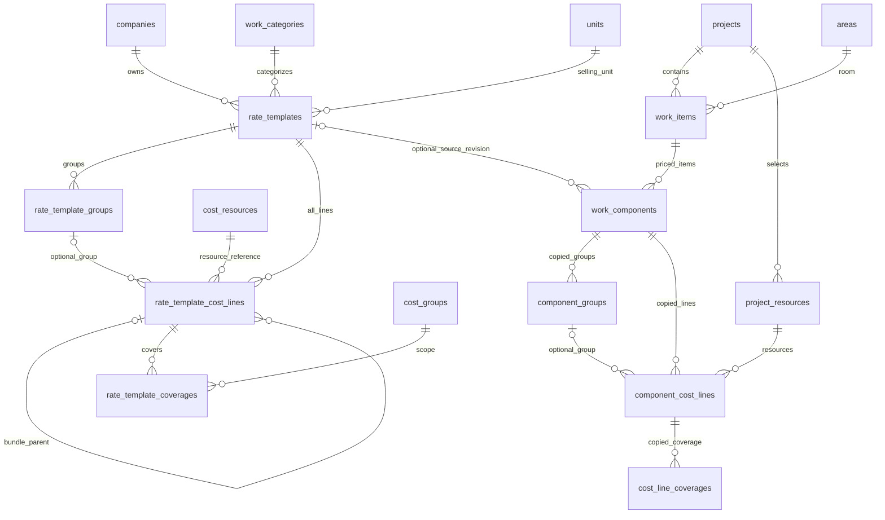

# Relation 22 ตาราง — คลังรายการทำราคาต่อหน่วยส่วนกลาง

> **รหัสต้นแบบล่าสุด:** สร้าง RT001, RT002 อัตโนมัติร่วมกันทั้งสร้างใหม่และบันทึกจากโครงการ คงรหัสเดิมและใช้รหัสเดียวเมื่อสร้างรุ่นถัดไป ไม่เพิ่มตารางหรือเปลี่ยนสูตร ดู [คู่มือ](LOCAL-APP-22-GUIDE.md)

> **เพิ่มการใช้งานล่าสุด:** บันทึกรายการทำราคาในโครงการเป็นต้นแบบร่างได้ พร้อมสำเนาต้นทุนและ snapshot เดิม ต้องตรวจอัตราต่อหน่วยก่อนพร้อมใช้ คงข้อมูลต้นทางและ 22 ตาราง ดู [คู่มือ](LOCAL-APP-22-GUIDE.md)

> **สถานะล่าสุด: ทดลอง SQLite 22 ตารางแล้ว** มีคลังรายการทำราคาต่อหน่วย เลือกใช้ใน Keyplan พร้อมสำเนาราคาและรุ่นเดิมของโครงการ ดู [คู่มือ 22 ตาราง](LOCAL-APP-22-GUIDE.md) ไม่เปลี่ยนเครื่องคำนวณและไม่เชื่อมออนไลน์ ข้อความเอกสารก่อนพัฒนาด้านล่างเป็นประวัติ

วันที่ 23 ตุลาคม 2569 · แบบเอกสารเพื่อทบทวนก่อนพัฒนา

**ข้อสรุป: เสนอ 22 ตารางธุรกิจ = 18 ตารางเดิม + 4 ตารางคลังต้นแบบ**

รอบนี้เปลี่ยนเฉพาะเอกสาร โค้ดและ SQLite ในเครื่องยังเป็น 18 ตาราง ไม่สร้าง migration ไม่แก้ฐานออนไลน์ และไม่เปลี่ยนสูตรคำนวณ จำนวนนี้ไม่รวมตารางภายในของฐานข้อมูลหรือ auth

## 1. สิ่งที่เปลี่ยนจากแบบเดิม

เดิมแต่ละ Keyplan ต้องสร้างรายการทำราคา กลุ่มงาน และต้นทุนใหม่เอง แบบใหม่นี้เตรียมต้นแบบไว้ส่วนกลางของบริษัท เช่น ตู้สูงโครงไม้ปิดลามิเนตต่อ 1 เมตร แล้วเลือกมาใช้ใน Keyplan และกรอกปริมาณตามแบบจริง ผู้ใช้ยังสร้างงานเฉพาะโครงการได้

คลังรายการทำราคาต่างจากคลังวัสดุ: รายการทำราคาเป็นงานที่ขายพร้อมสูตรต้นทุนและกำไร ส่วน cost_resources เป็นวัสดุ ค่าแรง หรือสินค้าที่ซื้อจริง เช่น ไม้อัด บานพับ และชุดหน้าบาน ไม่สร้างสินค้าราคาเหมารวมปลอมเพื่อแทนต้นแบบ เพราะจะสูญเสียรายละเอียดสรุปซื้อ

รหัส Keyplan ผู้ใช้กรอกตามผู้ออกแบบ เช่น B01 หรือ ID-12 และเลือกห้องที่สร้างไว้ รหัสรายการโครงการ S001 สร้างอัตโนมัติภายใน Keyplan ส่วนรหัสคลัง เช่น RT001 เป็นตัวตนอีกชุดหนึ่ง ไม่ใช้แทนกัน

## 2. รายชื่อตารางครบ 22 ตาราง

| ลำดับ | ตาราง | หน้าที่ |
|---|---|---|
| 1 | companies | บริษัทเจ้าของคลังและโครงการ |
| 2 | members | ผู้จัดทำ |
| 3 | company_memberships | บัญชีกับบริษัท |
| 4 | projects | โครงการ |
| 5 | areas | ห้องและชั้น/โซน |
| 6 | work_items | Keyplan ตามแบบ ห้อง ชื่อและรายละเอียดสำหรับใบเสนอราคาภายหลัง |
| 7 | work_components | รายการทำราคาที่ใช้จริงใน Keyplan ปริมาณและกำไร พร้อมที่มาต้นแบบ |
| 8 | work_categories | หมวดงาน |
| 9 | units | หน่วยนับ |
| 10 | cost_types | ประเภทต้นทุน |
| 11 | cost_resources | คลังวัสดุ ค่าแรง และสินค้าชุด |
| 12 | component_cost_lines | ต้นทุนจริงของรายการในโครงการและ snapshot |
| 13 | project_resources | ทรัพยากรโครงการและราคางบซื้อ |
| 14 | modular_products | สเปก Modular |
| 15 | cost_groups | หมวดขอบเขตต้นทุน |
| 16 | cost_line_coverages | ขอบเขตกันคิดซ้ำของบรรทัดโครงการ |
| 17 | component_groups | กลุ่มงานโครงการ BUY/MAKE |
| 18 | resource_bundle_items | ส่วนประกอบสินค้าชุดในคลังวัสดุ |
| 19 | rate_templates | หัวรายการทำราคาต่อหน่วยและรุ่นต้นแบบ |
| 20 | rate_template_groups | กลุ่มงานของต้นแบบ เลือก BUY/MAKE แยกกลุ่ม |
| 21 | rate_template_cost_lines | สูตรปริมาณ วัสดุ ค่าแรง ราคาและข้อมูลชุดฉบับต้นแบบ |
| 22 | rate_template_coverages | ขอบเขตกันคิดซ้ำของบรรทัดต้นแบบ |

ไม่เพิ่มตารางรายการที่เลือกเข้ามาอีกชั้น เพราะ work_components คือรายการที่เลือกมาใช้จริงอยู่แล้ว ไม่เพิ่มตารางราคาแยกจากสูตรหรือสำเนาวัตถุดิบอีกคลัง

## 3. ความสัมพันธ์

การคัดลอกเป็นการสร้างตัวตนโครงการใหม่ ไม่เชื่อมแก้ไขสดกับคลัง ต้นแบบไม่อ้าง project_resources ของโครงการใด

## 4. ตารางใหม่และข้อกำหนด

### 19 — rate_templates

- id UUID PK; company_id FK companies; code รหัสคลัง เช่น RT001; revision เลขรุ่น; name; quotation_description ไม่บังคับ
- category_id FK work_categories; unit_id FK units; default_margin ตามสูตรกำไรเดิม
- pricing_basis = PER_SELLING_UNIT และ base_quantity = 1 เป็นฐานนิยามต้นแบบ ไม่ใช่ปริมาณขายตามแบบของโครงการ
- status DRAFT / READY / RETIRED; version สำหรับตรวจการแก้ข้อมูลชนกัน; created_at / updated_at; is_active
- UNIQUE(company_id, code, revision) หนึ่งแถวคือหนึ่งรุ่น จึงไม่เพิ่มตารางประวัติรุ่นแยกอีกตาราง
- รุ่น READY ต้องมีต้นทุนครบและตรวจขอบเขตแล้ว ห้ามแก้เนื้อหา READY ที่นำไปใช้ ให้สร้าง revision ใหม่พร้อมลูกทั้งชุด ส่วน DRAFT แก้ได้และยังเลือกทำราคาใช้งานไม่ได้
- revision ไม่ใช่ version: revision คือรุ่นทางธุรกิจ ส่วน version เปลี่ยนทุกครั้งที่แก้ร่าง รวมการแก้ลูกด้วย
- หน่วย/สเปกเปลี่ยนความหมายเป็นคนละรายการให้สร้างรหัสคลังใหม่ ไม่รวมยอดข้ามหน่วยหรืออาศัยชื่อจับคู่
- ต้นทุนต่อหน่วยและราคาขายเป็นผลคำนวณจากรายละเอียด ไม่เปิดให้กรอกยอดซ้อนอีกชุด อาจเก็บ cache พร้อมลายนิ้วมือข้อมูลเพื่อแสดงผลได้ แต่ห้ามใช้ cache ที่เก่าแทนสูตร

### 20 — rate_template_groups

- id UUID PK; template_id FK rate_templates; code / name; assembly_kind; sourcing_method BUY/MAKE; calculation_method MANUAL/PANEL_AREA; sort_order / is_active / notes
- quantity_per_selling_unit และ panel_area_per_selling_unit เป็นอัตราที่ผู้ใช้ระบุ ไม่ใช่ยอดรวมของงานตัวอย่าง
- plywood_sides / laminate_sides ตามกติกาพื้นที่ด้านเดียวเดิม; ไม่เดาจำนวนด้านหรือมิติจากชื่อ
- UNIQUE(template_id, code); กลุ่มไม่ซ้อนกลุ่ม และไม่มี margin แยกซ้ำกับหัวรายการ

### 21 — rate_template_cost_lines

- id UUID PK; template_id FK; group_id FK rate_template_groups ไม่บังคับสำหรับต้นทุนตรง; resource_id FK cost_resources; parent_line_id FK ตารางเดียวกันสำหรับรายละเอียดสินค้าชุด
- variant BUY/MAKE; line_kind CHARGEABLE / INCLUDED_REFERENCE / EXCLUDED_REFERENCE; line_role; quantity_source; numerator / denominator; waste; labor_phase; sort_order / is_active
- อัตราวัสดุและค่าแรงต่อหน่วยขาย พร้อม snapshot ราคา หน่วยซื้อ/ใช้ ตัวแปลงหน่วย ขอบเขต และรุ่นทรัพยากร ไม่ดึงราคาคลังล่าสุดมาย้อนแก้ READY
- บรรทัดสินค้าชุดเก็บ bundle_snapshot และบรรทัดอ้างอิงรวม/ไม่รวมฉบับนั้นพร้อม parent_line_id ห้ามแตกจาก resource_bundle_items รุ่นล่าสุดอีกครั้งตอนเลือกใช้โครงการ
- ค่าแรงผลิต/ติดตั้งอยู่กลุ่มที่เกี่ยวข้อง ของที่รวมในชุดเป็นอ้างอิง ไม่บวกซ้ำ ไม่เดาส่วนแบ่งค่าแรงจากราคาชุด
- รายการเพิ่มนอกชุดเก็บเหตุผลและตำแหน่งแม่แบบได้ แต่การยืนยันจำนวน/ตำแหน่งจริงต้องเป็นของโครงการ ไม่คัดลอกหลักฐานยืนยันโครงการเก่ามาใช้
- quantity_source ในต้นแบบมีความหมายต่อหน่วยขาย: MANUAL เป็นจำนวนต่อหน่วยขาย, PANEL_AREA เป็นพื้นที่แผงต่อหน่วยขาย, PLYWOOD_AREA/LAMINATE_AREA คำนวณจากอัตราพื้นที่และด้าน, GROUP_QUANTITY เป็นจำนวนชุดต่อหน่วยขาย
- ไม่อนุญาตนำ TOTAL ของโครงการมาใช้เป็นอัตราโดยไม่ทบทวน ผู้ใช้ต้องระบุอัตราต่อหน่วยเองก่อนตั้ง READY

### 22 — rate_template_coverages

- id UUID PK; template_cost_line_id FK rate_template_cost_lines; cost_group_id FK cost_groups; template_group_id FK rate_template_groups เมื่อผูกกลุ่ม; scope_key; mode BUNDLED/DETAIL; notes
- เป็นความสัมพันธ์หนึ่งบรรทัดต่อหลายขอบเขต จึงแยกตารางเหมือน cost_line_coverages เดิม ไม่ยัดรายการขอบเขตที่ต้องตรวจซ้ำเป็นข้อความคั่นเครื่องหมาย
- UNIQUE(template_cost_line_id, scope_key); group ต้องตรงกับกลุ่มเจ้าของบรรทัด ขอบเขตใช้บริษัทเดียวกัน
- เมื่อสร้างบรรทัดอ้างอิงในชุด ให้กฎความเป็นเจ้าของและโหมดเหมือนโครงการเดิม ไม่สร้างสินค้าชุดซ้อนชุดในรอบนี้

ทุก FK ต้องตรวจบริษัทเดียวกัน ลูก/กลุ่ม/parent ต้องอยู่ template revision เดียวกัน ห้าม parent วนกลับ ข้อมูลทศนิยมใช้ชนิดเที่ยงตรงตาม Master ไม่ใช้ float สำหรับเงินและปริมาณ ไม่บังคับราคาไม่ทราบเป็นศูนย์ การเผยแพร่รุ่นและการคัดลอกต้องสำเร็จหรือย้อนกลับทั้งชุด

## 5. ส่วนที่เพิ่มในตารางโครงการเดิม

| ตาราง | ช่อง/พฤติกรรมเพิ่ม |
|---|---|
| work_components | source_template_id FK ไปแถวรุ่นต้นแบบ (nullable สำหรับงานเฉพาะโครงการ), source_template_code/revision/version snapshot, ชื่อ/คำอธิบาย/หน่วย/กำไรฉบับที่เลือก, imported_at, is_customized หรือค่าตรวจการแก้ |
| component_groups | source_template_group_id เป็นที่มาแบบ nullable; snapshot อัตราพื้นที่/จำนวนต่อหน่วยที่นำมาใช้ พร้อมพื้นที่/จำนวนรวมตามแบบปัจจุบัน |
| component_cost_lines | source_template_line_id เป็นที่มาแบบ nullable; ที่มารุ่นและ snapshot เดิม; แยกฐานอัตรากับจำนวนรวมชัดเจน |
| cost_line_coverages | source_template_coverage_id เป็นที่มาแบบ nullable; สำเนาขอบเขตจริงของบรรทัดโครงการ |
| project_resources | ใช้ resource เดิมแบบ UNIQUE(project_id, resource_id); ไม่เพิ่มรหัสวัสดุเพราะเลือกต้นแบบหลายรายการ |

FK ที่มาของลูกไม่ใช่ข้อมูลที่นำมาคำนวณโดยอ้างสด เก็บรุ่น READY ที่ถูกใช้ไว้และหยุดใช้แทนลบ หากเก็บที่มาแบบ FK ให้ ON DELETE RESTRICT การสร้างรายการเฉพาะงานใช้ source เป็น NULL ไม่ต้องสร้างต้นแบบปลอม

## 6. ขั้นตอนเลือกใช้และคูณปริมาณ

1. เปิดโครงการ → ห้อง → Keyplan ตามแบบ → เลือกจากคลังรายการทำราคา
2. แสดงชื่อ หน่วย สเปก รุ่น วัสดุ ค่าแรงผลิต/ติดตั้ง และราคาขายต่อหน่วย ให้เลือกต้นแบบ READY ของบริษัทเท่านั้น
3. ผู้ใช้กรอกปริมาณตามแบบ เช่น 3 เมตร ไม่เดาปริมาณจาก Keyplan หรือจากห้อง
4. บันทึกแบบ transaction: สร้าง work_components รหัส Sxxx ใหม่ สำเนากลุ่ม ต้นทุน ชุดและขอบเขต พร้อมจับคู่ UUID แม่/ลูกใหม่ทั้งหมด
5. เลือก project_resources ที่ยังไม่มีให้โครงการ ส่วนที่มีอยู่แล้วคงราคาอ้างอิงงบซื้อเดิม ไม่ทับราคาโครงการเงียบ ๆ ราคาบรรทัดต้นทุนใช้ snapshot ต้นแบบที่เลือก ความต่างกับราคางบซื้อแสดงให้ตรวจและเลือกปรับเอง
6. คำนวณด้วยเครื่องคำนวณเดิม แก้ข้อมูลเฉพาะโครงการได้และแสดงว่าแตกต่างจากต้นแบบ โดยไม่กระทบคลังหรือ Keyplan อื่น

**ตัวอย่างสมมติ:** ต้นทุนต่อหน่วย 4,800 บาท/เมตร กำไร 40% ของราคาขาย → ราคาขาย 8,000 บาท/เมตร; ปริมาณตามแบบ 3 เมตร → ขายรวม 24,000 บาท ตัวเลขเป็น SAMPLE ไม่ใช่ราคาตลาด

### การคูณปริมาณที่ไม่ซ้ำ

- วัสดุ/ค่าแรงกรอกจำนวนต่อหน่วยขาย: ลงบรรทัดโครงการแบบ PER_UNIT แล้วให้สูตรเดิมคูณ quantity เพียงครั้งเดียว
- แผง: พื้นที่แผงรวม = อัตราพื้นที่แผงต่อหน่วย × quantity; ไม้อัดรวม = พื้นที่แผงรวม × ด้านบุ; ลามิเนตรวม = พื้นที่แผงรวม × ด้านปิดผิว อัตราไม้โครง/กาวคำนวณจากพื้นที่นี้ด้วยฐาน TOTAL ไม่คูณ quantity ซ้ำที่บรรทัด
- จำนวนชุดที่เป็นอัตรา: แปลงจำนวนกลุ่มเป็นยอดรวมหนึ่งครั้ง แล้วบรรทัดที่ใช้ GROUP_QUANTITY ใช้ TOTAL
- ต้นทุนต่อหน่วย = ต้นทุนรวมก่อนปัด ÷ quantity; ราคาขายต่อหน่วย = ต้นทุนต่อหน่วย ÷ (1 − margin/100); ปัดราคาขายต่อหน่วย 2 ตำแหน่งก่อนคูณ quantity ตาม Master เดิม
- quantity เปลี่ยน ต้องคำนวณพื้นที่/จำนวนกลุ่มที่ยังอิงอัตราใหม่จากอัตราต้นทางเสมอ ไม่คูณยอดรวมเก่าทบต่อ ถ้าผู้ใช้เปลี่ยนพื้นที่/จำนวนเป็นยอดจริงเอง ให้ระบุฐาน ACTUAL_TOTAL และไม่ปรับตาม quantity อัตโนมัติ พร้อมแสดงว่าราคาต่อหน่วยอาจต่างจากต้นแบบ
- ต้นทุนเหมาทั้งงานหรือจำนวน Modular ที่เลือกตามแบบจริงไม่สรุปเองว่าเป็นสัดส่วนต่อเมตร ให้เป็นรายการเฉพาะโครงการ หรือให้ผู้ใช้กำหนดอัตราที่เหมาะสมก่อนทำต้นแบบ
- ปริมาณศูนย์/ข้อมูลรอกรอกคงกฎเครื่องคำนวณเดิม ไม่หารศูนย์ ไม่ถือราคาที่ขาดเป็นศูนย์ และไม่เปลี่ยนขั้นซื้อ/เผื่อเศษโดยเดา

## 7. ซื้อสำเร็จรูป ผลิตเอง และสรุปซื้อ

คง BUY/MAKE แยกกลุ่มทั้งต้นแบบและโครงการ โดยเก็บทางเลือกไม่ใช้งานไว้ได้ แต่คิดเฉพาะทางเลือกที่ใช้งาน การเปลี่ยนวิธีในโครงการต้องตรวจขอบเขตและต้นทุนใหม่ตามแบบเดิม

แม่สินค้าชุดคิดเงินครั้งเดียว INCLUDED_REFERENCE ไม่คิดราคาและไม่เข้ารายการซื้อ EXCLUDED_REFERENCE ต้องเพิ่มจริงหรือยืนยันไม่ต้องใช้ UNKNOWN ยังเป็นรอทบทวน ไม่ทำให้เป็น READY โดยอัตโนมัติ

รวมการใช้วัสดุ CHARGEABLE ที่เปิดใช้งานจากทุก Keyplan ตาม project_resource_id ก่อนปัดขั้นซื้อ แยกวัสดุคนละรหัส/สเปก/หน่วย ค่าแรงอยู่สรุปแรง ไม่เป็นวัสดุซื้อ และไม่เอาต้นแบบในคลังที่ยังไม่ได้เลือกมาเข้ายอดโครงการ

คลังกลางเก็บสูตรอัตราและราคาฉบับนั้น ไม่เก็บยอดสั่งซื้อที่ปัดเป็นแผ่นต่อ 1 เมตรไปคูณทั้งโครงการ เพราะจะปัดขั้นซื้อซ้ำและเกินจริง

## 8. รุ่น การปรับราคา และข้อมูลเดิม

- เลือก RT001 revision 1 แล้วแก้คลังเป็น revision 2: โครงการเดิมยังใช้สำเนา revision 1
- ถ้าต้องการเปลี่ยนรุ่นในโครงการ ให้แสดงเปรียบเทียบชื่อ/สเปก/หน่วย/สูตร/ราคา/ขอบเขต/รายการที่ปรับเฉพาะงานก่อนยืนยัน ไม่ทับงานที่ปรับเองเงียบ ๆ ไม่เพิ่มโฟลว์อนุมัติหลายระดับ
- ไม่เปลี่ยนหน่วยของรายการเดิมแล้วใช้ quantity เดิมโดยปริยาย ถ้าหน่วยเปลี่ยนต้องสร้างรายการใหม่หรือให้ผู้ใช้กำหนดปริมาณใหม่ชัดเจน
- ข้อมูลโครงการเดิมเป็นงานเฉพาะโครงการ source เป็น NULL คง UUID รหัส Keyplan รหัส Sxxx ราคา snapshot และยอดเดิม ไม่เปลี่ยนทุกโครงการให้เป็นต้นแบบโดยอัตโนมัติ
- การนำงานเดิมไปทำต้นแบบต้องเลือกโดยผู้ใช้ ตรวจอัตราต่อหน่วย เศษ/ยอดเหมา พื้นที่จริงและของที่รวมในชุดก่อน ไม่เอายอดรวมไปหารเมตรแล้วตั้ง READY โดยไม่ทบทวน
- ไม่เพิ่มรายการทำราคาที่มีเฉพาะราคาขายโดยไม่มีต้นทุนเข้ามาปนกับสูตรนี้ในรอบแรก หากต้องการเส้นทางราคาขายอย่างเดียวให้กำหนดแยกภายหลังเพื่อไม่ทำให้สรุปซื้อดูครบทั้งที่ไม่มีวัสดุ

## 9. หน้าจอที่เสนอและเกณฑ์พัฒนาต่อ

เพิ่มเมนู คลังรายการทำราคา แยกจากคลังวัสดุ แสดงรหัส/ชื่อ/หน่วย/รุ่น/ต้นทุนต่อหน่วย/ราคาขายต่อหน่วย/ความพร้อม เปิดดูตารางกลุ่มและวัสดุแบบเดียวกับโครงการ

ใน Keyplan ใช้ปุ่มหลัก เลือกจากคลังรายการทำราคา และปุ่ม สร้างรายการเฉพาะงาน กรอก quantity ตามแบบ แสดงที่มาและการแก้เฉพาะโครงการได้ ไม่บังคับให้ผู้ใช้กรอกรหัสคลังเองในโฟลว์เลือกใช้

ก่อนพัฒนา: ยืนยันแบบนี้ แล้ววาง schema/migration เฉพาะ SQLite ในเครื่อง สำรองไฟล์เดิมและตรวจการย้ายข้อมูลก่อนทำ โดยยังไม่เชื่อมออนไลน์

เกณฑ์ตรวจเมื่อพัฒนา: 22 ตาราง/FK ถูกต้อง, เลือกหนึ่งต้นแบบใช้หลายโครงการ/Keyplan, หน่วย/อัตราและการปัดตรงสูตรเดิม, แผง/กาว/ค่าแรงคูณครั้งเดียว, เปลี่ยน quantity แล้วไม่ทบพื้นที่, ของในชุดไม่ซ้ำ, รวมซื้อข้าม Keyplan ก่อนปัด, คลังเปลี่ยนแล้วโครงการเดิมไม่เปลี่ยน, งานเฉพาะยังใช้ได้, ความผิดพลาดย้อนกลับทั้งชุด และไฟล์เดิมยังมียอดเดิม

**สถานะตรวจรอบนี้:** ทบทวนเอกสารและ relation เทียบแบบ 18 ตารางกับ schema ปัจจุบันแล้ว ยังไม่ทดสอบโค้ด 22 ตาราง เพราะยังไม่ได้พัฒนา
